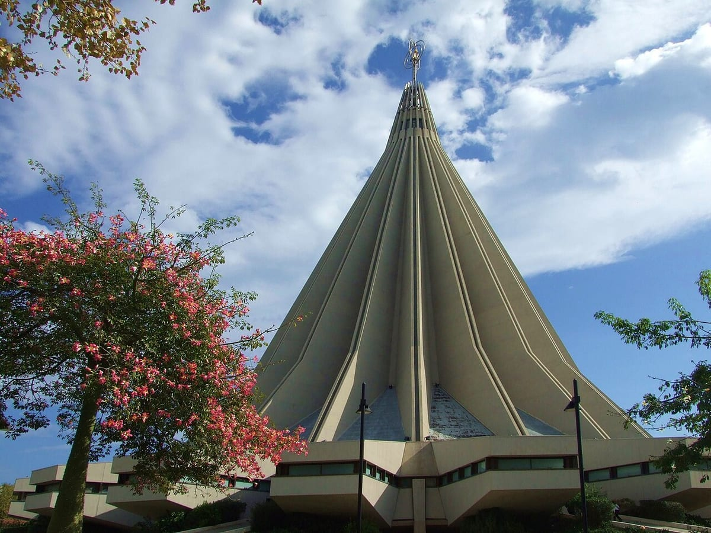
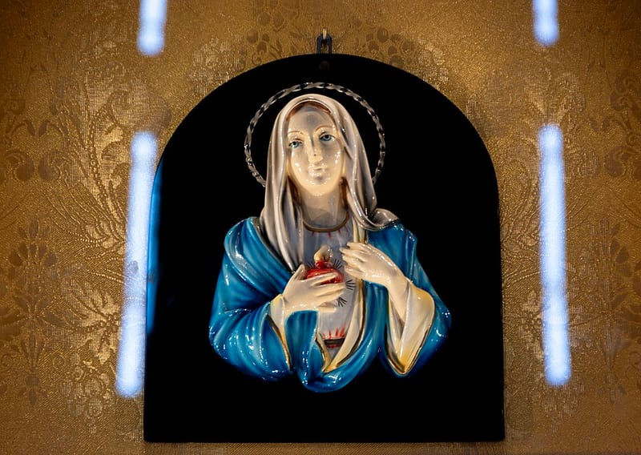
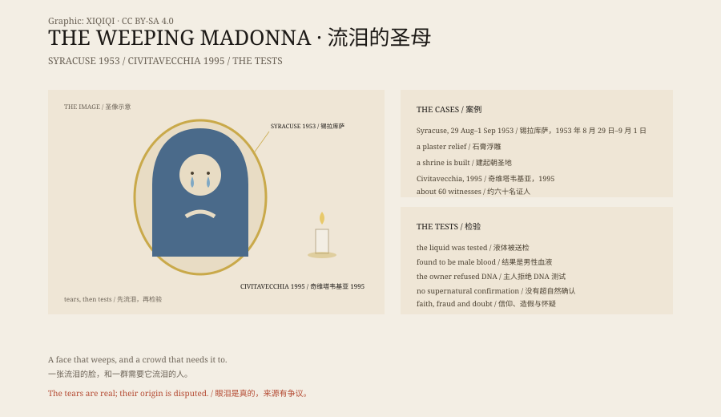

## 一、奥尔蒂街 11 号
1953 年 8 月底，西西里岛锡拉库萨，奥尔蒂街 11 号。屋里住着一对年轻夫妇，安杰洛·伊安努索（Angelo Iannuso）和安东尼娜·露琪亚·朱斯托（Antonina Lucia Giusto）。安东尼娜怀着第一个孩子，孕期不顺。床边的墙上挂着一幅小小的石膏浮雕，圣母无玷圣心，下面也许摆着蜡烛。

8 月 29 日上午，她看见浮雕的眼睛里有水。她后来说，起初以为是自己的幻觉，是怀孕和病弱的身体看错了。可水一直在那里，从眼眶里出来，顺着石膏的脸往下走。

邻居被叫来看。有人拿手帕去接。手帕湿了。

## 二、四天
眼泪从 8 月 29 日流到 9 月 1 日，断断续续，前后四天。消息在城里传得很快，巷子里站满了人。有人带着生病的孩子来，有人只是来看一眼。摄影师朱塞佩·萨拉切诺（Giuseppe Pippo Saraceno）拍下了流泪的那幅像，照片后来印在报纸和明信片上。

那几天锡拉库萨很热。有人说是返潮，有人说是石膏里的水渗出来。但接眼泪的人说，水是从眼眶里出来的，不是从墙上下来的。

## 三、取样
9 月 1 日，锡拉库萨总教区成立了一个委员会，医生和化验员在场。他们从像的眼睛里取走了大约三十滴液体，装进瓶子，送进化验室。

化验结果：成分与人的泪液一致。样本里有蛋白质和尿酸，没有石膏的碎屑，也没有颜料。委员会把它与一名成年人和一名两岁七个月孩子的眼泪做了对照，结论是同一类分泌物。

取样之后，像不哭了。四天到此为止。一个持续四天的现象，被一个下午的取样画上了句号。

这个顺序后来被反复提起：先流泪，后取样，取完就停。相信的人说，这是它愿意被检验；怀疑的人说，取样的人碰到了像，破坏了某个原本会渗水的缝隙。

## 四、承认
1953 年 12 月 13 日，锡拉库萨总主教承认了对这幅像的敬礼。后来城里建起一座专门供奉它的圣殿，泪圣母圣殿（Santuario della Madonna delle Lacrime），像被放在玻璃后面。

教会承认的是什么，需要说清楚：是敬礼，是允许信徒在这里祈祷，不是“眼泪来自超自然”的最终判决。教会对这类事件的程序一向谨慎，地方主教可以批准敬礼，却很少宣布超自然。锡拉库萨是少数走到这一步的案例。

程序通常是这样的：本堂神父先报告，主教成立委员会，医生、化学家、神学家分头看；委员会给出意见，主教决定允不允许公开敬礼。宣布“超自然”是另一道门，门槛更高，多数案例停在门外。

## 五、奇维塔韦基亚
1995 年 2 月 2 日，罗马北边的海滨城市奇维塔韦基亚，郊区潘塔诺。一尊 43 厘米高的圣母像放在花园里。屋主法比奥·格雷戈里（Fabio Gregori）六岁的女儿杰西卡先看见像的脸上有红色的液体。

事情重复了。邻居来，本堂神父来，最后主教吉罗拉莫·格里洛（Girolamo Grillo）也来了。据在场的人说，主教念着祈祷文，血从像的眼睛里流出来。消息传开，前后有数十人声称亲眼看见。

血被送去化验，结果是人的血，男性。对像做过 X 光和 CT，内部是实心的，没有发现管子或储液装置。格雷戈里拒绝做 DNA 检测。教会始终没有承认这件事。

## 六、拆穿的办法
把一尊像弄哭，比想象中容易。石膏是多孔材料，把液体注入内部，它会从最薄的地方——眼睛——慢慢渗出来。油和脂肪混在一起涂在眼眶上，室温一升，就会“流泪”。还有一种更普通的解释：石膏各部分的密度不同，冷的部分会凝结水珠，眼睛正好是最冷的地方。

被拆穿的案例不少。1985 年，加拿大蒙特利尔一尊像被说成流泪又流血，后来查明，是主人把血和剃须膏抹在了像上。2002 年，西西里墨西拿的一尊庇护神父像流出红色液体，教会化验后发现血属于一名女性，随即否定。2008 年，意大利北部一名教堂管理员因伪造圣母像的血迹受审，DNA 与他自己对上了。2012 年，一尊“流泪”的耶稣像被当作圣水，最后发现是污水管从像的脚边渗出来。2018 年，美国新墨西哥州霍布斯的一尊瓜达卢佩圣母像流泪，教区化验后宣布，眼泪的化学成分是玫瑰味的橄榄油。

这些案例不证明所有案例都是假的。它们只说明，眼泪可以被人做出来，也可以被一栋房子做出来。

## 七、玻璃后面
锡拉库萨那幅像还在圣殿里，玻璃后面，灯光照着。它不再流泪。玻璃罩上有一层薄薄的反光，挡住了像的脸。

帕维亚大学的一位化学家提出过一种解释：石膏的釉面有裂缝，水分靠毛细作用渗到眼眶。他没有打开玻璃，也没有检验过那幅像。这个解释因此停在“可能”上，和“神迹”停在同一个位置。两边都没有打开那层玻璃。

四天里接到的那些眼泪，化验单上写着人的成分。它们从哪里来，没有人能再证明。能证明的只有一件事：1953 年 9 月 1 日，取样的人来了，像就不哭了。

*现场照片：锡拉库萨的泪圣母圣殿，2007 年。Salvo Cannizzaro，CC BY-SA 3.0（Wikimedia Commons）。圣殿为安置流泪的圣母像而建。*

*现场照片：锡拉库萨泪圣母圣殿内展陈的圣母无玷圣心像，2025 年。Julian Lupyan，CC0（Wikimedia Commons）。像置于玻璃罩内，背景是金色织物。*

*原创示意图：1953 年锡拉库萨、1995 年奇维塔韦基亚与检验流程。不是文物照片。稀奇奇编辑部，CC BY-SA 4.0。*

---

**来源与许可**：事实来源见条目底部来源台账 S1–S6。文字与原创示意图采用 CC BY-SA 4.0。文中把锡拉库萨的个案、奇维塔韦基亚的争议、教会的程序与已被拆穿的骗局分开叙述；锡拉库萨的眼泪有化验记录，来源没有定论，其余案例多被否定。圣殿照片与像的照片为现场拍摄，示意图不是文物照片。
