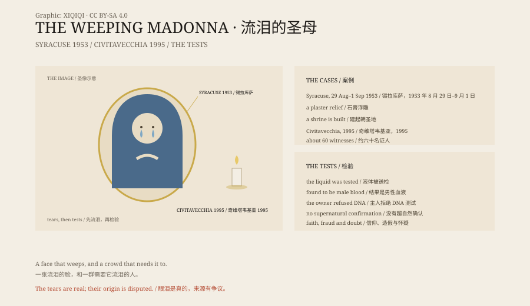

## 一、1953 年，锡拉库萨

意大利西西里，锡拉库萨。一对年轻夫妇家里，挂着一幅圣母无玷圣心的石膏浮雕。

1953 年 8 月 29 日，女主人看见画像的眼睛里有水。

不是水汽，是眼泪。

接下来的几天，眼泪又流了几次。消息传开，人群聚集。

## 二、教会

教会成立了委员会，检查眼泪，也检查了声称被治愈的人。

当地教会允许对这幅像的敬礼，并在锡拉库萨建了一座“泪圣母朝圣地”。

## 三、1995 年，奇维塔韦基亚

意大利中部，奇维塔韦基亚。一个六岁女孩看见家里的圣母像眼睛流血。

接下来的几个月，雕像在很多人面前“流血”，包括当地主教。

大约六十名证人作了证。主教说，他亲眼看见。

## 四、检验

血液被送去检验。结果是男性血液。

雕像的主人拒绝做 DNA 测试。

教会没有确认这是超自然现象。

## 五、其他案例

秋田、越前、叙利亚、美国……都有圣母像流泪的报告。

有的被教会承认，有的被否定，有的没有结论。

## 六、眼泪

一尊石膏像不会哭。

但人会。

在一个需要征兆的地方，眼泪是最容易读懂的语言：它在说，我看见你了。

*原创示意图：锡拉库萨 1953、奇维塔韦基亚 1995 与检验流程。不是文物照片。稀奇奇编辑部，CC BY-SA 4.0。*

---

**来源与许可**：本文的事实来源见条目底部来源台账 S1–S3。文字与原创示意图采用 CC BY-SA 4.0。文中把个案记录、教会立场与检验结果分开叙述；没有一例被科学确认为超自然现象。插图是场景复原，不是文物照片。
