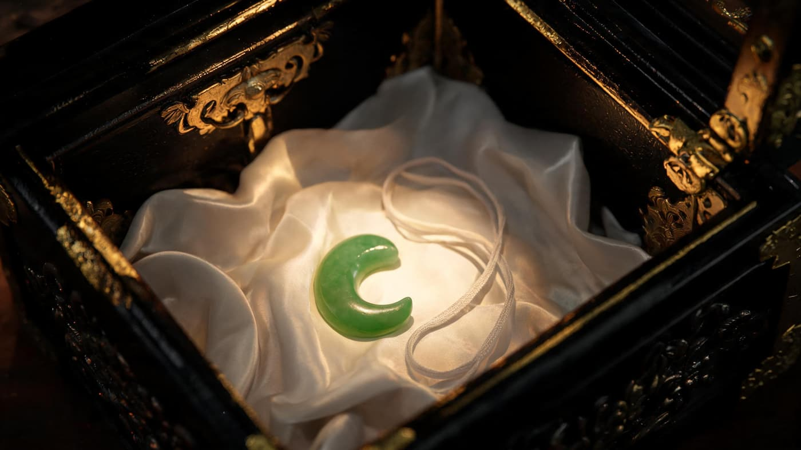
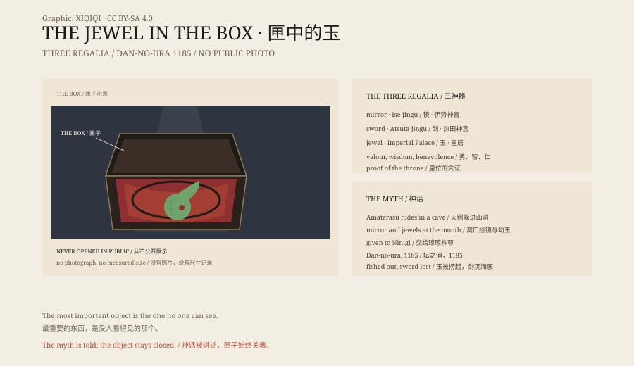

## 1. A Room in the Palace

On 1 May 2019, Emperor Naruhito acceded to the throne.

During the ceremony, chamberlains carried in two boxes. One held the sword. One held the jewel. The boxes were wrapped in cloth and set on a stand. Nobody opened them.

The jewel is called Yasakani no Magatama, and it is kept at the Kashiko-dokoro, the sanctuary within the Imperial Palace. It has no display case, no photograph, no measured dimensions. The daily rites of the three palace sanctuaries take place there. Ordinary visitors stop at the gate.

The box is small, wrapped in cloth and set on a stand. No one knows whether the jewel inside is a string of beads or a single large magatama, and no one has measured it.

## 2. The Cave

In the Kojiki, the sun goddess Amaterasu hides in a rock cave because of her brother Susanoo's violence, and the world goes dark.

The gods gather outside. A rooster crows, drums sound, the goddess Ame-no-Uzume dances. A mirror and a string of curved jewels are hung at the cave mouth.

Amaterasu hears the laughter and peeks out. A strong god hidden behind the door takes her hand and pulls her into the light.

The light at the cave mouth, the reflection in the mirror and the click of the beads were all meant to draw her out.

That string of jewels became the Yasakani no Magatama. In myth it was polished by the deity of bead-makers. "Yasakani" does not mean eight feet; it suggests many, or a great length. A magatama is a comma-shaped bead, worn in Japan long before the kofun era.

## 3. Three Objects

Amaterasu gave the mirror, the sword and the jewel to her grandson Ninigi when he descended to rule the earthly realm.

The three became the proof of the throne. Later tradition reads them as valour, wisdom and benevolence.

Today they are kept apart. The mirror is at Ise Jingu, the sword at Atsuta Jingu, the jewel in the Imperial Palace. At an accession, the boxes of the sword and jewel are brought into the room; the mirror stays at Ise.

## 4. Dan-no-ura

In 1185, at the naval battle of Dan-no-ura, the Taira clan was defeated.

The child emperor Antoku, aged six, was taken in his grandmother's arms and jumped into the sea. The regalia went in with them.

The Tale of the Heike says the mirror and the jewel were pulled from the water. The sword sank. Atsuta Shrine still keeps the Kusanagi; some say the blade that sank was a copy.

The jewel was returned to Kyoto and later moved to Tokyo with the imperial household.

## 5. Unseen

The jewel's shape, size and material are not on public record.

The usual image is a string of green or blue-green beads on a cord. Some scholars suggest it may be a single large magatama. The Imperial Household Agency does not display it, photograph it or lend it out.

*Reconstruction: a magatama on silk inside a lacquered box. Not a photograph of an artefact. XIQIQI Editorial, CC BY-SA 4.0.*

It is not even on the list of designated cultural properties. The imperial regalia sit outside that system.

## 6. Belief

A country locks its most important object in a box, then leaves the box to time.

The unseen jewel stays in place more firmly than any exhibit could.

The box became a boundary: inside are myth and the throne, outside are ordinary corridors and footsteps.

On that day in 2019, the box was carried down a corridor and set down. The ceremony ended. It was carried back. Nobody looked inside.

*Original schematic: the three regalia, the 1185 battle of Dan-no-ura and the box in the palace. Not a photograph of an artefact. XIQIQI Editorial, CC BY-SA 4.0.*

## Sources and evidence

For “The Jewel in the Box”, the factual trail runs mainly through S1–S3: S1 is “Wikipedia · Imperial Regalia of Japan” and S2 is “Kokugakuin University · Basic Terms of Shinto: Sanshu no Shinki”. Dates, places, and names in the text follow the lowest common denominator of those sources; image credits and licences are listed at the foot of the entry.

## Limits of the record

For “The Jewel in the Box”, the checkable coordinates are Tokyo, Japan, Ancient, and the source-ledger entries S1 “Wikipedia · Imperial Regalia of Japan” and S2 “Kokugakuin University · Basic Terms of Shinto: Sanshu no Shinki”. The gap between excavation context, restoration records, and material analysis remains; public pages often give conclusions without the full chain of examination.

The entry is currently labelled “disputed”; the label describes the present state of the evidence, not a final verdict on the subject.
## Archival note

But "symbol" is not the same as "legal document". Neither the Meiji Constitution nor the post-war imperial model listed the three artifacts as necessary conditions for ascending to the throne. They were more of a ritual confirmation that the new emperor was inheriting not just power but a set of objects passed down from mythology.

The legitimacy of this set of objects comes from narratives "from ancient times" rather than from a single archaeological discovery. No one can prove that they are the three things in the myth.
There are many replicas of the three artifacts in Japan.

There are replicas in museums, shrines and tourist shops. Mirrors, swords and jade are made into keychains, ornaments and souvenirs. Some of the shapes of the replicas are based on ancient paintings, some are based on legends, and some are completely imagined.

The more copies there are, the more mysterious the original becomes. One can buy an "Eight-foot Magatama", but the real one is still in the Imperial Palace and is not displayed to the public.
When the emperor ascends the throne, three artifacts appear in ceremonies.

But the ceremony was closed to the media. The outside world can only know what happened through announcements from the Imperial Household Agency and descriptions from participants. There are few photos and even less detail.

This closure allows the artifact to retain its mythical status. If they were placed in a museum glass case, measured, photographed, and studied, they might become "artifacts." Today, they remain "artifacts."

---

**Sources and licenses**: the factual sources are listed in the source ledger S1–S3 at the bottom of this entry. Text and original diagrams are licensed under CC BY-SA 4.0. This article separates Shinto myth, imperial ceremony and the present state of the object; the jewel's actual form is not on public record. The illustration is a scene reconstruction, not a photograph of an artefact.
