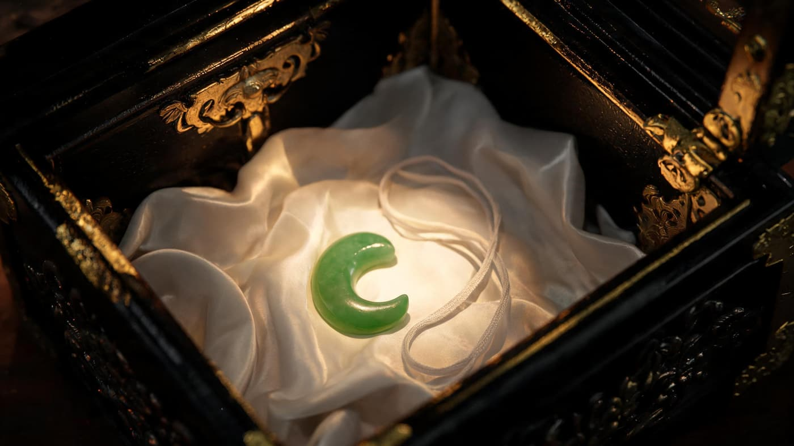
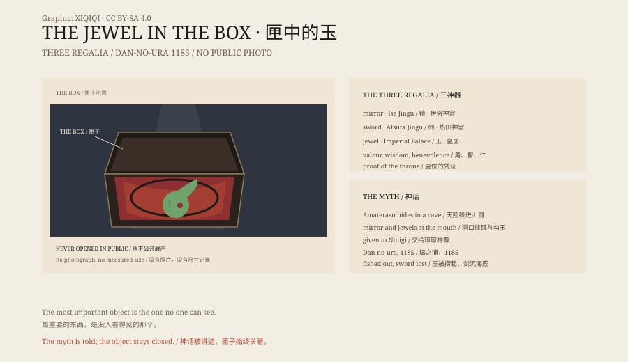

## 一、皇居里的一间屋子

2019 年 5 月 1 日，德仁天皇即位。

仪式上，侍从捧着两个箱子进来。一个装剑，一个装玉。箱子用布包着，放在案上。没有人打开。

玉叫八尺琼勾玉，供在皇居的贤所。它没有展柜，没有照片，没有尺寸记录。宫中三殿的祭祀在那里进行，普通人止步于门外。

匣子不大，包着布，放在案上。没有人知道里面的玉是串珠还是一颗单独的勾玉，也没有人量过它的尺寸。

## 二、山洞

《古事记》里，天照大神因为弟弟须佐之男胡闹，躲进天岩户，世界陷入黑暗。

众神在洞口想办法：公鸡啼叫，太鼓震响，天钿女命跳舞。洞口挂了一面镜子和一串勾玉。

天照听见笑声，探头出来看。藏在门后的力士抓住她的手，把她拉了出来。光回来了。

洞口的光、镜子的反光、勾玉碰撞的声音，都是为了把她引出来。

那串勾玉，就是后来的八尺琼勾玉。神话里，它由负责制玉的神打磨。“八尺”不是八英尺，是多、长的意思；“勾玉”是逗号形的珠子，早在古坟时代之前，日本人就佩戴它。

## 三、三件

天照把镜子、剑、玉交给孙子琼琼杵尊，让他去统治苇原中国。

三件东西成了皇位的凭证。后世常解释为：剑代表勇，镜代表智，玉代表仁。

今天它们分在三处：镜在伊势神宫，剑在热田神宫，玉在皇居。天皇即位时，剑与玉的箱子会到场；镜留在伊势。

## 四、坛之浦

1185 年，源平合战最后一战，坛之浦。平氏败了。

安德天皇才六岁，由祖母抱着投海。三神器也一起入水。

《平家物语》说，镜和玉被人捞起，剑沉入海底。热田神宫仍供着草薙剑；也有人说，沉下去的那把是复制品。

玉被送回京都，后来跟着皇室迁到东京。

## 五、看不见

玉的形状、大小、材质，没有公开记录。

通常的想象是一串绿色或碧色的勾玉，串在绳上；也有学者认为它可能是一颗大型勾玉。宫内厅不展示，不拍照，不借展。

*场景复原：匣中丝上的勾玉。不是文物照片。稀奇奇编辑部，CC BY-SA 4.0。*

它甚至不在《文化财保护法》的指定名单里。皇室御物不按那套制度走。

## 六、相信

一个国家把最重要的东西锁进匣子，然后把匣子交给时间。

看不见的玉，反而比任何展品都更牢地待在原位。

匣子成了边界：里面是神话和皇位，外面是普通的走廊和脚步声。

2019 年那天，箱子被捧过走廊，放下。仪式结束，又捧回去。没有人往里看。

*原创示意图：三神器的供奉地、1185 年坛之浦与皇居中的匣子。不是文物照片。稀奇奇编辑部，CC BY-SA 4.0。*

## 勾玉

八尺琼勾玉的名字里，“勾玉”是一个形状。

它像一颗逗号，也像一颗弯牙。一端圆，一端尖，中间有一个孔，可以用绳子穿起来。日本的勾玉最早出现在绳文时代，材料有玉石、玛瑙、滑石和玻璃。

勾玉不是日本独有的东西。朝鲜半岛、中国东北和日本列岛都出土过类似的弯形佩饰。它们的大小、材料和孔的位置不同，但基本形状一致。这个形状可能来自动物牙、贝壳或某种弯曲的石头。

## 三件神器

日本皇室的三件神器，分别是镜、剑和玉。

镜在伊势神宫，剑在热田神宫，玉在皇居。三件东西不在同一个地方，也不一定同时对外展出。它们各自有自己的神社、祭祀和传说。

八尺琼勾玉是其中唯一留在皇居的。它不公开陈列，普通人也看不到。每年的某些仪式里，它会被拿出来，但不对媒体开放。

## 皇位

三件神器在日本天皇即位仪式里有象征意义。

但“象征”不等于“法律文件”。明治宪法和战后的皇室典范，都没有把三件神器写成即位的必要条件。它们更像一种仪式性的确认：新天皇接过的不只是权力，还有一套从神话传下来的物件。

这套物件的合法性，来自“自古以来”的叙述，而不是来自某一次考古发现。没有人能证明它们就是神话里的那三件。

## 看不见

八尺琼勾玉最特别的地方，是它几乎不被看见。

没有高清照片，没有公开测量，没有材料分析。研究者只能根据宫廷记录、古画和复制品来推测它的样子。复制品在博物馆和神社里有很多，但原件始终在幕后。

这种“看不见”本身就是权力的一部分。一个物件越少露面，越容易被想象。它不需要证明自己是真的，只需要没有人能证明它是假的。

## 现在

今天，三件神器仍然是日本皇室仪式的一部分。

它们不在博物馆的玻璃柜里，也不在考古报告里。它们在神社和皇居里，被包裹、被供奉、被讲述。对研究者来说，它们是不可验证的；对皇室来说，它们是不可缺少的。

八尺琼勾玉的价值，不在玉石本身，而在它占据的位置：一个连接神话、皇位和现在的空位。

## 材料

勾玉的材料，比形状更能说明问题。

日本的勾玉，早期多用滑石、蛇纹石，后来用翡翠、玛瑙和碧玉。翡翠从缅甸或日本本土的矿点来，玛瑙来自火山岩。材料的来源，意味着贸易或交换网络。

八尺琼勾玉的材料，没有公开分析。我们不知道它是翡翠、玛瑙还是别的石头。仅凭宫廷记录，无法判断它的产地和年代。

## 复制

三件神器的复制品，在日本很多。

博物馆、神社和旅游商店都有复制品。镜、剑、玉被做成钥匙扣、摆件和纪念品。复制品的形状，有的根据古画，有的根据传说，有的完全想象。

复制品越多，原件越神秘。一个人可以买到一个“八尺琼勾玉”，但真正的那个，仍然在皇居里，不对外展示。

## 仪式

天皇即位时，三件神器会出现在仪式中。

但仪式不对媒体开放。外界只能通过宫内厅的公告和参加者的描述，知道发生了什么。照片很少，细节更少。

这种封闭，让神器保留了神话的地位。如果它们被放在博物馆的玻璃柜里，被测量、被拍照、被研究，它们可能会变成“文物”。现在，它们仍然是“神器”。

---

**来源与许可**：本文的事实来源见条目底部来源台账 S1–S3。文字与原创示意图采用 CC BY-SA 4.0。文中把神道神话、皇室仪式与文物现状分开叙述；玉的真实形制没有公开记录。插图是场景复原，不是文物照片。
