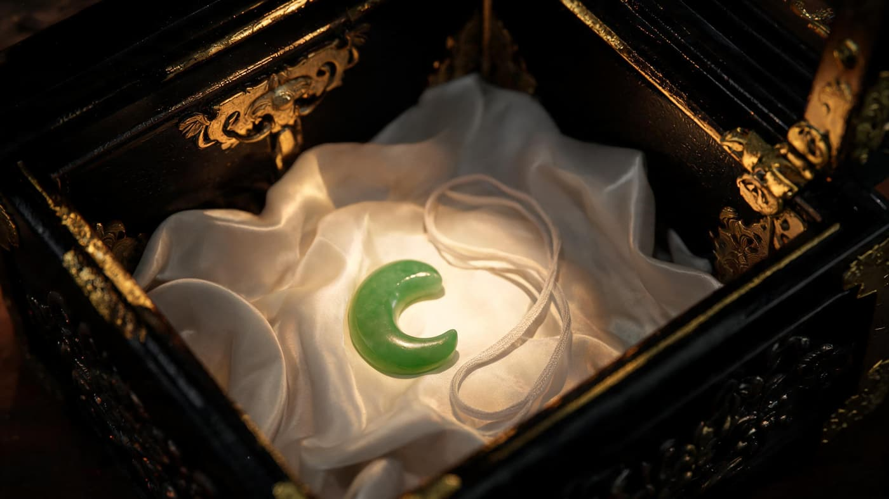
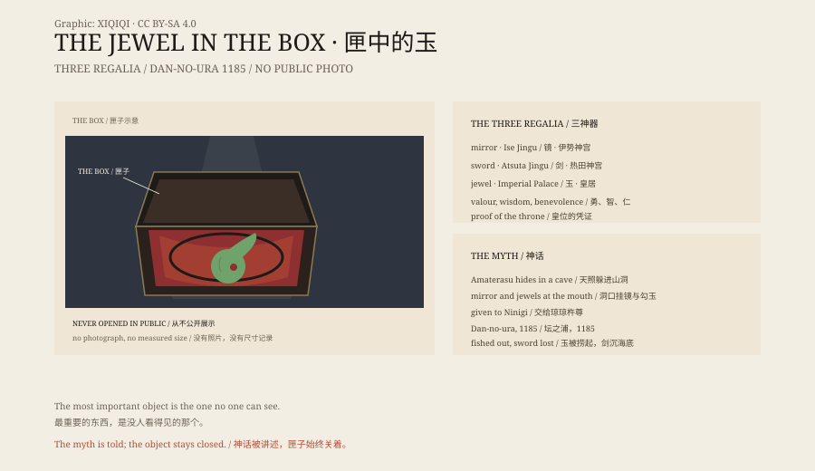

## 一、皇居里的一间屋子

2019 年 5 月 1 日，德仁天皇即位。

仪式上，侍从捧着两个箱子进来。一个装剑，一个装玉。箱子用布包着，放在案上。没有人打开。

玉叫八尺琼勾玉，供在皇居的贤所。它没有展柜，没有照片，没有尺寸记录。宫中三殿的祭祀在那里进行，普通人止步于门外。

匣子不大，包着布，放在案上。没有人知道里面的玉是串珠还是一颗单独的勾玉，也没有人量过它的尺寸。

## 二、山洞

《古事记》里，天照大神因为弟弟须佐之男胡闹，躲进天岩户，世界陷入黑暗。

众神在洞口想办法：公鸡啼叫，太鼓震响，天钿女命跳舞。洞口挂了一面镜子和一串勾玉。

天照听见笑声，探头出来看。藏在门后的力士抓住她的手，把她拉了出来。光回来了。

洞口的光、镜子的反光、勾玉碰撞的声音，都是为了把她引出来。

那串勾玉，就是后来的八尺琼勾玉。神话里，它由负责制玉的神打磨。“八尺”不是八英尺，是多、长的意思；“勾玉”是逗号形的珠子，早在古坟时代之前，日本人就佩戴它。

## 三、三件

天照把镜子、剑、玉交给孙子琼琼杵尊，让他去统治苇原中国。

三件东西成了皇位的凭证。后世常解释为：剑代表勇，镜代表智，玉代表仁。

今天它们分在三处：镜在伊势神宫，剑在热田神宫，玉在皇居。天皇即位时，剑与玉的箱子会到场；镜留在伊势。

## 四、坛之浦

1185 年，源平合战最后一战，坛之浦。平氏败了。

安德天皇才六岁，由祖母抱着投海。三神器也一起入水。

《平家物语》说，镜和玉被人捞起，剑沉入海底。热田神宫仍供着草薙剑；也有人说，沉下去的那把是复制品。

玉被送回京都，后来跟着皇室迁到东京。

## 五、看不见

玉的形状、大小、材质，没有公开记录。

通常的想象是一串绿色或碧色的勾玉，串在绳上；也有学者认为它可能是一颗大型勾玉。宫内厅不展示，不拍照，不借展。

*场景复原：匣中丝上的勾玉。不是文物照片。稀奇奇编辑部，CC BY-SA 4.0。*

它甚至不在《文化财保护法》的指定名单里。皇室御物不按那套制度走。

## 六、相信

一个国家把最重要的东西锁进匣子，然后把匣子交给时间。

看不见的玉，反而比任何展品都更牢地待在原位。

匣子成了边界：里面是神话和皇位，外面是普通的走廊和脚步声。

2019 年那天，箱子被捧过走廊，放下。仪式结束，又捧回去。没有人往里看。

*原创示意图：三神器的供奉地、1185 年坛之浦与皇居中的匣子。不是文物照片。稀奇奇编辑部，CC BY-SA 4.0。*

---

**来源与许可**：本文的事实来源见条目底部来源台账 S1–S3。文字与原创示意图采用 CC BY-SA 4.0。文中把神道神话、皇室仪式与文物现状分开叙述；玉的真实形制没有公开记录。插图是场景复原，不是文物照片。
