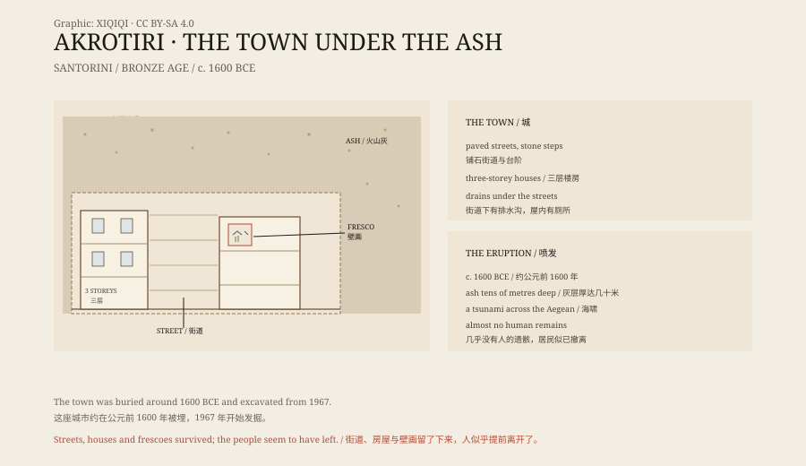

## 1. Santorini

Santorini lies in the Aegean, a crescent-shaped volcanic island.

On the west the cliffs drop steeply into a deep blue bay. The bay is a huge volcanic caldera, formed when the volcano collapsed after an eruption thousands of years ago.

On the south of the island there is an archaeological site called Akrotiri.

## 2. 1967

In 1967 the Greek archaeologist Spyridon Marinatos began to excavate at Akrotiri.

He did not find a temple or a palace. He found a town. Streets, squares, three-storey houses, staircases, storerooms, toilets and drains lay beneath the ash.

The houses were built of stone and mud brick, with plastered walls, some of them painted. Inside were pottery jars, looms, stone mills, bronze tools and stacks of clay containers.

There was no palace and no large cemetery. It looked like a trading town that lived from the sea.

## 3. The streets

The streets were paved with stone, with steps in places.

Houses stood along the streets, their doors opening onto the lanes. The ground floor held storerooms and workshops; the upper floors were living space. Windows and doorways faced the street, and light and air had been considered.

The drains ran under the streets and carried waste out of the town. Some houses had toilets flushed with running water.

For the Bronze Age, this was unusual urban comfort.

## 4. The frescoes

The frescoes of Akrotiri are the most famous part of the site.

One shows red rocks, white lilies and swallows in flight. Another shows blue monkeys climbing among rocks. Another shows two young boxers, with belts and gloves. Another shows a fleet of ships with rowers, cabins and coloured sails.

The pigments were minerals: red and yellow ochre, azurite blue, charcoal black. The painting is free, and the animals and plants are vivid.

Most of the frescoes are now in the National Archaeological Museum in Athens and the Museum of Prehistoric Thera in Fira. The site displays copies.

## 5. The eruption

Around 1600 BCE the volcano on Santorini erupted.

It was an enormous eruption. Ash and pumice covered the whole island, in places tens of metres deep. The eruption also produced a tsunami that affected coasts across the Aegean.

It was not a single instant. Earthquakes had been shaking the town for some time. Some walls were cracked and later repaired. The inhabitants may have been used to earthquakes, but this one was different.

## 6. No people

One strange thing about Akrotiri is that the excavators found almost no human remains.

At Pompeii, the ash holds the bodies of the dead. At Akrotiri it does not. What the excavators found was mainly animal bones and scattered objects.

The usual explanation is that the people left before the eruption. They had boats, a harbour and time. The earthquakes were a warning, and they took what they could carry and went.

Others suggest that the remains lie deeper, or were destroyed by later farming. But so far the town has produced no crowd of victims like Pompeii.

## 7. Atlantis

Because of the eruption, some people have linked Akrotiri with Atlantis.

Plato's Atlantis was a powerful island state that sank into the sea in a single night. The eruption of Thera, the buried town and the partial collapse of the island look similar.

But Plato's account contains many specific numbers and geographical details that do not match Santorini. Mainstream archaeology does not accept Akrotiri as Atlantis. It is simply a real town buried by a volcano.

## 8. Now

Akrotiri is now the most important archaeological site on Santorini.

The whole site is covered by a large roof. Visitors walk along wooden walkways and look down at the streets and houses. Some areas are closed, and excavation continues.

The volcano is still there. The Santorini caldera is active, and its last eruption was in 1950. The wine, the white houses and the sunsets of the island all stand on the same volcano.

*Original schematic: the layout of the streets, the positions of the frescoes and the ash layers. Not a survey drawing. Oddity Archive, CC BY-SA 4.0.*

---

**Sources and licenses**: the factual sources are listed in the source ledger S1–S3 at the bottom of this entry. Text and original diagrams are licensed under CC BY-SA 4.0. This article separates the town, the frescoes, the eruption and the absence of human remains; the date of the eruption is still debated, and there is no archaeological evidence linking Akrotiri to Atlantis. The illustration is a scene reconstruction, not a photograph of the site.
