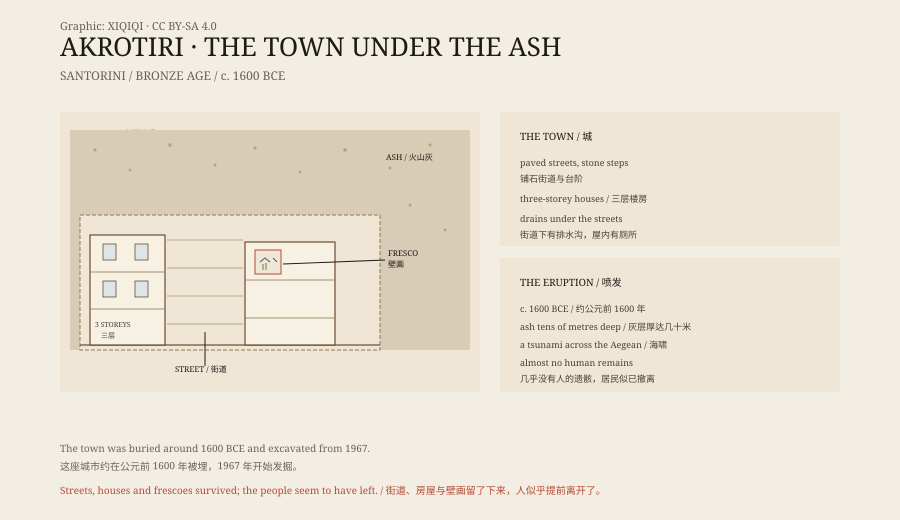

## 一、圣托里尼

圣托里尼在爱琴海，是一圈月牙形的火山岛。

岛的西侧是陡峭的悬崖，悬崖下面是深蓝色的海湾。海湾本身是一个巨大的火山口，几千年前喷发后塌陷形成。

岛的南边有一个考古遗址，叫阿克罗蒂里。

## 二、1967 年

1967 年，希腊考古学家斯皮里宗·马里纳托斯开始在阿克罗蒂里发掘。

他挖到的不是一座神庙，也不是一座宫殿，而是一座城。街道、广场、三层楼房、楼梯、储藏室、厕所和排水沟，都在火山灰下面。

房子是用石头和泥砖砌的，墙面抹灰，有的还画着壁画。屋里留着陶罐、织布机、石磨、青铜工具和成堆的陶土容器。

这里没有发现王宫，也没有发现大型墓葬。它更像一个靠海吃饭的贸易城镇。

## 三、街道

城里的街道铺着石头，有的地方有台阶。

房子沿着街道排列，门开向巷子。底层是储藏室和作坊，楼上是住人的房间。窗户和门洞朝向街道，采光和通风都考虑过。

排水系统埋在街道下面，把污水引到城外。有些房子里有厕所，用流水冲走。

在青铜时代，这样的城市生活并不常见。

## 四、壁画

阿克罗蒂里的壁画，是这个遗址最出名的东西。

有一幅画着红色的岩石、白色的百合和飞过的燕子。有一幅画着蓝色的猴子，在岩石间攀爬。有一幅画着两个拳击的少年，腰间系着腰带，戴着拳套。还有一幅画着一支船队，船上有桨手、船舱和彩色的船帆。

颜料是矿物做的：红赭石、黄赭石、蓝铜矿、炭黑。画法很自由，动物和植物都画得生动。

这些壁画现在大部分保存在雅典的国家考古博物馆和费拉的史前博物馆，遗址上留下的是复制品。

## 五、喷发

大约在公元前 1600 年，圣托里尼的火山喷发了。

这是一次巨大的喷发。火山灰和浮石覆盖了整个岛，有些地方厚达几十米。喷发还引发了海啸，影响了爱琴海沿岸。

喷发不是一瞬间的事。在此之前，地震已经持续了一段时间。城里有些墙壁被震裂，后来又修补过。居民可能已经习惯了地震，但这一次不一样。

## 六、没有人

阿克罗蒂里的发掘有一个奇怪的地方：几乎没有人的遗骸。

庞贝古城里，火山灰下埋着遇难者。阿克罗蒂里没有。发掘者找到的，主要是动物骨骼和散落的物品。

最常见的解释是：居民在喷发前撤离了。他们有船，有港口，有时间。地震是警告，他们带着能带走的东西上了船。

也有人认为，遗骸在更深的层位，或者被后来的耕作破坏。但到目前为止，这座城里没有出现庞贝那样的人群。

## 七、亚特兰蒂斯

因为这场喷发，有人把阿克罗蒂里和亚特兰蒂斯联系起来。

柏拉图写的亚特兰蒂斯，是一个强大的海岛国家，在一夜之间沉入海底。圣托里尼的火山喷发、城市被埋、岛屿部分塌陷，看起来有点像。

但柏拉图的描述里有很多具体的数字和地理细节，和圣托里尼对不上。主流考古学不认为阿克罗蒂里就是亚特兰蒂斯。它只是一个被火山埋掉的真实城市。

## 八、现在

阿克罗蒂里现在是圣托里尼最重要的考古遗址。

整个遗址被一个巨大的屋顶罩住，游客沿着木栈道走，往下看街道和房子。有些区域不开放，发掘还在继续。

火山还在。圣托里尼的火山口是活的，最近一次喷发在 1950 年。岛上的葡萄酒、白房子和日落，都建立在同一座火山上。

*原创示意图：街区布局、壁画位置与火山灰层位。不是测绘图。稀奇奇编辑部，CC BY-SA 4.0。*

---

**来源与许可**：本文的事实来源见条目底部来源台账 S1–S3。文字与原创示意图采用 CC BY-SA 4.0。文中把城市结构、壁画、喷发与“无遗骸”现象分开叙述；喷发年代的估计仍有讨论，阿克罗蒂里与亚特兰蒂斯的联系没有考古证据。插图是场景复原，不是现场照片。
