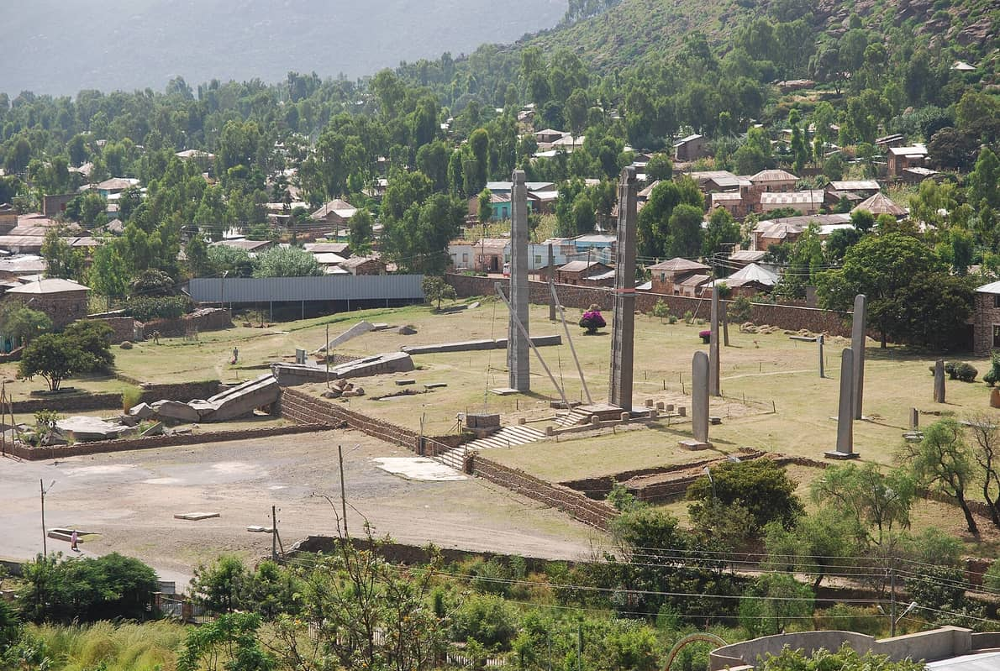
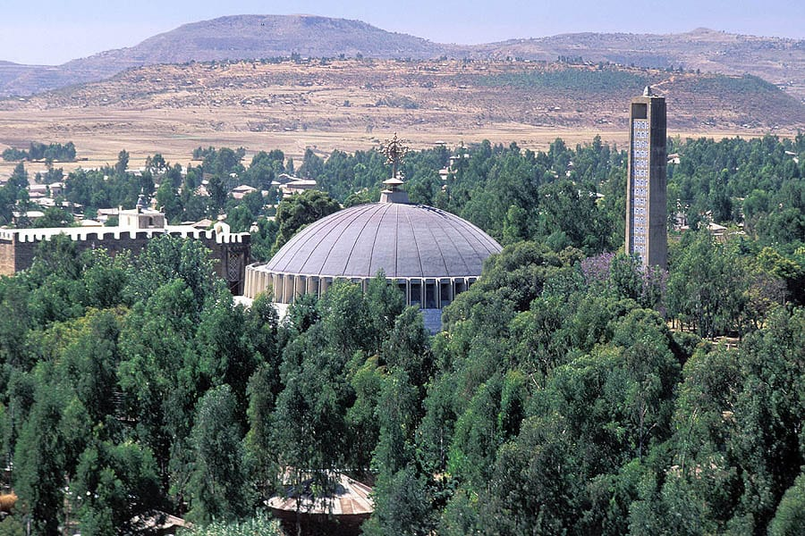
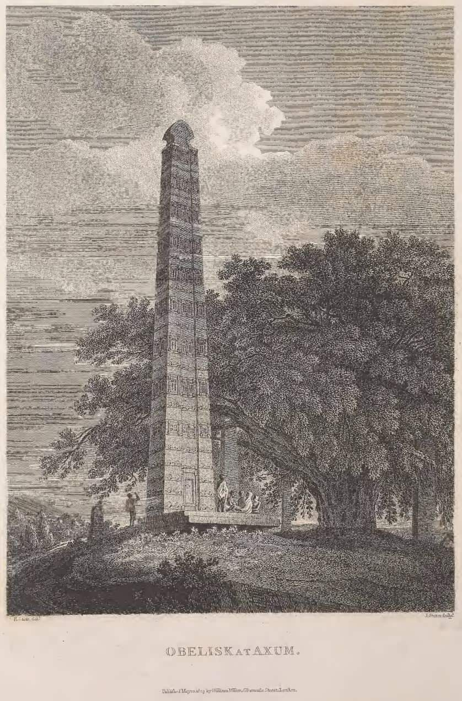
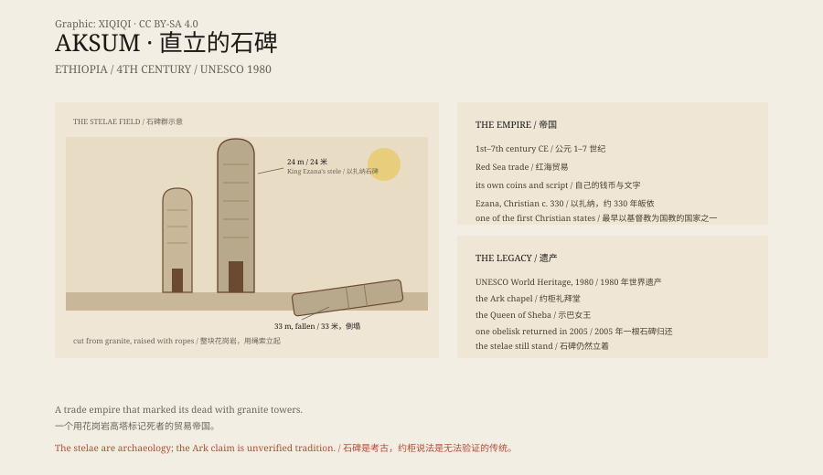

## 1. The Stelae in the Field

Aksum, in the Tigray region of northern Ethiopia, on a highland plateau around two thousand metres up. Grass grows on the slopes, and grey stelae rise out of it.

The tallest standing ones are over twenty metres high, like a narrow building pressed flat: tier upon tier, with false windows, false doors, beams and niches cut into the granite. Wind has polished the surface; the edges are chipped. In the early morning the mist lies on the ground and the stones come out of it.

The largest does not stand with the others. It lies beside them, broken into pieces, the longest section still showing its original shape. It was 33 metres tall, the biggest object on the site. Scholars believe it fell while it was being raised and broke where it landed.

The stelae are about seventeen hundred years old. They are not towers built from blocks. Each is a single piece of granite, cut from the bedrock, moved to the spot and set upright.

*Site photograph: the Northern Stelae Park at Aksum, 2010. JensiS65, CC BY-SA 3.0 (Wikimedia Commons). The stelae are carved with tiers of false windows and doors.*

## 2. The Capital of the Red Sea

In the first century AD a Greek sailing manual, the Periplus of the Erythraean Sea, mentioned Aksum and called it a "metropolis". By then it already controlled the trade of the western Red Sea coast. Ivory, gold and spices came from the interior to the port of Adulis and went out to Rome, India and Arabia.

Aksum minted its own coinage, gold, silver and bronze, stamped with the king's head and name. It had its own script, Ge'ez. It had palaces: the sixth-century traveller Cosmas Indicopleustes described a royal palace with four towers and bronze statues of unicorns in front of it.

In the fourth century King Ezana converted to Christianity. Aksum became one of the first states to adopt Christianity as its official religion. Ezana left a stone inscribed in three scripts, Ge'ez, Sabaean and Greek, recording his campaigns and his faith, and it still stands at Aksum.

## 3. How They Were Raised

The form of the stelae developed over time. The earliest were rough stones used as grave markers. Later the granite was dressed smooth, and later still the masons carved architecture into the shaft: tier after tier of windows, a door, beams, projecting corners.

The false windows and doors were not ornament. They copied the multi-storey buildings of Aksum. The stele stood above an underground tomb; its shaft was a "tower" for the dead. Some shafts still have mortices where metal discs were fixed.

To separate a block of granite from the bedrock, move it and raise it upright took a large workforce. The masons cut the outline in the rock, drove wedges in from the side, worked the stone free, dressed it, hauled it and lifted it. The largest never stood. The place where it came down is the place you see today.

## 4. The Church and the Ark

The other centre of Aksum is the church of Our Lady Mary of Zion.

The first cathedral is said to have been built by Ezana. It was destroyed, rebuilt, destroyed again in the sixteenth-century war with Adal. The present old church was built in 1665 by Emperor Fasilides. Beside it stands the new cathedral, a neo-Byzantine building begun in 1955; Emperor Haile Selassie interrupted the state visit of Queen Elizabeth II to attend its dedication.

Between the two churches is a small building called the Chapel of the Tablet. It was put up at the same time as the new cathedral, paid for out of the private funds of the Empress Menen Asfaw. Ethiopian tradition holds that the Ark of the Covenant is kept there, watched over by a single guardian monk. No one else may enter, not the Patriarch, not the Emperor.

The claim cannot be tested. It comes from the tradition of the Kebra Nagast: the Queen of Sheba visited Jerusalem, bore a son to Solomon, and that son brought the Ark back to Aksum. There is a text, a ritual and a guardian. There is no box anyone may open.

*Site photograph: the church of Our Lady Mary of Zion at Aksum, 2002. Jialiang Gao, CC BY-SA 3.0 (Wikimedia Commons). The old church dates from 1665; the new cathedral stands beside it.*

## 5. 1937

In 1935 Italian troops took Aksum. In 1937 the army cut a 24-metre stele into five pieces, loaded them on a ship and carried them to Rome, where it was set up in front of the former Ministry of Italian Africa.

The stele was one of the finest pieces of Aksumite stonework, with false windows, false doors and mortices for metal discs. Ethiopia protested the removal at the time.

In 1947 the United Nations and Italy agreed that the stele should be returned. Italy stalled for decades. Only in April 2005 were the five pieces shipped back to Aksum, with Italy paying four million dollars for the transport. In July 2008 the stele was re-erected, and on 4 September 2008 it was unveiled.

A stone left home for sixty-eight years and came back to a country that had changed governments several times. It stands in its old place, on the same plateau.

*Historical print: the obelisk at Aksum, drawn by Henry Salt in 1809, titled "Obelisk at Axum". Public domain (Wikimedia Commons). One of the earliest European images of the stelae.*

## 6. Salt and Stone

In 1809 the British traveller Henry Salt came to Aksum and drew the fallen stones. His drawings gave Europe its first clear look at their shape. In 1906 a German expedition led by Enno Littmann carried out the first systematic investigation. In 1980 UNESCO inscribed the Aksum archaeological site on the World Heritage list.

Today Aksum is a small town of fewer than seventy thousand people. The stelae park has a fence around it; grass grows between the stones, and monks walk in the shadow of the church.

The stelae are still there. Some stand, some lie down, one went away and came back. They do not speak. They simply stand, proof that an empire was here, and that people could turn a piece of bedrock into a tower for the dead.

*Original schematic: the structure of the Aksum stelae, the Red Sea trade and the timeline from the first to the seventh century. Not a site photograph. Oddity Archive, CC BY-SA 4.0.*

---

**Sources and licenses**: sources are listed in the ledger S1–S5 at the foot of this entry. Text and original diagrams are CC BY-SA 4.0. The article keeps apart the archaeology and history of Aksum, the removal and return of the stele, and the traditions of the Queen of Sheba and the Ark; the stelae and the imperial site rest on archaeology, the Ark claim cannot be verified. The photographs and the 1809 print are historical and site images; the schematic is not.
