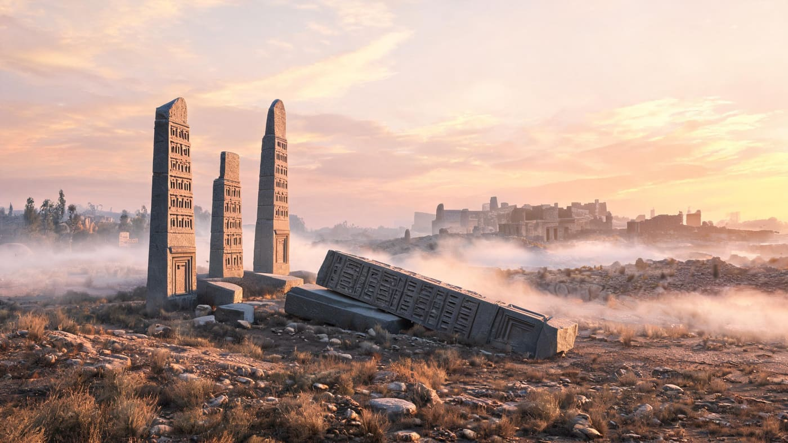
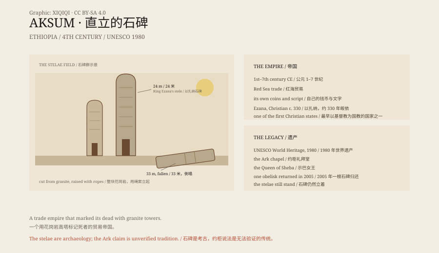

## 1. The Stelae

Aksum, northern Ethiopia.

Granite stelae stand in the fields, the tallest more than twenty metres high, like narrow towers carved with false windows and doors.

At dawn in Aksum, mist lies along the ground. The stelae rise out of the grass, their surfaces polished by wind, the false windows and doors casting shallow shadows in the slanting light.

The largest lies on the ground in pieces. It was originally 33 metres tall and weighed hundreds of tonnes.

*Reconstruction: the stelae field at Aksum at dawn, with the fallen giant obelisk. Not a historical photograph. Oddity Archive, CC BY-SA 4.0.*

## 2. The Empire

Aksum was an empire of the first to seventh centuries CE.

It controlled Red Sea trade and did business with Rome and India. It had its own script, coinage and capital.

In the fourth century King Ezana converted to Christianity. Aksum became one of the first states to adopt Christianity as its official religion.

## 3. The Stelae

The stelae were gravestones and displays of power.

They were cut whole from the granite bedrock and raised with rollers and ropes. The largest was never raised; it may have broken during the attempt.

This was not a tower built from blocks. It was a single piece of granite: cut into shape in the bedrock, separated from the hill, moved to its place, and raised.

## 4. The Queen of Sheba

Ethiopian tradition says the Queen of Sheba visited Jerusalem and had a son with King Solomon.

That son brought the Ark of the Covenant back to Aksum.

Today the chapel beside the Church of Our Lady Mary of Zion is said to house the Ark, watched over by a single guardian monk.

No one can verify it. But the story draws more visitors than the stelae.

## 5. Decline

After the seventh century, Red Sea trade routes shifted and Aksum declined.

It was not destroyed overnight; it slowly lost its ports, trade and power.

Today it is a UNESCO World Heritage Site.

## 6. Stone

The stelae are still there.

Some stand, some lie down, and one was taken to Rome and later returned.

They do not speak. They simply stand there, proving that an empire was once here.

*Original schematic: the structure of the Aksum stelae, the Red Sea trade and the 1st–7th century timeline. Not a photograph of a site. Oddity Archive, CC BY-SA 4.0.*

---

**Sources and licenses**: the factual sources are listed in the source ledger S1–S4 at the bottom of this entry. Text and original diagrams are licensed under CC BY-SA 4.0. This article separates the archaeology and history of Aksum, the Queen of Sheba legend and the Ark claim; the stelae and the empire are archaeological evidence, while the Ark claim cannot be verified. The illustration is a scene reconstruction, not a photograph of a site.
