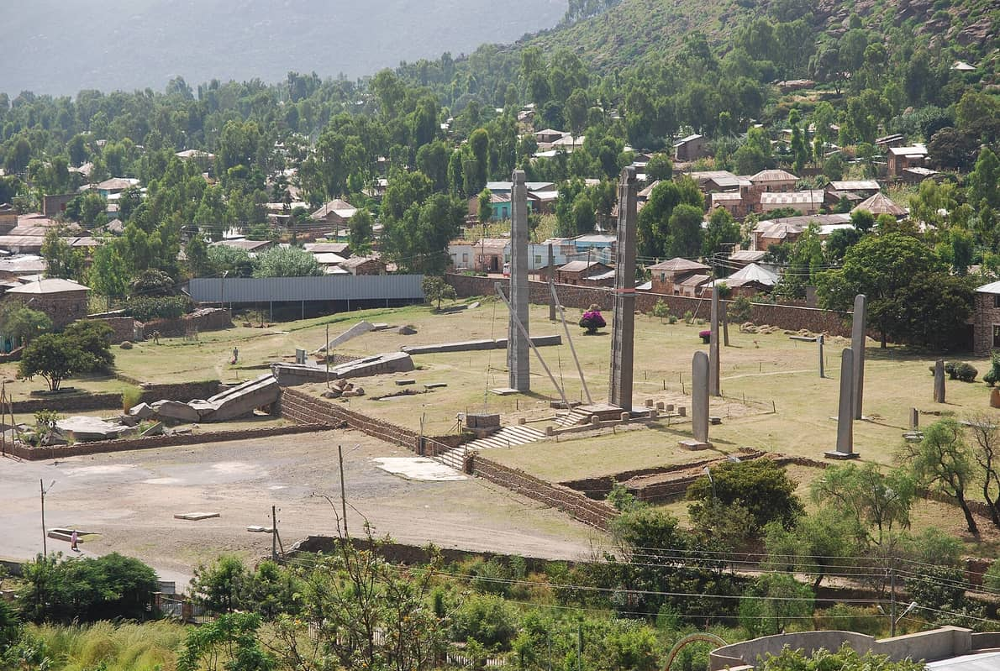
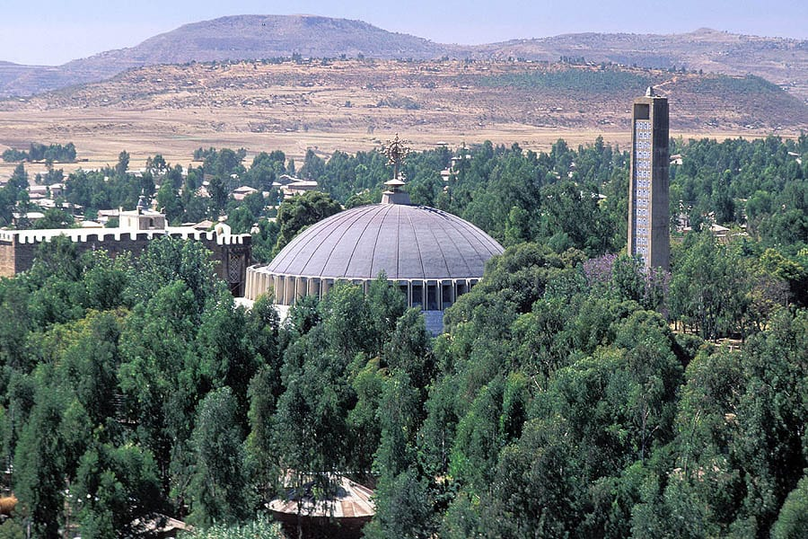
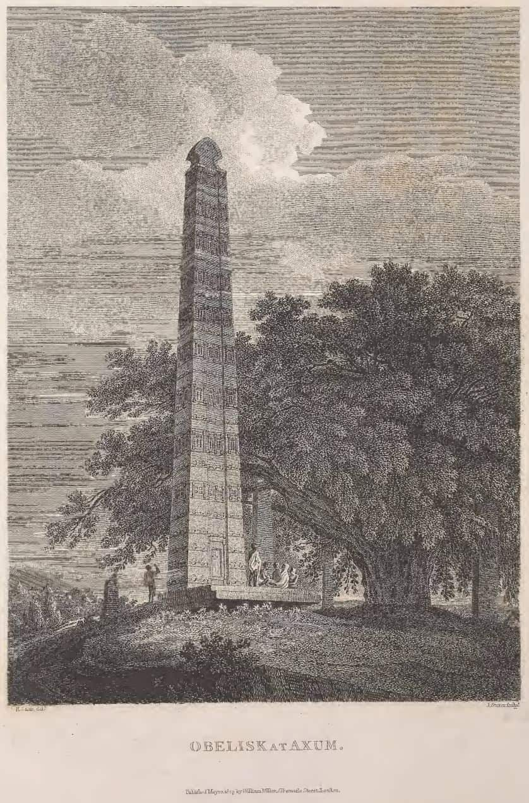
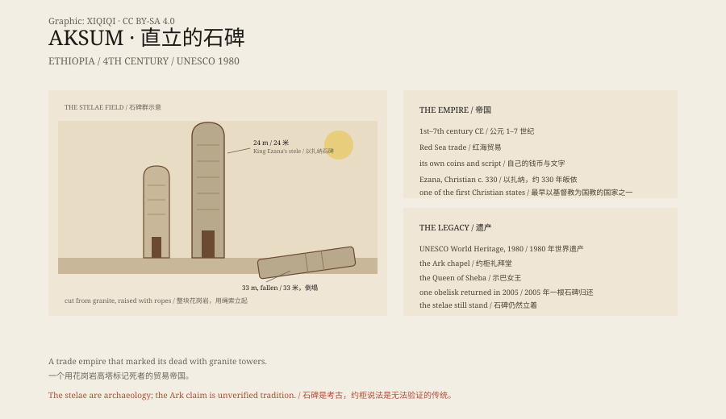

## 一、田野里的石碑

埃塞俄比亚北部，提格雷州，阿克苏姆。海拔两千米上下的高原，草场开在缓坡上，几根灰色的石碑从草里立起来。

最高的二十多米，像一栋被压扁的楼：一层一层，凿出假窗、假门、横梁和壁龛。石头表面被风磨得发亮，边缘有些缺口。清晨的雾贴着地面，碑身从雾里伸出来。

最大的一根不在站立的那排里。它倒在旁边，断成几截，最长的一段还看得出原来的形状。它原本有 33 米高，是整个遗址里最大的一件。学者相信，它在竖立的过程中就倒了，摔断在原地。

这些石碑大约有一千七百年历史。它们不是一块块石头垒起来的塔，每一根都是一整块花岗岩，从山体上凿出来，运到这里，再竖起来。

*现场照片：阿克苏姆北石碑公园的石碑群，2010 年。JensiS65，CC BY-SA 3.0（Wikimedia Commons）。石碑被凿出多层假窗与假门。*

## 二、红海的都城

公元 1 世纪，一本希腊语的航海手册《厄立特里亚海航行记》提到阿克苏姆，称它为“大城”（metropolis）。那时的它已经控制红海西岸的贸易，内地的象牙、黄金、香料从港口阿杜利斯出海，运往罗马、印度和阿拉伯半岛。

阿克苏姆有自己的钱币，金币、银币、铜币，铸着国王的头像和名字。它有自己的文字，吉兹语（Ge'ez）。它还有宫殿：六世纪的旅行者科斯马斯·印第科普莱夫特斯（Cosmas Indicopleustes）记下过一座四座塔楼的王宫，说宫前立着青铜的独角兽像。

4 世纪，国王埃扎纳（Ezana）皈依基督教。阿克苏姆成了世界上最早以基督教为国教的国家之一。埃扎纳留下一块石碑，用吉兹语、萨巴语和希腊语三种文字刻写，记录他的征战和信仰，位置就在今天的阿克苏姆。

## 三、怎么立起来的

石碑的形制有一个演化过程。最早的是粗糙的石块，只作为墓标。后来石头被打磨平整，再后来，石匠开始在碑身上凿出建筑的形状：一层一层的窗，门，横梁，转角处的凸出部分。

这些假窗假门不是装饰。它们模仿的是当时阿克苏姆的多层建筑。石碑立在地下的墓室上方，碑身就是给死者看的一栋“楼”。有的碑侧还留着榫眼，原本嵌着金属圆盘。

要把一整块花岗岩从山体上分离，再用滚木和绳索立起来，需要大量人力。石匠先在岩体上凿出轮廓，从侧面打进楔子，一点点把石头和山分开，再修整、运输、起吊。最大的那根没能立住。它倒下的地方，就是今天看到的那几截。

## 四、教堂与约柜

阿克苏姆的另一个中心，是锡安圣母玛利亚教堂。

最早的教堂据说由埃扎纳建造，后来被毁、重建，再毁于 16 世纪的阿达尔战争。现在的老教堂是 1665 年法西利德斯皇帝（Fasilides）所建。旁边的新教堂是 1955 年动工的新拜占庭式建筑，海尔·塞拉西皇帝为了参加它的落成典礼，中断了英国女王伊丽莎白二世的国事访问。

两座教堂之间，有一座小礼拜堂，叫“石板礼拜堂”（Chapel of the Tablet）。它和新教堂同时建成，由皇后梅嫩·阿斯法（Menen Asfaw）私人出资。埃塞俄比亚的传统说，约柜就放在这里，由一位守柜修士终身看管。除了他，任何人不得进入，连宗主教和皇帝也不行。

这个说法无法验证。它来自《列王荣耀记》（Kebra Nagast）的传统：示巴女王去过耶路撒冷，与所罗门王生了一个儿子，儿子把约柜带回阿克苏姆。故事有文字，有仪式，有守柜的人，没有可以打开检查的柜子。

*现场照片：阿克苏姆的锡安圣母玛利亚教堂，2002 年。Jialiang Gao，CC BY-SA 3.0（Wikimedia Commons）。老教堂建于 1665 年，新教堂在旁。*

## 五、1937 年

1935 年，意大利军队占领阿克苏姆。1937 年，意军把一根 24 米高的石碑拆成五段，装上船，运到罗马，竖在意大利非洲殖民地部旧址前。

这根石碑是阿克苏姆石作的代表作之一，有假窗、假门和金属圆盘的榫眼。它被运走的时候，埃塞俄比亚向国际社会提出抗议。

1947 年，联合国与意大利达成协议，石碑应归还。意大利拖了几十年。直到 2005 年 4 月，五段石头才被运回阿克苏姆，意大利承担了四百万美元的运输费用。2008 年 7 月，石碑重新竖立，9 月 4 日举行揭幕仪式。

一根石头离开家乡六十八年，回来时国家已经换了几次政权。它站回原来的位置，脚下是同一片高原。

*历史画作：亨利·索尔特（Henry Salt）1809 年所绘的阿克苏姆石碑，题为“Obelisk at Axum”。公有领域（Wikimedia Commons）。这是 19 世纪初欧洲对阿克苏姆石碑的早期图像记录。*

## 六、盐与石头

1809 年，英国旅行家亨利·索尔特来到阿克苏姆，画下了倒地的石碑。他的画让欧洲第一次看清这些石头的形状。1906 年，德国考古队由恩诺·利特曼（Enno Littmann）带队，第一次系统考察。1980 年，联合国教科文组织把阿克苏姆遗址列入世界遗产。

今天的阿克苏姆是一个小镇，人口不到七万。石碑公园围了栏杆，草从石缝里长出来，修士在教堂的阴影里走过。

石碑还在。有的立着，有的躺着，有的离开过又回来。它们不说话。它们只是站在那里，证明一个帝国曾经在这里，证明一群人能把一整块山岩，变成一栋给死人住的楼。

*原创示意图：阿克苏姆石碑的结构、红海贸易与 1–7 世纪时间线。不是现场照片。稀奇奇编辑部，CC BY-SA 4.0。*

---

**来源与许可**：事实来源见条目底部来源台账 S1–S5。文字与原创示意图采用 CC BY-SA 4.0。文中把阿克苏姆的考古与历史、石碑的搬运与归还、示巴女王与约柜传说分开叙述；石碑与帝国遗址有考古依据，约柜在阿克苏姆的说法无法验证。照片与 1809 年版画为历史图像与现场拍摄，示意图不是。
