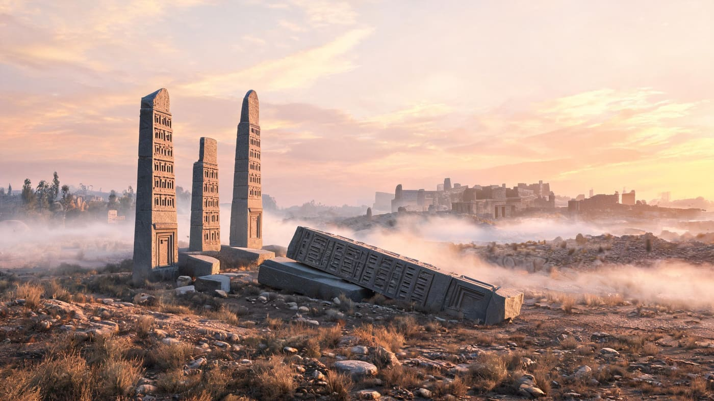
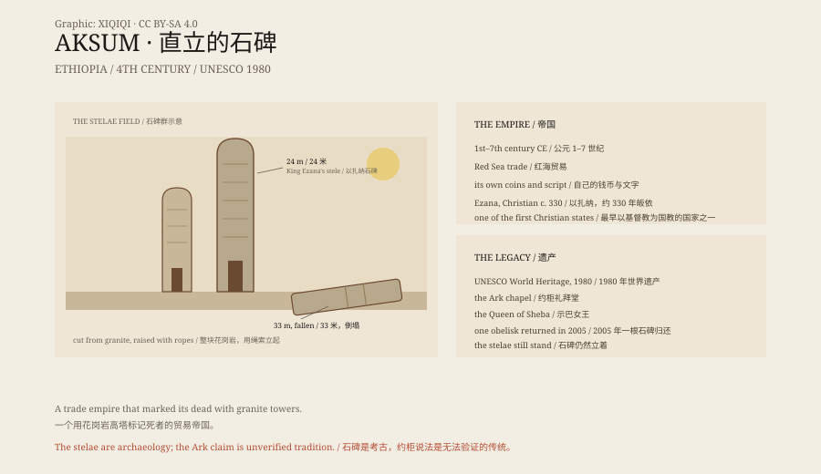

## 一、石碑

埃塞俄比亚北部，阿克苏姆。

田野上立着几根巨大的石碑，最高的二十多米，像一栋细长的楼，被凿出了假窗和假门。

清晨的阿克苏姆，雾贴着地面。石碑从草里立起来，表面被风磨得发亮，假窗和假门在斜光里投下很浅的影子。

最大的那一根倒在地上，断成几截。它原本有 33 米高，重几百吨。

*场景复原：清晨的阿克苏姆石碑群与倒塌的巨碑。不是历史照片。稀奇奇编辑部，CC BY-SA 4.0。*

## 二、帝国

阿克苏姆是公元 1 到 7 世纪的一个帝国。

它控制红海贸易，和罗马、印度做买卖。它有自己的文字、钱币和都城。

4 世纪，国王以扎纳皈依基督教。阿克苏姆成了最早以基督教为国教的国家之一。

## 三、石碑

这些石碑是墓碑，也是权力的展示。

它们从花岗岩山体上整块凿出来，再用滚木和绳索立起来。最大的那根没有立起来，可能在半途就断了。

这不是一块块石头垒起来的塔，而是一整块花岗岩。先在山体上凿出形状，再把它和山分开，运到位置，竖起来。

## 四、示巴女王

埃塞俄比亚的传统说，示巴女王来过耶路撒冷，和所罗门王生了一个儿子。

这个儿子把约柜带回阿克苏姆。

今天，锡安圣母玛利亚教堂旁边的小礼拜堂，据说就放着约柜，由一个守柜修士看管。

没有人能验证。但这个故事，比石碑更吸引游客。

## 五、衰落

7 世纪以后，红海贸易路线改变，阿克苏姆衰落。

它没有被一夜摧毁，而是慢慢失去了港口、贸易和权力。

今天，它是联合国教科文组织世界遗产。

## 六、石头

石碑还在。

有的立着，有的躺着，有的被运到罗马又还回来。

它们不说话。它们只是站在那里，证明一个帝国曾经在这里。

*原创示意图：阿克苏姆石碑的结构、红海贸易与 1–7 世纪时间线。不是现场照片。稀奇奇编辑部，CC BY-SA 4.0。*

---

**来源与许可**：本文的事实来源见条目底部来源台账 S1–S4。文字与原创示意图采用 CC BY-SA 4.0。文中把阿克苏姆的考古与历史、示巴女王传说和约柜说法分开叙述；石碑与帝国遗址有考古依据，约柜在阿克苏姆的说法无法验证。插图是场景复原，不是现场照片。
