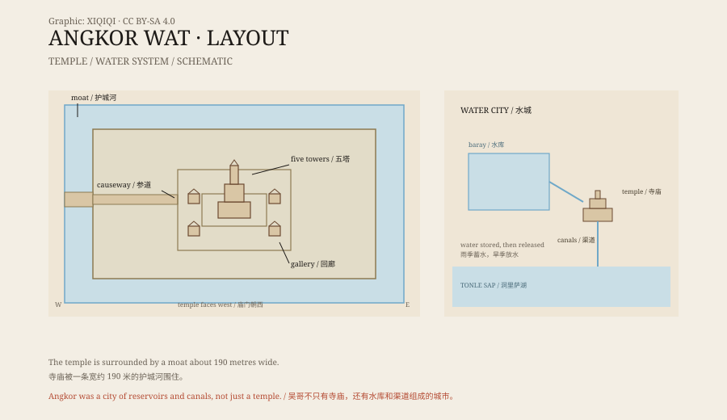

## 1. Towers inside a moat

Leave Siem Reap and head north, and the first thing you see is water.

A moat about 190 metres wide surrounds a rectangular stone city. Cross the floating bridge, pass through the outer gate, and a long causeway leads to five towers.

The central tower is about 65 metres high. Four others stand at the corners. Their tops are shaped like lotus buds, and green moss grows on the stone.

This is Angkor Wat.

## 2. Who built it

Angkor Wat was built in the twelfth century, roughly between 1113 and 1150.

The king who ordered it was Suryavarman II of the Khmer Empire. He dedicated the temple to Vishnu and made it both his state temple and part of his capital. The layout copies Mount Meru, the cosmic mountain: the central tower is the centre of the world, the four towers are its peaks, and the moat is the ocean around it.

Later, the Khmer Empire turned to Buddhism, and Angkor Wat gradually became a Buddhist temple. It is still a working religious site today.

*Original schematic: the temple layout, the moat, and the water system of the Angkor region. Not a survey drawing. Oddity Archive, CC BY-SA 4.0.*

## 3. Stories in stone

There is almost no blank space on the walls of Angkor Wat.

The reliefs in the galleries run for hundreds of metres. They show scenes from Indian epic: battles from the Mahabharata, rescues from the Ramayana, and Vishnu fighting demons. The most famous panel is the Churning of the Ocean of Milk, in which gods and demons pull a giant serpent to churn the sea and find the elixir of immortality.

Another wall shows Suryavarman II himself. He sits on an elephant, surrounded by soldiers and attendants, receiving the submission of his people. The reliefs contain thousands of figures, each in a different pose.

These carvings were not decoration. They placed myth, kingship, and history on the same wall, so that anyone walking in could see the order of the world.

## 4. A city of water

Angkor was more than a temple.

The whole region was covered with huge reservoirs, canals, and channels. Water was stored in the rainy season and released in the dry season, supporting a city of hundreds of thousands of people. Angkor was one of the largest pre-industrial urban complexes in the world.

Water was also the city's weakness. Climate change, years of drought, floods, and war eventually led to the abandonment of the capital in the fifteenth century. The temple stayed; the city dispersed.

In 2015, LiDAR scanning revealed more streets, ponds, and buildings beneath the jungle. Angkor was far larger than the ruins visible on the surface.

## 5. The “discovery”

In the nineteenth century, the Frenchman Henri Mouhot came to Angkor.

He wrote about what he saw and published it in Europe. After the book appeared, Europeans called Angkor a “city swallowed by the jungle” and Mouhot its “discoverer”.

But Angkor had never really disappeared. Local monks and villagers had always lived nearby, and the temple had never stopped receiving offerings. Mouhot was not the first person to see it; he was the first to put it in front of a European readership.

“Discovered in the jungle” is a colonial narrative more than a fact.

## 6. Now

In 1992, Angkor Wat became a World Heritage Site.

Today it appears on the Cambodian flag and in countless tourist photographs. Every morning, crowds gather by the reflecting pool to watch the sun rise behind the towers.

The stone is weathering, the trees are growing, and the visitors keep coming. Conservation teams are always at work; some towers are wrapped in scaffolding, and some reliefs have been replaced with copies.

A temple built for gods and kings has become the symbol of a nation.

---

**Sources and licenses**: the factual sources are listed in the source ledger S1–S3 at the bottom of this entry. Text and original diagrams are licensed under CC BY-SA 4.0. This article separates the construction record, the reliefs, the urban water system, and the “discovery” narrative; estimates of Angkor's population and the causes of its decline vary.
