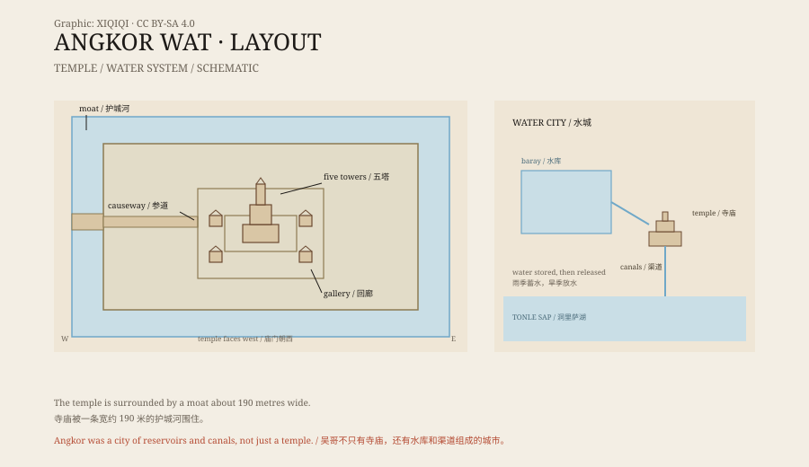

## 一、护城河里的塔

从暹粒往北走，先看到的是水。

一条宽约一百九十米的护城河，围着一座长方形的石头城。走过浮桥，穿过外门，眼前会出现一条长长的参道，尽头是五座塔。

中间那座最高，约六十五米。另外四座在四角。五座塔的顶端像莲花苞，石头上长着绿色的苔。

这就是吴哥窟。

## 二、谁建的

吴哥窟建于十二世纪，大约在 1113 年到 1150 年之间。

下令建造的是高棉国王苏耶跋摩二世。他把这座庙献给毗湿奴，同时把它当作自己的国寺和都城的一部分。庙的布局模仿神话里的须弥山：中间的塔是世界的中心，四座塔是山峰，护城河是围绕世界的大海。

后来，高棉帝国改信佛教，吴哥窟也慢慢变成佛寺。今天，它仍然是有人供奉的宗教场所。

*原创示意图：吴哥窟的寺庙布局、护城河与吴哥地区的水利系统。不是测绘图。稀奇奇编辑部，CC BY-SA 4.0。*

## 三、石头上的故事

吴哥窟的墙上，几乎没有空白。

回廊里的浮雕长达数百米，刻的是印度史诗里的故事：《摩诃婆罗多》的战争、《罗摩衍那》的救援、毗湿奴与恶魔的搏斗。最著名的一幅是“搅拌乳海”：一群神和一群阿修罗拉着一条巨蛇，搅动海水，寻找长生不老药。

还有一面墙刻着苏耶跋摩二世本人。他坐在大象上，带着军队和随从，接受臣民的朝见。浮雕里的人物有几千个，姿态各异。

这些浮雕不是装饰。它们把神话、王权和历史放在同一面墙上，让走进来的人一眼看到秩序。

## 四、水城

吴哥不只有庙。

整个吴哥地区有巨大的水库、运河和渠道。雨季蓄水，旱季放水，支撑着几十万人的城市。吴哥是前工业时代最大的城市聚落之一。

水利系统也是这座城市的弱点。气候变化、连年干旱、洪水，加上战争，最终让都城在十五世纪被放弃。庙没有搬走，但城市散了。

2015 年，激光雷达扫描发现了丛林底下更多街道、池塘和建筑遗迹。吴哥的城市范围，比地面上看到的要大得多。

## 五、“发现”

十九世纪，法国人亨利·穆奥来到吴哥。

他把见闻写进游记，带回欧洲。书出版后，欧洲人把吴哥称为“被丛林吞没的城市”，把穆奥称为“发现者”。

但吴哥从来没有真正消失。当地的僧人和村民一直住在附近，庙里一直有人上香。穆奥不是第一个看到它的人，他是第一个把它写进欧洲读者视野的人。

“被丛林发现”这个说法，更多是殖民时代的叙事，而不是事实。

## 六、现在

1992 年，吴哥窟被列入世界遗产。

今天，它出现在柬埔寨的国旗上，也出现在无数旅游照片里。每天清晨，人们挤在池塘边，等太阳从塔后升起。

石头在风化，树根在生长，游客在增加。修复团队一直在工作，有些塔被脚手架包住，有些浮雕被复制品替换。

一座为神明和王权建造的庙，最后成了这个国家的象征。

---

**来源与许可**：本文的事实来源见条目底部来源台账 S1–S3。文字与原创示意图采用 CC BY-SA 4.0。文中把建造记录、浮雕内容、城市水利与“发现”叙事分开叙述；吴哥的城市人口和衰落原因仍有不同估计。
