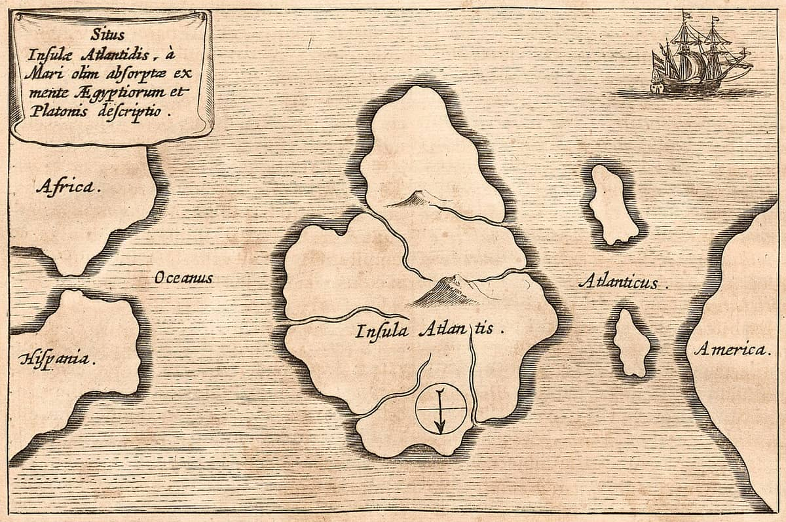
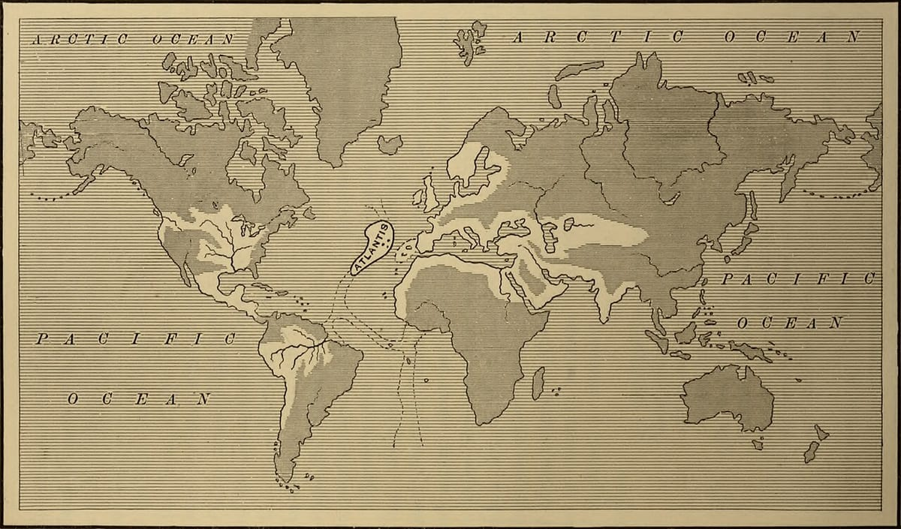
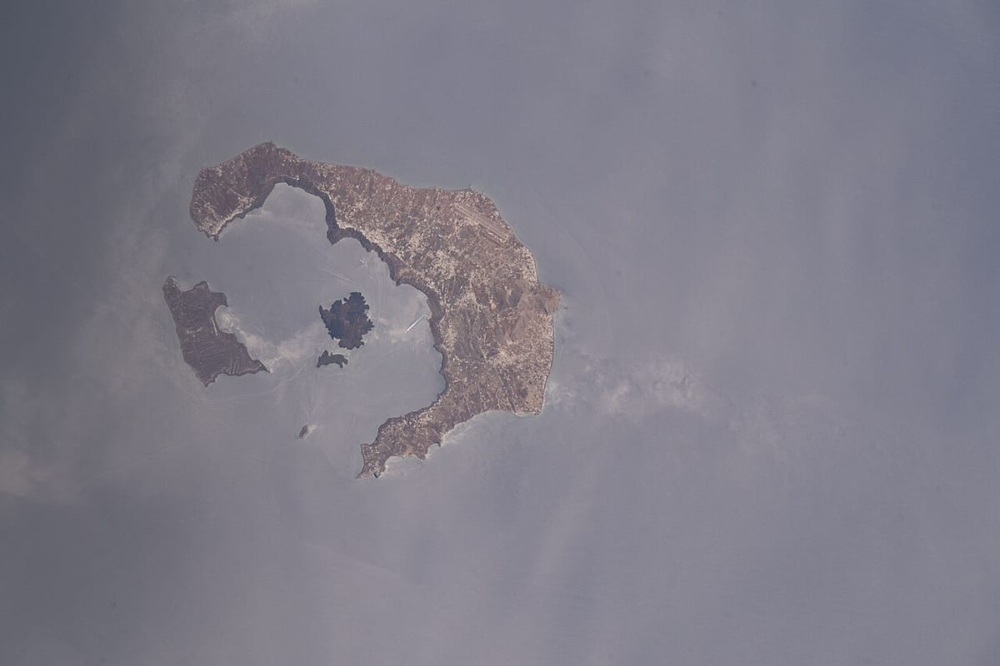
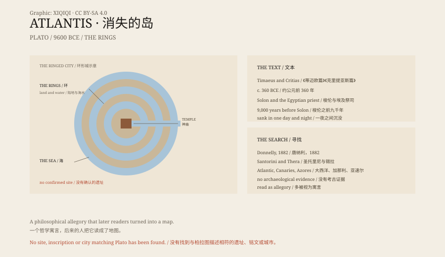

## 1. Plato

Atlantis first appears in two of Plato's dialogues, the Timaeus and the Critias.

The Timaeus was written around 360 BCE. At the start, Socrates discusses the ideal state and asks whether anyone can tell a story showing such a state at work in the world. Critias says he has a story handed down from his ancestors.

The story says that the Athenian statesman Solon visited Egypt between 590 and 580 BCE and heard of Atlantis from the priests. Solon translated the Egyptian records and planned a poem, but never finished it. Critias says the story has been kept in his family.

Beyond the Pillars of Hercules lies a great island, larger than Libya and Asia Minor combined. It holds a powerful kingdom. Its army attacks Athens, and the Athenians defeat it. Then earthquakes and floods swallow the island in a single day and night.

In Plato's description the island is circular: a ring of land, a ring of water, another ring of land. There is a temple, docks, and a canal bringing ships from the sea directly into the city. At the centre stands a temple to Poseidon, its outer wall covered in gold, its inner walls in tin and bronze.

*Historical map: Athanasius Kircher's map of Atlantis from Mundus Subterraneus, 1669. Public domain (Wikimedia Commons). The map is oriented with south at the top and places the island in the middle of the Atlantic.*

## 2. The Date

The Egyptian priests say the event happened nine thousand years before Solon.

Solon lived in the sixth century BCE. Nine thousand years before him is about 9600 BCE.

That is far earlier than the pyramids, earlier than agriculture.

It places Atlantis not in "ancient" history but in prehistory. Plato uses a distant date to push the story beyond human memory.

## 3. Allegory

Why did Plato write it?

The Timaeus and Critias discuss the ideal state. Atlantis is its opposite: wealthy, powerful, arrogant, and finally punished by the gods.

In the Critias, the kings of Atlantis are originally descended from gods. In time the divine blood is diluted and human nature takes over. They become greedy and expansionist, and Zeus decides to punish them. The dialogue breaks off there; it was never finished.

Most classicists now read Atlantis as an allegory, not history.

One common reading is that Plato is contrasting Atlantis with the Persian Empire: Atlantis is a naval empire from the west, Persia a land empire from the east, and Athens stands between them. Athens defeats Atlantis, demonstrating the superiority of Plato's ideal state over a real empire.

Another reading is that Plato had just returned from Sicily, and the walls, harbours and tyranny of Syracuse gave him material.

Aristotle, Plato's student, believed his teacher had invented the island to teach philosophy. But some ancient writers thought it was real. Crantor, a student of Plato's student Xenocrates, is often cited as believing the story historical. Proclus, a Neoplatonist of the fifth century CE, reports Crantor's view, but the pronoun in the original is ambiguous, and it is unclear whether Crantor or Plato is speaking.

Today classicists largely agree that Atlantis is fiction. The argument is only about which real events Plato used as material.

*Historical map: the Atlantean empire from Ignatius Donnelly's Atlantis: The Antediluvian World, 1882. Public domain (Wikimedia Commons). Donnelly drew Atlantis as a continent in the Atlantic, with influence reaching the Americas and Africa.*

## 4. 1882

But people kept looking.

In 1882 the American writer and politician Ignatius L. Donnelly published Atlantis: The Antediluvian World. He presented Atlantis as a real civilisation, the source of all ancient civilisations.

Donnelly placed the biblical creation story, the legends of the American Indians, and the myths of Egypt and Greece side by side, and argued that they all pointed to one lost motherland. He believed Atlantis was destroyed by the biblical Flood.

The book sold well. Donnelly has been called the father of the nineteenth-century Atlantis revival; the modern popularity of Atlantis owes much to him.

His method was not history but comparative myth: assume a motherland first, then count every similar story as evidence.

Later writers went further. The Theosophist Helena Blavatsky put Atlantis into The Secret Doctrine, calling it the home of the fourth "root race". In the twentieth century the clairvoyant Edgar Cayce said Atlantis would rise again in the 1960s, and that a "Hall of Records" lay beneath the Sphinx.

None of this has physical evidence. But it turned Plato's allegory into a place people could search for.

## 5. The Search

In the twentieth century Atlantis was placed in the Atlantic, the Canary Islands, the Azores, Antarctica, the Caribbean.

The most popular candidate is Santorini.

Around 1600 BCE the Thera volcano erupted and destroyed Akrotiri, a Minoan town on the island. Part of the island collapsed, forming the present caldera. In 1967 archaeologists excavated Akrotiri, buried under volcanic ash.

The story resembles the "sunk in a single day" account: a sophisticated civilisation destroyed by a volcano.

But Santorini is not Atlantis. Plato never mentions it, and the dates do not fit — Plato's Atlantis is nine thousand years before Solon, while the Thera eruption was more than a thousand years before Solon. Nor was Akrotiri "swallowed": it was buried in ash, and the site is still there.

Other candidates have their own problems. Helike in Greece was destroyed by an earthquake and tsunami in 373 BCE, but it was a Greek city, not an island in the Atlantic. The Athenian expedition to Sicily failed in 415–413 BCE, which may have inspired Plato, but that was a war, not a sinking. The Sea Peoples and the Trojan War have also been proposed, with no direct evidence.

By various counts, dozens of "Atlantis locations" have been proposed, from the Mediterranean to the Atlantic, from the Arctic to the Antarctic. Most satisfy only one or two of Plato's conditions: water, catastrophe, a certain date. None satisfies all of them.

After plate tectonics became established, the premise of a continent sinking in the Atlantic in the recent geological past was largely ruled out. There is no such continent under the Atlantic.

*Satellite photograph: the Santorini caldera, 24 June 2022, from the International Space Station. NASA, public domain (Wikimedia Commons). The Thera eruption around 1600 BCE formed this caldera; it is often proposed as Atlantis.*

## 6. Evidence

Archaeologists have not found Atlantis.

There is no identified site, no inscription, no city matching Plato's description.

There are sunken cities, volcanoes and earthquakes under the Mediterranean and the Atlantic. Heracleion and Canopus, at the mouth of the Nile, have been found underwater; but their dates, locations and causes have nothing to do with Atlantis.

The only primary source for Atlantis is Plato's two dialogues. Every later claim rests on those two texts. There is no second ancient document, no stone carved with the island's name, no city built on the circular plan and dated to the right time.

## 7. Why It Survives

Atlantis is the perfect lost civilisation: rich, advanced, suddenly gone.

It leaves a blank in archaeology and a place for fantasy.

It can also be used to say almost anything: environmentalists call it a lesson in hubris; politicians call it the fate of a powerful empire; mystics call it evidence of a prehistoric civilisation; novelists call it a good story.

In the twentieth century Atlantis was used by racial theorists as the homeland of the "Aryans"; today it appears mostly in comics, films, games and tourism advertising. A name has become a genre.

Plato wrote an allegory. Later readers turned it into a map.

## 8. The Island

Today Atlantis is still in books, on screens, in search engines.

Some keep looking, some keep writing, some keep believing.

In Plato's story the island disappears in a single day and night. He leaves no coordinates. He leaves only a question: why does a powerful state destroy itself?

Two thousand years later we are still answering it. We have only turned it into a question about an island.

*Original schematic: Plato's ring city, the sinking narrative and the main candidate sites. Not an archaeological photograph. XIQIQI Editorial, CC BY-SA 4.0.*

---

**Sources and licenses**: Text and original diagrams are licensed CC BY-SA 4.0; third-party image and source licences are listed in the source ledger below.
