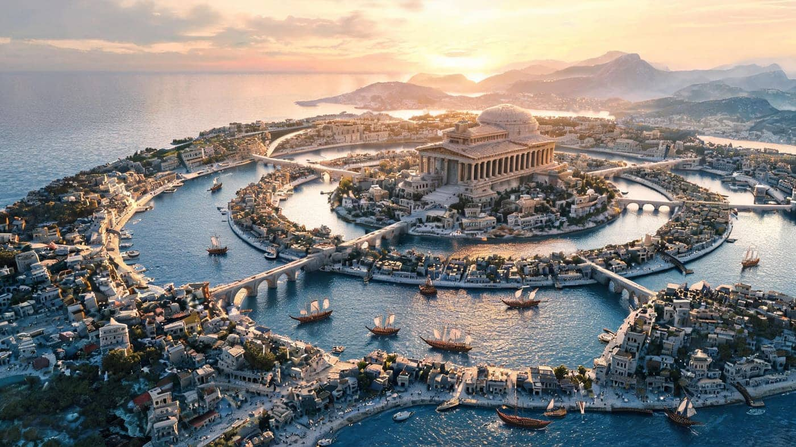
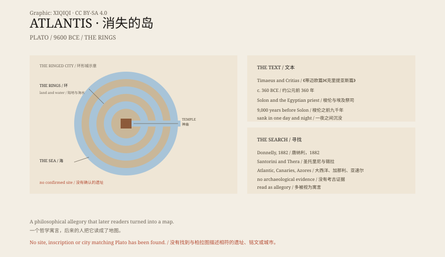

## 1. Plato

Atlantis first appears in two of Plato's dialogues: the Timaeus and the Critias.

Plato says the story was told to the Athenian statesman Solon by an Egyptian priest. The priest described a great island beyond the Pillars of Hercules, larger than Libya and Asia combined.

The island held a powerful kingdom. Its army attacked Athens and was driven back. Later, earthquakes and floods swallowed the island in a single day and night.

In Plato's description the island was ringed: a circle of land, a circle of water, and another circle of land. The city had temples, docks and canals, and ships came in from the sea directly into the city.

*Reconstruction: the ringed city and canals described by Plato. Not an archaeological photograph. Oddity Archive, CC BY-SA 4.0.*

## 2. The Date

The Egyptian priest said this happened nine thousand years before Solon.

Solon lived in the sixth century BCE. Nine thousand years before him is roughly 9600 BCE.

That is long before the pyramids, and before the invention of agriculture.

It also places Atlantis further away than "ancient": it is prehistoric.

## 3. The Ideal State

Why did Plato write it?

The Timaeus and the Critias are about the ideal city. Atlantis is a negative example: rich, powerful and arrogant, and finally punished by the gods.

Most scholars regard Atlantis as a philosophical allegory, not history.

## 4. The Search

People have kept looking.

In 1882 the American writer Ignatius Donnelly published Atlantis: The Antediluvian World, arguing that Atlantis was a real civilisation.

In the twentieth century it was placed in the Atlantic, the Canary Islands, the Azores, Antarctica and the Caribbean.

The most popular candidate is Santorini: around 1600 BCE the Thera volcano erupted and destroyed Akrotiri, a Minoan town. The story resembles a sudden catastrophe.

But Santorini is not Atlantis. Plato never mentions it, and the date does not match.

## 5. The Evidence

Archaeologists have not found Atlantis.

There is no clear site, no inscription, no city matching Plato's description.

The Mediterranean and the Atlantic contain sunken cities, volcanoes and earthquakes, but none of them is Atlantis.

## 6. Why It Survives

Atlantis is a perfect lost civilisation: rich, advanced and suddenly gone.

It leaves a blank in archaeology and a place for fantasy.

Plato wrote an allegory. Later readers turned it into a map.

*Original schematic: Plato's ringed city, the sinking narrative and the main candidate sites. Not an archaeological photograph. Oddity Archive, CC BY-SA 4.0.*

---

**Sources and licenses**: the factual sources are listed in the source ledger S1–S3 at the bottom of this entry. Text and original diagrams are licensed under CC BY-SA 4.0. This article separates Plato's text, its philosophical meaning, later hypotheses and the archaeological evidence; Atlantis has no confirmed site, and mainstream scholarship treats it as an allegory. The illustration is a scene reconstruction, not an archaeological photograph.
