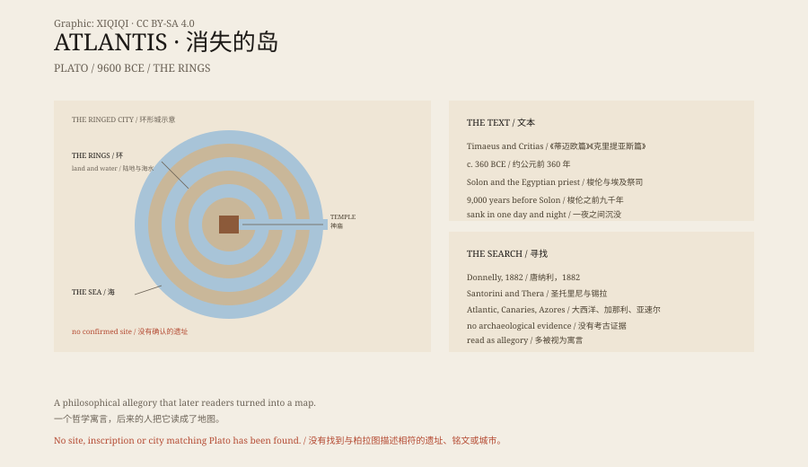

## 一、柏拉图

亚特兰蒂斯第一次出现，是在柏拉图的两篇对话里：《蒂迈欧篇》和《克里提亚斯篇》。

柏拉图说，这个故事是雅典政治家梭伦从埃及祭司那里听来的。祭司说，在赫拉克勒斯之柱以外，有一个巨大的岛，比小亚细亚和利比亚加起来还大。

岛上有强大的王国。它的军队进攻雅典，被雅典人击退。后来，地震和洪水在一夜之间把岛吞了。

在柏拉图的描述里，岛是环形的：一圈陆地，一圈水，再一圈陆地。城里有神庙、船坞和运河，船从海里直接开进城市。

*场景复原：柏拉图笔下的环形城与运河。不是考古照片。稀奇奇编辑部，CC BY-SA 4.0。*

## 二、时间

埃及祭司说，这件事发生在梭伦之前九千年。

梭伦生活在公元前 6 世纪。九千年，就是公元前 9600 年左右。

这个时间，比金字塔早得多，比农业出现还早。

这也让亚特兰蒂斯显得更远：它不是“古代”，而是史前。

## 三、理想国

柏拉图为什么写这个？

《蒂迈欧篇》和《克里提亚斯篇》讨论的是理想城邦。亚特兰蒂斯是一个反面教材：富有、强大、傲慢，最后被神惩罚。

很多学者认为，亚特兰蒂斯是柏拉图编出来的寓言，不是历史。

## 四、寻找

但人们一直在找。

1882 年，美国作家伊格内修斯·唐纳利写了《亚特兰蒂斯：大洪水前的世界》，把亚特兰蒂斯说成一个真实的文明。

20 世纪，有人把它放在大西洋、加那利群岛、亚速尔群岛、南极洲、加勒比海。

最流行的候选是圣托里尼：公元前 1600 年左右，锡拉火山爆发，摧毁了米诺斯文明的阿克罗蒂里城。这个故事和“一夜之间沉没”有点像。

但圣托里尼不是亚特兰蒂斯。柏拉图没有提过它，时间也对不上。

## 五、证据

考古学家没有找到亚特兰蒂斯。

没有明确的遗址，没有铭文，没有与柏拉图描述相符的城市。

地中海和大西洋的海底，有沉没的城市、火山和地震，但都不是亚特兰蒂斯。

## 六、为什么还在

亚特兰蒂斯是一个完美的失落文明：富有、先进、突然消失。

它给考古学留了一个空白，也给幻想留了一个位置。

柏拉图写的是一个寓言。后来的人把它读成了地图。

*原创示意图：柏拉图的环形城描述、沉没叙事与主要候选地点。不是考古照片。稀奇奇编辑部，CC BY-SA 4.0。*

---

**来源与许可**：本文的事实来源见条目底部来源台账 S1–S3。文字与原创示意图采用 CC BY-SA 4.0。文中把柏拉图的文本、哲学寓意、后世假说与考古证据分开叙述；亚特兰蒂斯没有可确认的遗址，主流学界多把它视为寓言。插图是场景复原，不是考古照片。
