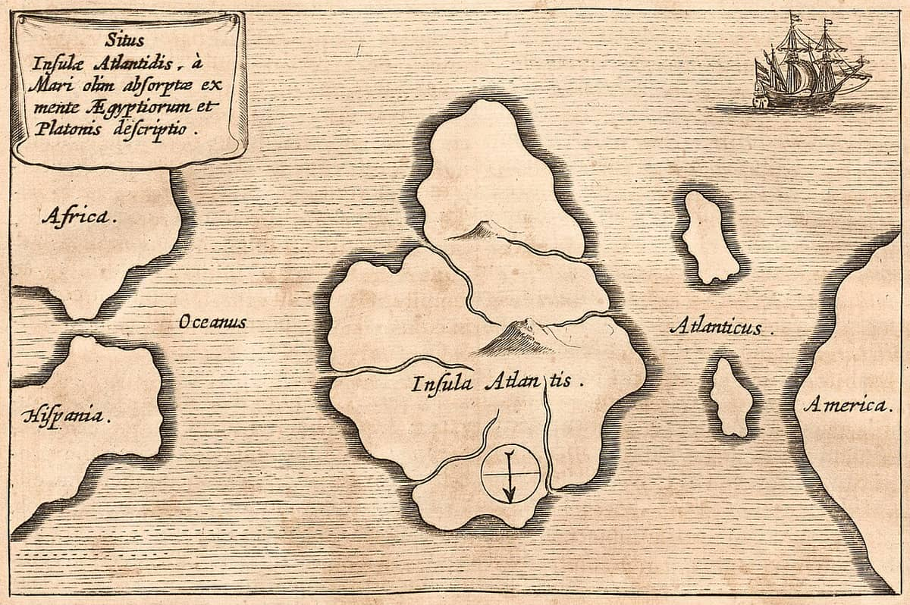
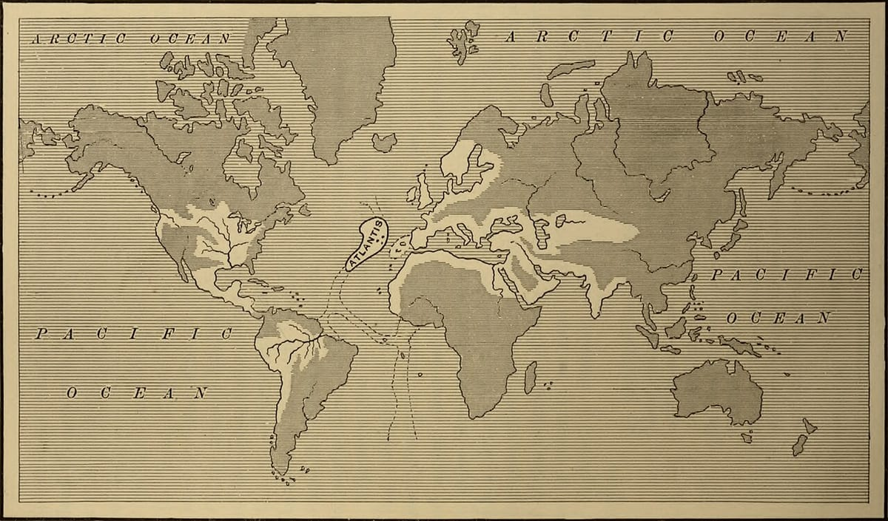
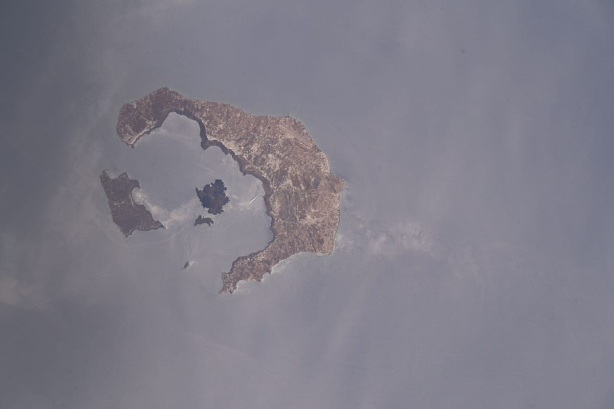
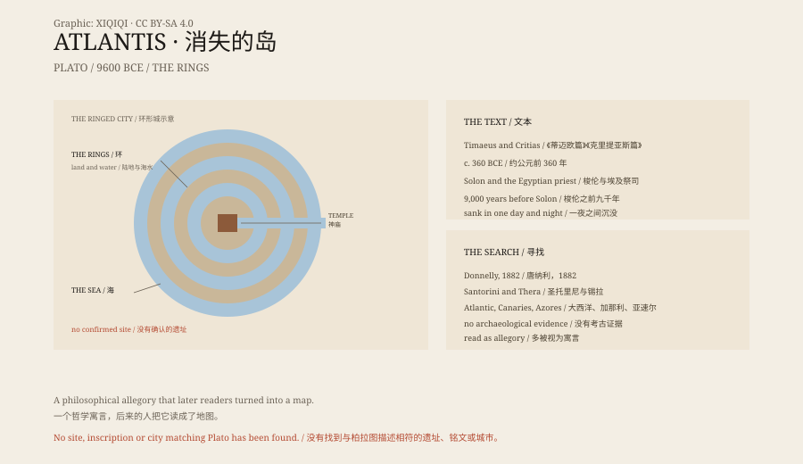

## 一、柏拉图

亚特兰蒂斯第一次出现，是在柏拉图的两篇对话里：《蒂迈欧篇》和《克里提亚斯篇》。

《蒂迈欧篇》写于公元前 360 年左右。开头，苏格拉底谈论理想城邦，问在座的人能不能讲一个故事，说明这种城邦在现实中如何运作。克里提亚斯说，他有一个从祖先那里听来的故事。

故事说，雅典政治家梭伦在公元前 590 到 580 年间访问埃及，从祭司那里听说了亚特兰蒂斯。梭伦把埃及的记录翻译过来，准备写成诗，但没有完成。克里提亚斯说，他家里保存着这个故事。

在赫拉克勒斯之柱以外，有一个巨大的岛，比小亚细亚和利比亚加起来还大。岛上有强大的王国。它的军队进攻雅典，被雅典人击退。后来，地震和洪水在一夜之间把岛吞了。

在柏拉图的描述里，岛是环形的：一圈陆地，一圈水，再一圈陆地。城里有神庙、船坞和运河，船从海里直接开进城市。岛的中心有一座供奉波塞冬的神庙，外墙包着金，内墙包着锡和铜。

*历史地图：阿塔纳修斯·基歇尔《地下世界》中的亚特兰蒂斯地图，1669 年。公有领域（Wikimedia Commons）。地图以南为上，把岛放在大西洋中部。*

## 二、时间

埃及祭司说，这件事发生在梭伦之前九千年。

梭伦生活在公元前 6 世纪。九千年，就是公元前 9600 年左右。

这个时间，比金字塔早得多，比农业出现还早。

这也让亚特兰蒂斯显得更远：它不是“古代”，而是史前。柏拉图用一个遥远的时间，把故事推到了人类记忆之外。

## 三、寓言

柏拉图为什么写这个？

《蒂迈欧篇》和《克里提亚斯篇》讨论的是理想城邦。亚特兰蒂斯是一个反面教材：富有、强大、傲慢，最后被神惩罚。

在《克里提亚斯篇》里，亚特兰蒂斯的国王原本是神的后代，后来神圣的血统被稀释，人性占了上风。他们开始贪财、扩张，宙斯决定惩罚他们。故事在这里中断——对话没有写完。

很多古典学家认为，亚特兰蒂斯是柏拉图编出来的寓言，不是历史。

一个常见的解释是：柏拉图用亚特兰蒂斯影射波斯帝国。亚特兰蒂斯是一个来自西方的海上帝国，波斯是一个来自东方的陆上帝国；雅典夹在中间。柏拉图让雅典击败亚特兰蒂斯，是为了证明他的理想城邦优于现实中的帝国。

另一个解释是：柏拉图写亚特兰蒂斯时，刚从西西里回来。叙拉古的城墙、港口和暴政，可能给了他灵感。

亚里士多德是柏拉图的学生，他认为老师编这个岛是为了教哲学。但古代也有人相信它是真的。柏拉图的再传弟子克兰托尔（Crantor）被引用来支持“历史说”；五世纪的新柏拉图主义者普罗克洛斯（Proclus）转述了他的说法，但原文里的代词指代不清，无法确定克兰托尔到底说了什么。

今天，古典学家大多同意：亚特兰蒂斯是虚构的。争论只在于，柏拉图借用了哪些现实素材。

*历史地图：伊格内修斯·多内利《亚特兰蒂斯：大洪水前的世界》中的亚特兰蒂斯帝国地图，1882 年。公有领域（Wikimedia Commons）。多内利把亚特兰蒂斯画成大西洋中的大陆，势力范围延伸到美洲和非洲。*

## 四、1882 年

但人们一直在找。

1882 年，美国作家、政治家伊格内修斯·多内利（Ignatius L. Donnelly）出版了《亚特兰蒂斯：大洪水前的世界》。他把亚特兰蒂斯说成一个真实的文明，是所有古代文明的源头。

多内利把《圣经》的创世故事、美洲的印第安传说、埃及和希腊的神话放在一起，认为它们都指向同一个失落的母国。他相信亚特兰蒂斯毁于《圣经》里的大洪水。

这本书卖得很好，多内利被称为“十九世纪亚特兰蒂斯复兴之父”。今天亚特兰蒂斯仍然流行，很大程度上要归功于他。

但他的方法不是历史学，而是比较神话：先假定有一个母国，再把所有相似的故事都算作证据。

后来的人走得更远。十九世纪的神智学者布拉瓦茨基夫人把亚特兰蒂斯写进《秘密教义》，说它是“第四根族”的家园。二十世纪的灵媒埃德加·凯西说，亚特兰蒂斯会在 1960 年代重新升起，还说埃及狮身人面像下面有一座“记录大厅”。

这些说法都没有实物证据。但它们让亚特兰蒂斯从柏拉图的寓言，变成了一个可以被人“寻找”的地方。

## 五、寻找

二十世纪，有人把亚特兰蒂斯放在大西洋、加那利群岛、亚速尔群岛、南极洲、加勒比海。

最流行的候选是圣托里尼。

公元前 1600 年左右，锡拉火山爆发，摧毁了米诺斯文明的阿克罗蒂里城。岛屿的一部分塌陷，形成现在的火山口。1967 年，考古学家在圣托里尼挖出了被火山灰埋住的阿克罗蒂里遗址。

这个故事和“一夜之间沉没”有点像：一个高度发达的文明，被火山摧毁。

但圣托里尼不是亚特兰蒂斯。柏拉图没有提过它，时间也对不上——柏拉图说的是梭伦之前九千年，圣托里尼的爆发是在梭伦之前一千多年。而且，阿克罗蒂里没有被“吞没”，它是被火山灰埋住的，遗址还在。

其他候选也各有问题。希腊的赫利克城（Helike）在公元前 373 年被地震和海啸摧毁，但它是古希腊的一座城，不是大西洋里的岛。公元前 415 到 413 年，雅典远征西西里失败，这可能给了柏拉图灵感，但那是战争，不是沉没。还有人把它和“海上民族”的入侵、特洛伊战争联系起来，同样缺少直接证据。

据不完全统计，被提出来的“亚特兰蒂斯位置”有几十个，从地中海到大西洋，从北极到南极。它们大多只满足柏拉图描述里的一两个条件：有水、有灾难、有某个年代。没有一个能同时满足全部条件。

板块构造学建立之后，“大西洋里有一块大陆在最近地质年代沉没”这个前提，基本被排除了。大西洋底下没有这样一块大陆。

*卫星照片：圣托里尼火山口，2022 年 6 月 24 日，国际空间站。NASA，公有领域（Wikimedia Commons）。公元前 1600 年左右的锡拉火山爆发形成了这个火山口，常被当作亚特兰蒂斯的候选。*

## 六、证据

考古学家没有找到亚特兰蒂斯。

没有明确的遗址，没有铭文，没有与柏拉图描述相符的城市。

地中海和大西洋的海底，有沉没的城市、火山和地震。比如埃及的赫拉克利翁、卡诺普斯，在尼罗河口的海底被发现；但它们沉没的时间、地点和原因，都与亚特兰蒂斯无关。

亚特兰蒂斯的唯一原始来源，是柏拉图的两篇对话。所有后来的说法，都建立在这两篇文本上。没有第二份古代文献，没有一块刻着岛名的石头，没有一座按环形布局建成的、年代对得上的城市。

## 七、为什么还在

亚特兰蒂斯是一个完美的失落文明：富有、先进、突然消失。

它给考古学留了一个空白，也给幻想留了一个位置。

它还可以被用来讲几乎任何话：环保主义者说，这是对自然的傲慢；政治家说，这是强大帝国的下场；神秘主义者说，这是史前文明的证据；小说家说，这是一个好故事。

二十世纪，亚特兰蒂斯被一些种族主义者拿去做“雅利安人故乡”的文章；今天，它更多出现在漫画、电影、游戏和旅游广告里。一个名字，变成了一个类型。

柏拉图写的是一个寓言。后来的人把它读成了地图。

## 八、岛

今天，亚特兰蒂斯仍然在书上、屏幕上和搜索引擎里。

有人继续找，有人继续写，有人继续相信。

柏拉图的故事里，岛在一夜之间消失。他没有留下坐标。他只留下一个提问：一个强大的城邦，为什么会毁灭？

两千年后，我们还在回答这个问题。只是我们把它变成了一个关于岛的问题。

*原创示意图：柏拉图的环形城描述、沉没叙事与主要候选地点。不是考古照片。稀奇奇编辑部，CC BY-SA 4.0。*

---

**来源与许可**：文字与原创示意图采用 CC BY-SA 4.0；第三方图片与资料的许可见文末来源台账。
