## 1. Sleep first

One September afternoon in the 1830s, a party of Americans pitched their tents beside a spring southwest of Baalbek. The spring is Rās al-ʿAyn; the locals called it Rosalyn. It was some fifty feet across, and its water split into two branches beside the camp. They had just crossed the Anti-Lebanon range, a day of dry ridges "deserted by the very insects."

The sensible next move was to walk straight to the ruins. Instead they ate, and then took a nap.

George Jones, the ship's chaplain, explained the decision in his book of 1836: after a long journey, to rush up to an interesting object "with eyes full of dust and faculties all jaded" is to do it an injustice. He is blunter about the symptoms — the red, peeling face, the tongue "as dry as if it belonged to a mummy," the guide crying "look, here is something truly wonderful" while you can only groan.

Rested, they walked two miles through the hot sun. The town sat beside the ruins, barely two hundred people in 1835, its hovels making the temples look taller. Jones counted the columns: nine still standing on one side, carrying a stretch of entablature.

He could not say who built the place. "These ruins of Balbec... stand here without a history and without a name." He raked the ancient authors, came up with contradictions, and admitted the gleanings were "sufficient only to tantalize, and not to satisfy our curiosity."

## 2. Three blocks in the podium

Most visitors today look up at the six columns. What keeps engineers awake is the podium underneath them.

In the second course of the podium's west wall lie three blocks side by side, each about nineteen metres long, 4.3 high and 3.6 wide, estimated at around 800 tonnes. They sit several metres above the ground, with narrow joints. Jones measured them in feet: 64, 64, 63.

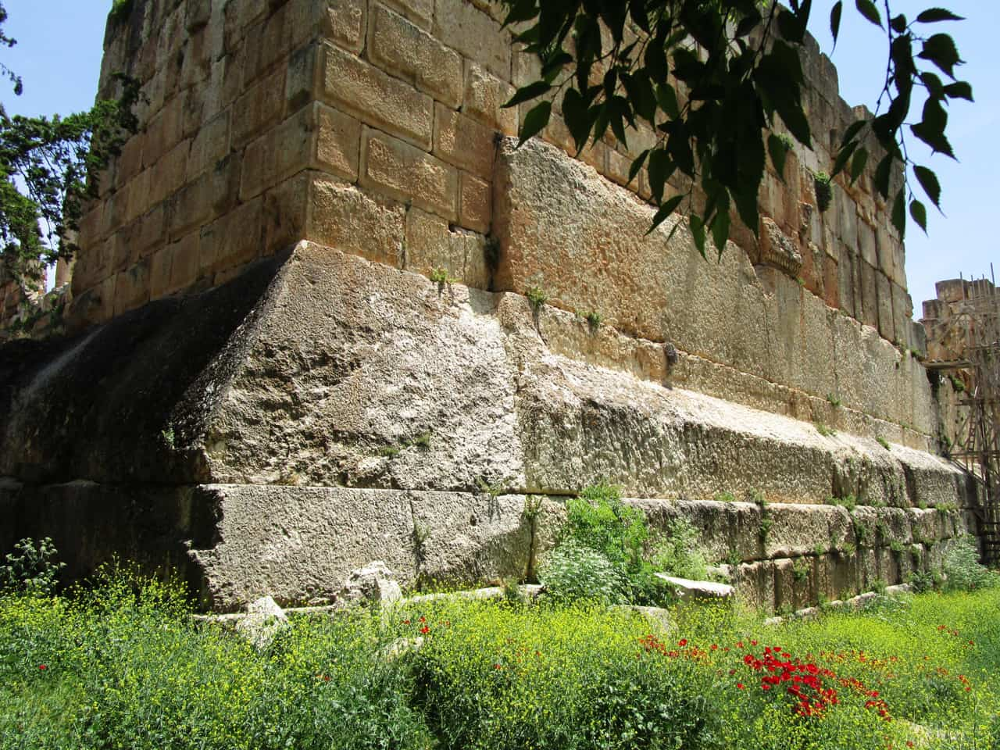

*Site photograph: 15 May 2019, Lodo27, CC BY-SA 3.0 (Wikimedia Commons). Weathered faces and joints of the trilithon.*

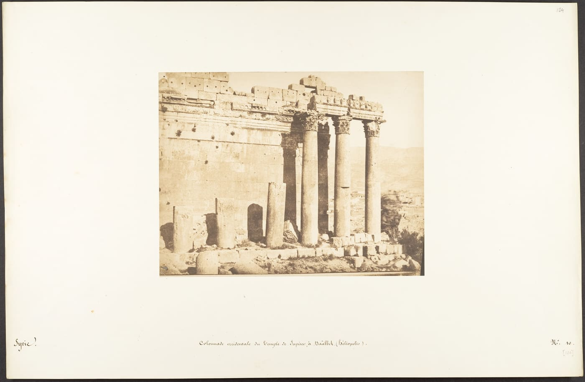

*Historical photograph: 15 September 1850, Maxime Du Camp, salted paper print. The Metropolitan Museum of Art, CC0.*

No cranes, no steel. Timber sledges, rollers, rope, levers, and men and oxen willing to pull. Once a block landed it barely moved again; the next course was laid straight on top of it, where it has stayed for well over a thousand years.

## 3. The quarry: cut channels, a pregnant stone, a card

The quarry lies about 800 metres from the town, slightly higher than the temple. Its rock face keeps a row of vertical cut channels — the negative shapes left where blocks were taken out, like a row of pulled teeth.

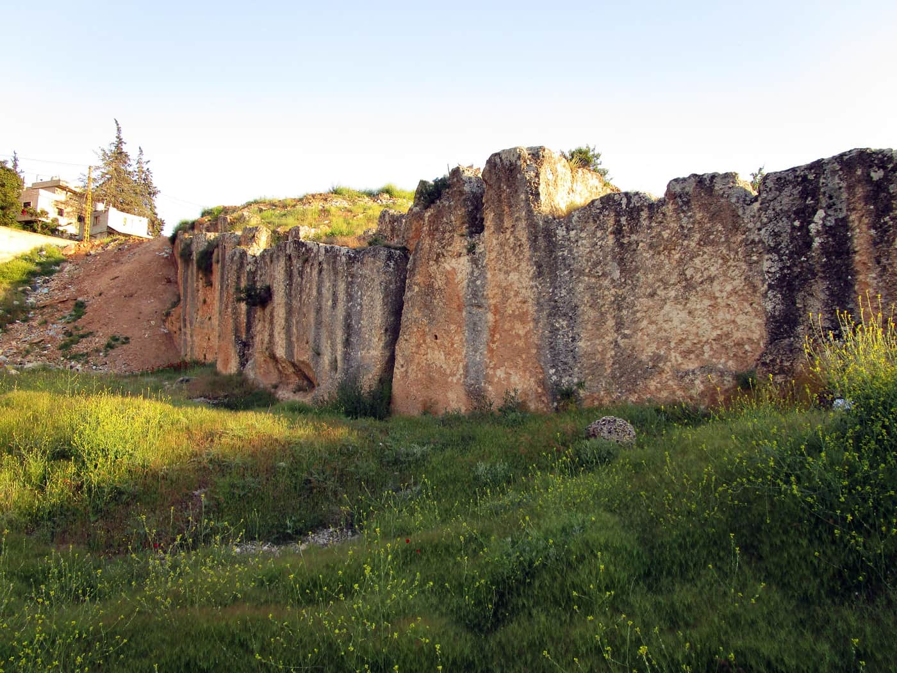

*Site photograph: 15 May 2019, Lodo27, CC BY-SA 3.0 (Wikimedia Commons). The cut channels of the quarry face.*

In the pit lies a block cut free of the bedrock but never moved: the Stone of the Pregnant Woman, about twenty metres long, still joined to the hill on one side, modern estimates near 1,000 tonnes. In a 2018 photograph two people in red stand at its right end, less than half its height; a Lebanese flag flies from its top, and today's town and a mosque minaret sit behind it.

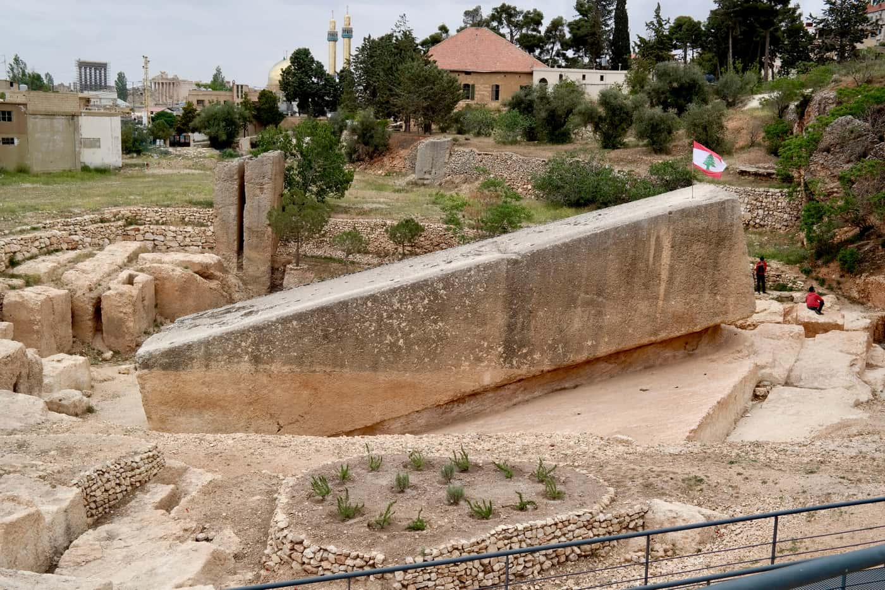

*Site photograph: 27 April 2018, Choinowski, CC BY-SA 4.0 (Wikimedia Commons). The pregnant stone and the two people at its end.*

By 1900 the stone had been printed on a stereograph card issued by Underwood & Underwood, its back carrying the title in six languages: "The mightiest Building Stone ever cut." In the card's image a person sits in front of the block, and on the horizon behind it stand the six columns — quarry and temple in a single glance.

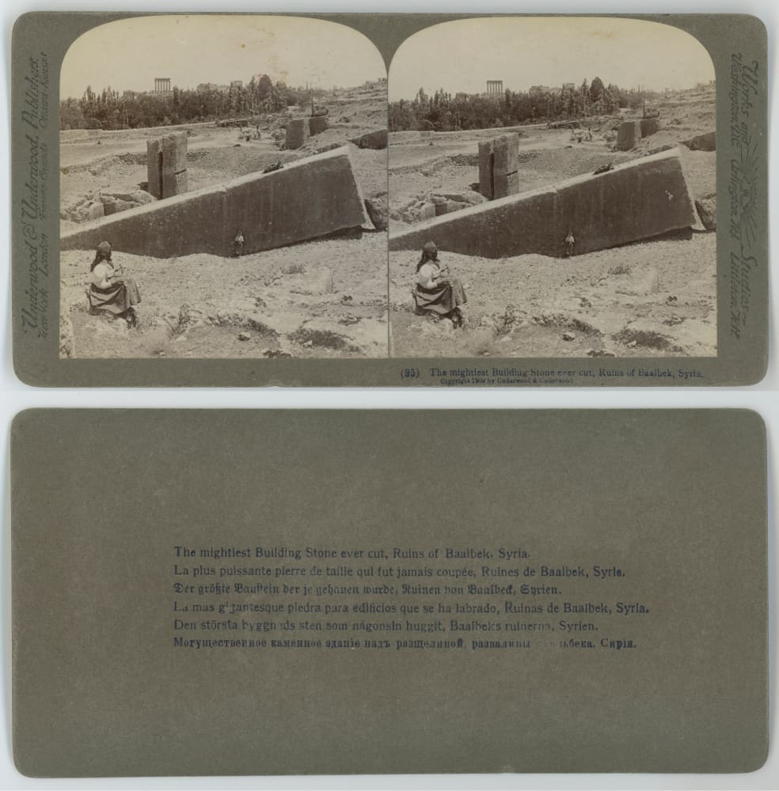

*Historical photograph: 1900 Underwood & Underwood stereograph card, SMU Central University Libraries, no known copyright restrictions (Wikimedia Commons).*

## 4. The fifth and the sixth

Jones measured the pregnant stone: seventy feet long, fourteen wide, fourteen feet five inches deep, and he estimated 1,135 tons. The same stone weighs a hundred tonnes more in an 1836 book than it does today. A weight like this is never a measurement; it is volume times density, and everyone has their own habit about the density.

A fifth block, around 1,200 tonnes, lies in the same quarry, also never moved. In 2014 a team from the German Archaeological Institute and the Lebanese University, led by Jeanine Abdul Massih, identified a sixth beneath and beside the pregnant stone: 19.6 × 6 × 5.5 metres, about 1,650 tonnes, never fully excavated.

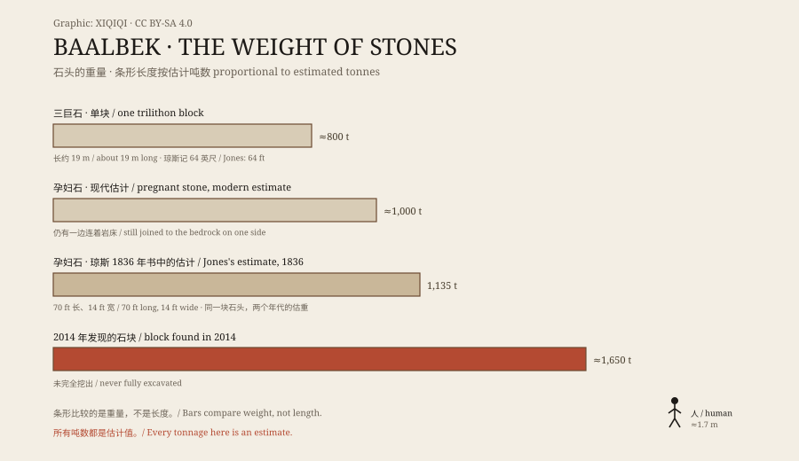

*Original graphic: estimated weights of one trilithon block, the pregnant stone (modern and Jones's 1836 figure), the fifth block and the sixth found in 2014. Oddity Archive, CC BY-SA 4.0.*

## 5. The part with no record

The quarry is higher than the temple, so moving the stones was downhill and needed no lift. The real lift happened at the podium: getting 800 tonnes onto the top of a wall several metres high.

No ancient text or image records the whole process. What remains is hypothesis: an earth ramp and rollers, fill a layer and drag a stretch; levers, lift a corner and pack in timber; a timber crane with capstan and pulleys, splitting the load across several ropes. Jean-Pierre Adam did the arithmetic in 1977: 512 workers with capstans and pulley blocks could move 557 tonnes. No single Roman crane could lift such a weight.

So the aliens, the giants, the lost civilisations keep their audience. They carry no archaeological evidence; they fill the blank labelled "we don't know."

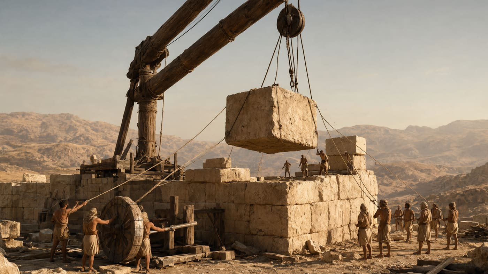

*Reconstruction: an imagined first-century CE lift, timber shear-legs, rope and capstan. Not a historical photograph and not an archaeological conclusion. Oddity Archive, CC BY-SA 4.0.*

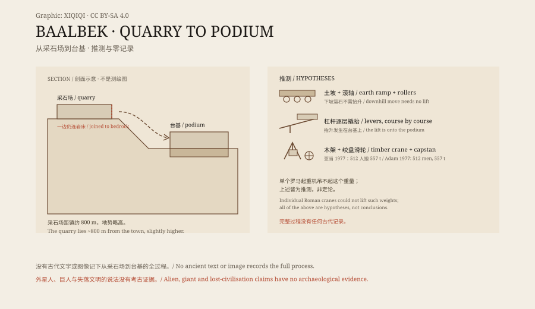

*Original schematic: the height difference, three hypotheses and Adam's 1977 estimate. Not a survey drawing. Oddity Archive, CC BY-SA 4.0.*

## 6. 1843: two mirrors

Less than ten years after Jones, the camera arrived. In 1843–44 Joseph-Philibert Girault de Prangey travelled the eastern Mediterranean with a daguerreotype outfit and left among the earliest images of the site: a horizontal plate in which the long podium wall fills the frame, its top carrying a broken entablature and a few columns; and one of the hexagonal court, where collapsed masonry piles into pale hills.

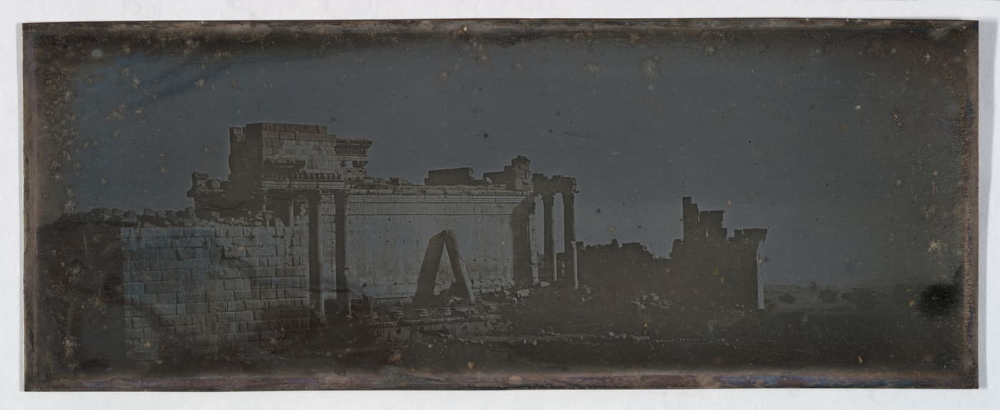

*Historical photograph: 1843–1844, Joseph-Philibert Girault de Prangey, daguerreotype. The Metropolitan Museum of Art, CC0.*

A daguerreotype is not paper but a silvered copper plate: the image floats on a mirror, legible only at an angle, and the tarnish at the edges looks like mould but is silver going black. To read these two pictures you have to imagine a man tilting a mirror to catch the light.

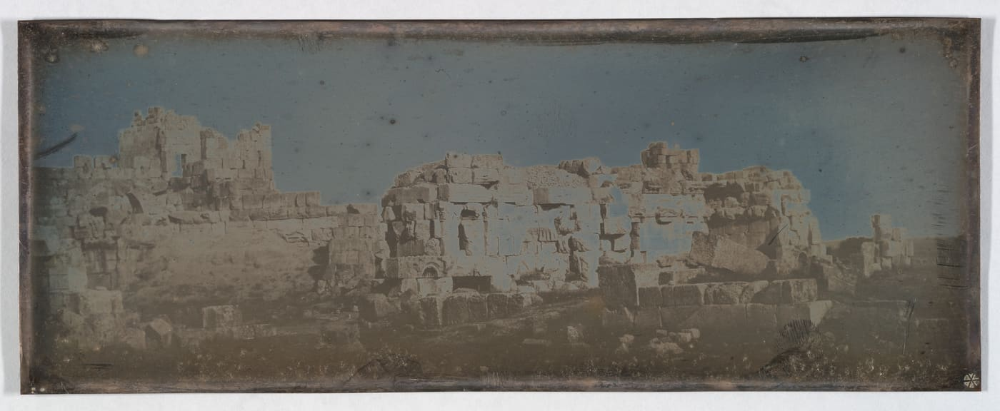

*Historical photograph: 1843, Joseph-Philibert Girault de Prangey, daguerreotype. The Metropolitan Museum of Art, CC0.*

## 7. 15 September 1850

On 15 September 1850 Maxime Du Camp exposed a series of salted paper prints, later mounted in an album: pen notes in the margins, "Syrie?" with its question mark on the left, "1850. 9." at the lower right.

One print faces the colonnade squarely: six columns carrying a complete entablature. The column ledger runs like this: twenty-seven still standing in 1554; nine recorded by Robert Wood in 1757; three more fell in the 1759 earthquakes, leaving six, which is what stands today. Jones's "nine" in the 1830s does not fit that sequence — he miscounted, or counted broken stubs; the book does not say.

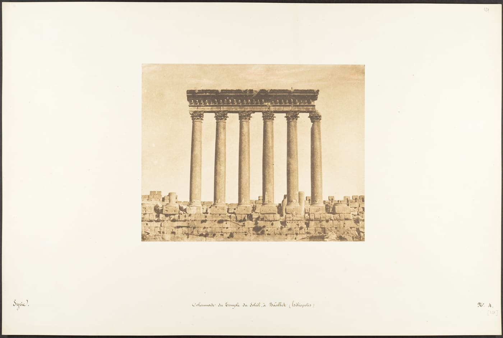

*Historical photograph: 15 September 1850, Maxime Du Camp, salted paper print on an album page with handwritten captions. The Metropolitan Museum of Art, CC0.*

In another, a fallen column leans against the podium wall as if someone had half propped it up. A third shows the curved outer wall: square blocks above arched niches, grass in the joints.

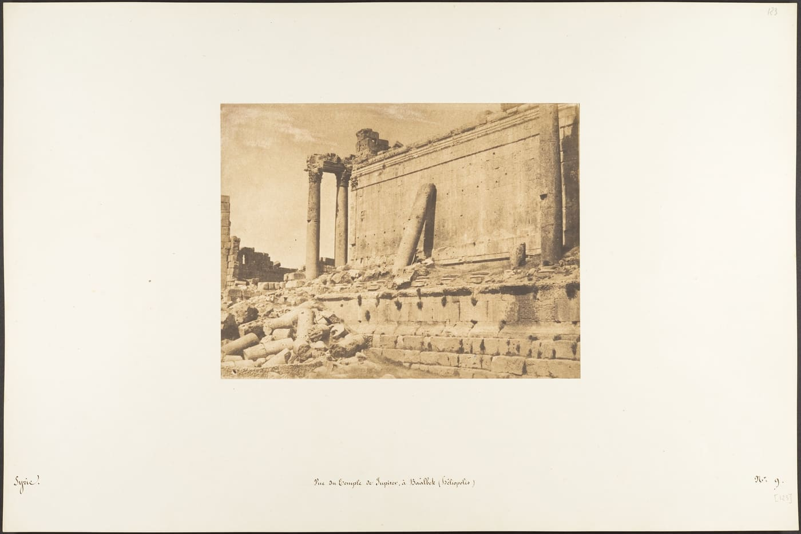

*Historical photograph: 15 September 1850, Maxime Du Camp, salted paper print. The Metropolitan Museum of Art, CC0.*

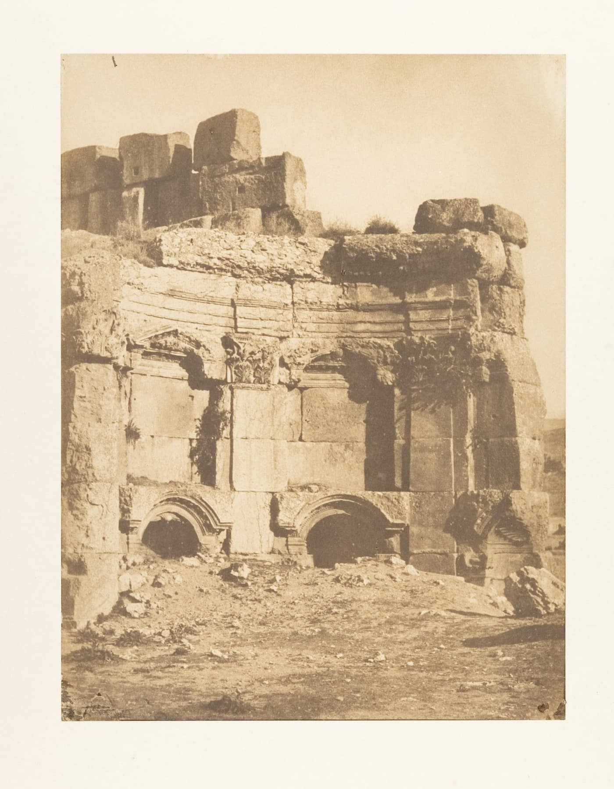

*Historical photograph: 15 September 1850, Maxime Du Camp, salted paper print. The Metropolitan Museum of Art, CC0.*

## 8. The almost intact temple next door

The Temple of Jupiter keeps six columns; the Temple of Bacchus beside it is almost whole: forty-two columns around its cella, entablature still in place, the best-preserved Roman temple of its size. It survived for an unglamorous reason — its own collapsed rubble buried and shielded it.

The 1759 earthquakes slid the keystone of its doorway two feet; in the 1860s someone built a rough masonry column to hold it up. The famous eagle carved on the ceiling inside sits behind that prop.

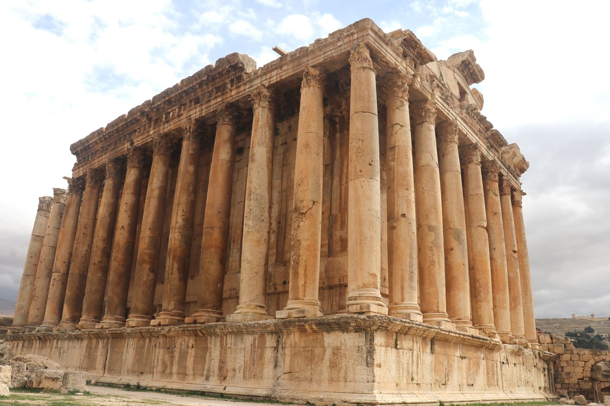

*Site photograph: 29 January 2023, Hiba Itani, CC BY-SA 4.0 (Wikimedia Commons). The colonnade of the Temple of Bacchus.*

## 9. A man at the column base

Around 1870 Félix Bonfils, who ran a photographic studio in Beirut, photographed the same colonnade. His albumen prints are darker and harder than Du Camp's. What matters is the man standing at the column base, in white, barely taller than one course of the podium. You need no tonnage to understand the scale of this place — the man is enough.

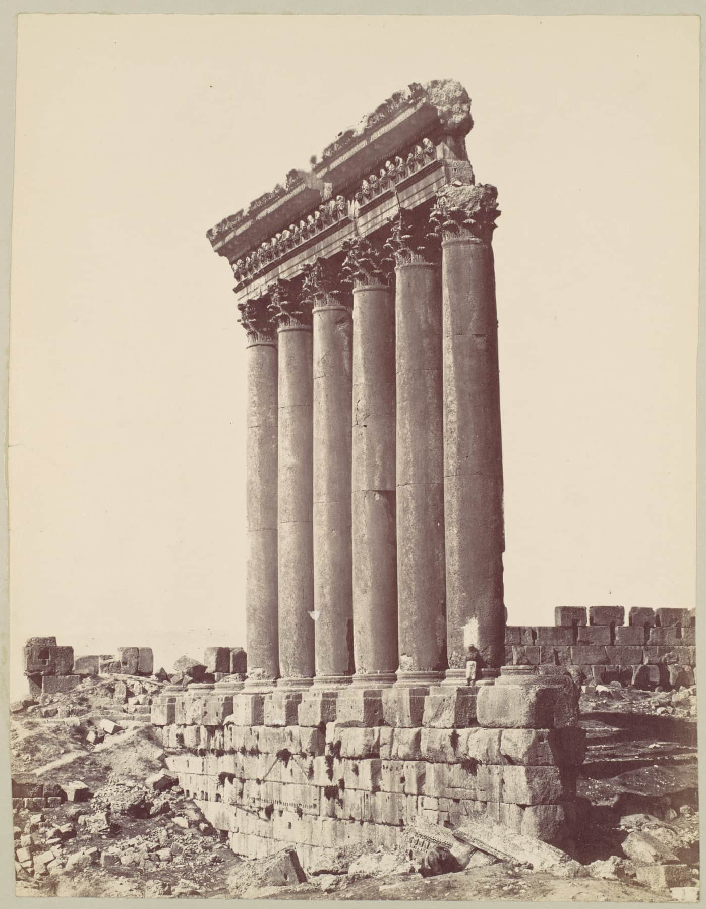

*Historical photograph: c. 1870, Félix Bonfils, albumen silver print. The Metropolitan Museum of Art, CC0.*

In 1906 John Singer Sargent painted the ruins in watercolour, honey and pale violet, the brushwork loose to the point of shorthand. The leaning column is still there at the wall — as in the 1850 photograph, propped, neither fallen nor righted.

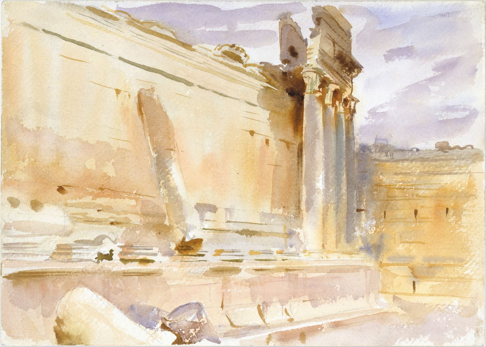

*Historical artwork: 1906, John Singer Sargent, watercolour and graphite; catalogued by the Met as "Temple of Bacchus, Baalbek." The Metropolitan Museum of Art, CC0.*

The stones are still lying there. The pregnant stone still joined to the hill, the 2014 block still half buried. The next person to raise a camera will likely get the same wall, the same leaning column, and one very small person beneath it.

---

**Sources and licenses**: factual sources are in the ledger S1–S18 below. Text and original graphics are CC BY-SA 4.0. Met images are CC0 / public domain; Commons images are credited per item in the ledger; the 1900 card is held by SMU with no known copyright restrictions. The reconstruction is not a historical photograph. All weights are estimates; the transport method is unsettled; alien and giant claims have no archaeological evidence. Jones quotations are from his 1836 book (public domain).