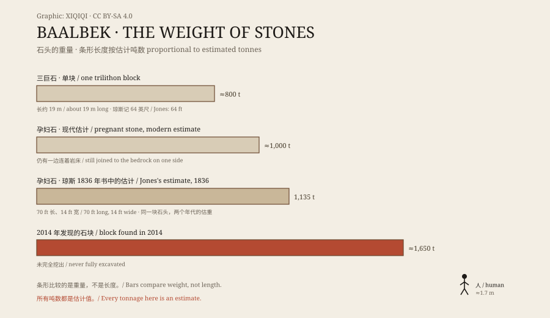

## 一、贝卡谷地

巴尔贝克在黎巴嫩东部的贝卡谷地，海拔约一千一百米。

这里有一条古老的商路，从叙利亚穿过山谷，通往地中海。罗马人把这座城叫作赫利奥波利斯，意思是“太阳之城”。

## 二、朱庇特神庙

公元前 1 世纪到公元 1 世纪，罗马人在巴尔贝克建起一座巨大的朱庇特神庙。

神庙建在一个高台上。高台用巨大的石块砌成，外面包着石材。今天，神庙的主体只剩六根柱子，立在高台上。柱子高约二十米。

## 三、三巨石

高台的基座里，有一组石头，叫“三巨石”。

三块石头并排躺着，每块长约十九米，高约四米，宽约三米半，重量估计在八百吨左右。它们被安放在离地面几米高的位置，接缝很窄。

这是古代世界最大的建筑石块之一。没有起重机，没有钢铁，只有绳索、木头、滚轴、杠杆和大量人力。

## 四、孕妇石

神庙附近的采石场里，还有一块没被运走的石头。

当地人叫它“孕妇石”。它长约二十米，估计重一千吨，仍然有一边连着岩床，斜躺在采石场里。它可能是被放弃了——太大，或者裂了。

2014 年，德国考古研究所在同一片采石场里，又发现了一块更大的石块，估计重一千六百五十吨。它一直没有被完全挖出来。

## 五、怎么搬

没有人知道罗马人具体怎么把这些石头搬上去。

常见的推测是：用木橇和滚轴，用大量牛和人拉；用土坡和沙堆，把石头一点点抬高；用杠杆把它撬到位。采石场离神庙不远，但地势略高，运输并不轻松。

也有实验考古学家做过缩小比例的尝试，证明几百吨的石头并非完全不能移动。但从采石场到台基的完整过程，没有文字记录，也没有图像记录。

于是，外星人、巨人、失落文明的说法一直存在。它们没有任何考古证据，只是填补了“不知道怎么搬”这块空白。

## 六、神庙群

巴尔贝克不只有朱庇特神庙。

旁边是巴克斯神庙，长约六十九米，保存得相当完整，被认为是罗马帝国同规模神庙中保存最好的一座。再往南，是一座小的维纳斯神庙，圆形，带柱廊。

这三座神庙建于不同时期，前后延续了几百年。它们建在一个更早的土丘上，下面还有更早的层位。

## 七、现在

1984 年，巴尔贝克被列入世界遗产。

地震、战争和风化带走了大部分建筑。剩下的柱子、台基和石块还在。游客站在下面，抬头看那三块石头，最容易问的一句话还是：他们到底怎么搬上去的？

*原创示意图：神庙台基、三巨石与采石场石块的位置关系与尺寸对比。不是测绘图。稀奇奇编辑部，CC BY-SA 4.0。*

---

**来源与许可**：本文的事实来源见条目底部来源台账 S1–S3。文字与原创示意图采用 CC BY-SA 4.0。文中把神庙群、三巨石、采石场石块与运输推测分开叙述；石块重量为估计值，罗马人的具体运输方法没有定论，外星人与巨人说法没有考古证据。插图是场景复原，不是现场照片。
