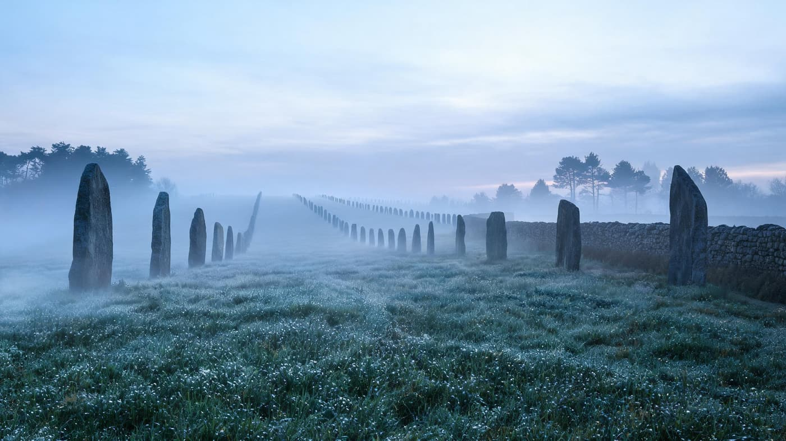
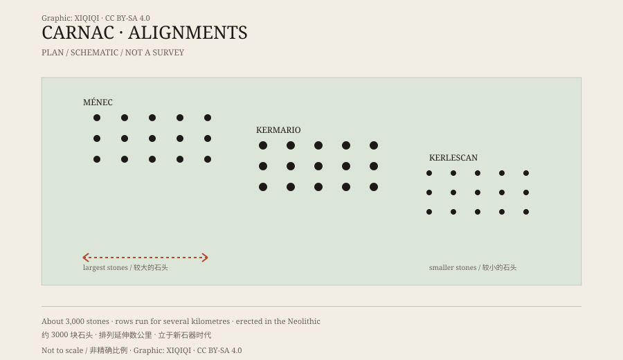

## 1. The stones of Brittany

Carnac is a small town on the south coast of Brittany, close to the Atlantic. It rains often, the wind is strong, and the fields are divided by low stone walls and scrub.

Around the town stand thousands of stones.

They are not natural boulders. Most are upright oblong blocks — menhirs, from the Breton words for “long stone.” They are set in rows, roughly evenly spaced, following the lie of the land.

## 2. The rows

Carnac's stones are not one site but several.

The best known are the alignments of Ménec, Kermario, Kerlescan, and Petit-Ménec. They stand close to one another, and together they contain more than three thousand stones in over a dozen rows, running for several kilometres.

The stones vary in size. Some are half a metre tall, some are taller than a person, and the largest exceed four metres. Within a group, the stones often grow or shrink from one end to the other, as if the line were designed.

On a misty morning, the rows look most like a road. The first stones begin at your feet and step up the slope, smaller and smaller, until they dissolve into the fog. Lichen patches the granite grey and white, and the stone is cold to the touch. The grass is wet; your shoes are soaked within minutes. There is no other sound but wind passing between the stones.

*Reconstruction: the Carnac alignments in morning mist. Not a photograph of the site. Oddity Archive, CC BY-SA 4.0.*

*Original schematic: several groups of stones at Carnac and the way their sizes change along the rows. Not a precise survey. Oddity Archive, CC BY-SA 4.0.*

## 3. Dating

The stones were erected in the Neolithic.

Radiocarbon dates and the stratigraphy of nearby monuments place the main construction between the fifth and fourth millennia BCE, roughly 4500 to 3300 BCE.

That is far earlier than the Egyptian pyramids, and earlier than Stonehenge. The builders had no writing. What they left behind is stone, earthworks, tombs, and a small number of objects.

## 4. Purpose

No one can say for certain why the stones were raised.

One idea is procession. The long rows look like a route, a path along which people walked from one place to another as part of a ritual.

Another idea involves astronomy. The rows may correspond to the sun, the moon, or particular seasons, but the Carnac alignments are too long and complex to be explained by a single celestial alignment.

Others suggest the rows marked territory, or were connected to ancestor worship and burial. Moving stones of that size required a great deal of labour, which tells us the task mattered to the people who did it.

## 5. Legends

Later stories offered simpler answers.

A Breton legend says that Saint Cornely turned a troop of Roman soldiers to stone. The rows became “the petrified army.”

Another version credits Merlin's magic. The stories are vivid, but they date from after the arrival of Christianity, thousands of years after the stones were raised.

## 6. Now

The Carnac alignments are among France's most important prehistoric sites and one of Brittany's best-known landscapes.

The stones are fenced and protected; visitors cannot wander freely through the fields, and parts of the site are open in high season only with guides. Erosion and tourism pressure remain management concerns.

The rows are still there, one after another. They do not need a legend to stand: several thousand years ago, a group of people raised several thousand stones here, and then left.

---

**Sources and licenses**: the factual sources are listed in the source ledger S1–S3 at the bottom of this entry. Text and original diagrams are licensed under CC BY-SA 4.0. This article separates the stones themselves, the dating, and the hypotheses about their purpose; the stories of Saint Cornely and Merlin are later legends, not archaeological conclusions.
