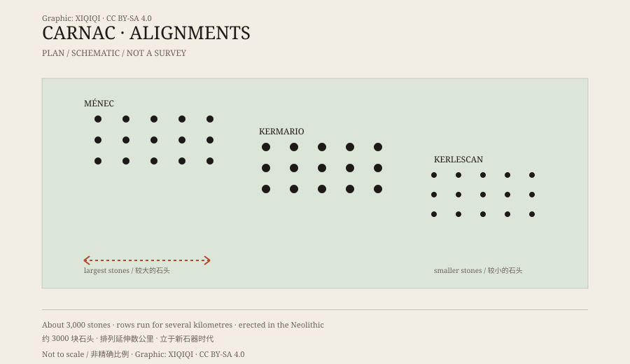

## 一、布列塔尼的石头

卡纳克是布列塔尼南岸的一个小镇，靠近大西洋。这里雨水多，风大，田野被低矮的石墙和灌木分开。

镇子周围，立着几千块石头。

它们不是天然散落的岩块。绝大多数是竖立的长条形巨石，也就是“menhir”，布列塔尼语里的“长石”。它们被排成一行行，间距大致均匀，沿着地势延伸。

## 二、排列

卡纳克的石阵不是一处，而是好几组。

最著名的是梅内克、凯尔马里奥、凯尔莱斯康和佩蒂梅内克几组。它们彼此相隔不远，合起来有三千多块石头，排成十几行，长度加起来有几公里。

石头的尺寸不一样。有的只有半米高，有的一人多高，最大的超过四米。在同一组里，石头往往从一端到另一端逐渐变大或变小，像一条有意设计的线。

*原创示意图：卡纳克石阵的几组排列与石头尺寸变化。不是精确测绘图。稀奇奇编辑部，CC BY-SA 4.0。*

## 三、年代

这些石头立在新石器时代。

研究者用放射性碳定年和周边遗迹的层位关系，把主要建造时间定在公元前第五千纪到第四千纪之间，也就是大约公元前 4500 到 3300 年。

这个时间比埃及金字塔早得多，比巨石阵也早。当时的人还没有文字，留下的是石头、土台、墓葬和少量器物。

## 四、用途

石头为什么立在这里，没有人能给出确定答案。

一种说法是游行路线。长排的石头像一条通道，人们沿着它行走，从一个地点走到另一个地点，完成某种仪式。

另一种说法和天文有关。石头的排列可能对应太阳、月亮或特定季节的位置，但卡纳克的石阵太长、太复杂，很难用单一的天文对准来解释。

还有人认为，石阵是领地的标志，或者与祖先崇拜、埋葬仪式有关。石头的重量和搬运本身就需要大量人力，说明这件事对当时的人很重要。

## 五、传说

后来的传说给出了更简单的答案。

布列塔尼流传着一个故事：圣科内利把一队罗马士兵变成了石头。于是，这些石阵就被说成是“被石化的军队”。

另一个版本说，是梅林施了魔法。故事很生动，但它出现在基督教传入之后，和石头的实际年代隔了几千年。

## 六、现在

卡纳克石阵是法国最重要的史前遗址之一，也是布列塔尼最著名的景观。

石头被围栏保护起来，游客不能随意进入田野；一部分区域在旺季开放，由导览员带着参观。风化和旅游压力，一直是管理方要面对的问题。

石阵还在那里，一排接一排。它们不需要传说也能成立：几千年前，一群人把几千块石头立在这里，然后离开了。

---

**来源与许可**：本文的事实来源见条目底部来源台账 S1–S3。文字与原创示意图采用 CC BY-SA 4.0。文中把石阵的实物、年代测定和用途假说分开叙述；圣科内利与梅林的传说属于后世故事，不是考古结论。
