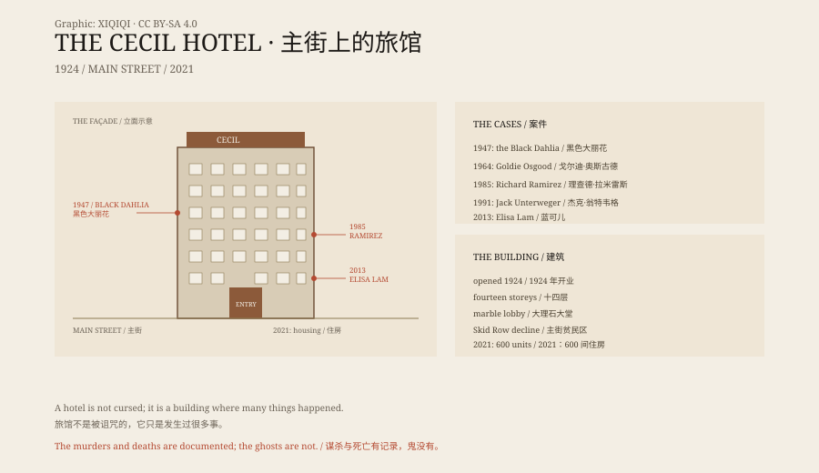

## 1. 1924

December 1924, Main Street, downtown Los Angeles. The Cecil Hotel opened.

Fourteen storeys, a marble lobby, stained glass, a roof garden. It served businessmen, travellers and people arriving to try their luck in Hollywood.

The architect was Loy Lester Smith. The building cost about 1.5 million dollars.

## 2. Decline

In the 1930s the Depression hit. The blocks around Main Street became Skid Row. The Cecil turned from a business hotel into a cheap residence.

Long-term tenants, short-term renters, drinkers, the sick, people just off the train. Rent was paid by the week.

## 3. The Black Dahlia

On 9 January 1947 Elizabeth Short — later known as the Black Dahlia — was seen near the Cecil Hotel on Main Street. Some accounts say she went into the hotel bar and drank with a man.

On 15 January her body was found on a vacant lot in south Los Angeles.

The case was never solved. The Cecil's name became tied to the murder.

## 4. Other Names

In 1964 a retired telephone operator named Goldie Osgood was killed in her room at the hotel. She was known for feeding pigeons. That case was never solved either.

In 1985 Richard Ramirez — the "Night Stalker" — stayed at the Cecil while he was killing across Los Angeles. He reportedly stayed on the fourteenth floor and returned to the hotel after his crimes, dumping bloodstained clothes in an alley.

In 1991 the Austrian journalist and murderer Jack Unterweger stayed at the Cecil. He was in Los Angeles researching a story while committing murders. He was later convicted of killing nine women.

## 5. Elisa Lam

On 26 January 2013 Elisa Lam, a 21-year-old Canadian student, checked into the Cecil — then called Stay on Main. On 31 January she disappeared.

On 19 February guests complained of low water pressure and strange-tasting water. Maintenance workers found her body in a rooftop water tank.

In elevator surveillance footage she pressed several floors, stepped in and out, and gestured at the air. The video went online and became a "ghost video".

Los Angeles police ruled the death an accidental drowning and found no sign of homicide. Her history of bipolar disorder was later made public.

The behaviour in the footage can be explained by a psychiatric episode. The tank hatch was open. How she reached the roof and entered the tank is still debated.

## 6. 2021

In 2011 the hotel was renamed Stay on Main. Renovation began in 2017 and stopped during the pandemic in 2020.

On 13 December 2021 the Cecil reopened, not as a hotel but as the Cecil Apartments: about 600 single rooms for formerly homeless residents.

In 2023 the Los Angeles Times reported black mould, vermin and disrepair inside. It is still a building in need of repair.

## 7. The Story

The Cecil's reputation is a stack of layers: real murders, real deaths, real poverty, and ghost stories from the internet age.

It is not a "cursed building". It is a cheap hotel that has stood downtown for a century, housing both the richest and the poorest people in the city, and witnessing several unsolved cases.

The Black Dahlia, the Night Stalker and Elisa Lam are all genuinely connected to it. The ghosts are not.

*Original schematic: the 1924–2021 timeline, the Main Street location and the associated cases. Not a photograph of the site. Oddity Archive, CC BY-SA 4.0.*

---

**Sources and licenses**: the factual sources are listed in the source ledger S1–S3 at the bottom of this entry. Text and original diagrams are licensed under CC BY-SA 4.0. This article separates the building and its management, the documented cases, the Elisa Lam death and the ghost stories; the hotel and the cases are documented, while the paranormal claims have no verifiable evidence. The illustration is a scene reconstruction, not a photograph of the site.
