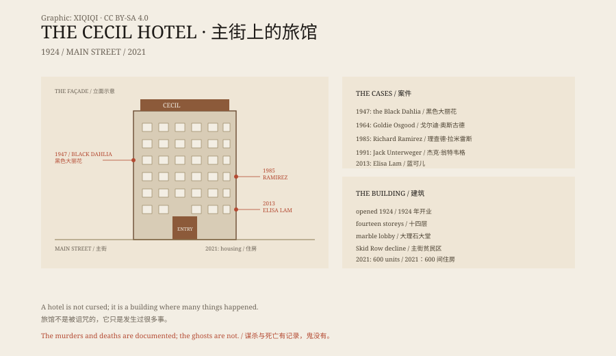

## 一、1924 年

1924 年 12 月，洛杉矶市中心主街。塞西尔酒店开门。

十四层，大理石大堂，彩绘玻璃，屋顶有花园。它接待商人、旅行者和来好莱坞碰运气的人。

建筑师是洛伊·莱斯特·史密斯，造价约一百五十万美元。

## 二、下坡

1930 年代，大萧条。主街附近变成了贫民区。塞西尔从商务酒店变成廉价旅馆。

长期住户、短期租客、酒鬼、病人、刚下火车的人。房租按周付。

## 三、黑色大丽花

1947 年 1 月 9 日，伊丽莎白·肖特——后来被称为“黑色大丽花”——被人看到在主街的塞西尔酒店附近。有人说她进了酒店的酒吧，和一个男人喝了酒。

1 月 15 日，她的尸体在洛杉矶南部的空地上被发现。

案子没有破。塞西尔的名字，从此和这起谋杀绑在一起。

## 四、别的名字

1964 年，一个叫戈尔迪·奥斯古德的退休电话接线员在酒店房间里被杀。她以喂鸽子出名，案子也没破。

1985 年，理查德·拉米雷斯——媒体叫他“夜行者”——在洛杉矶杀人期间住在塞西尔。据报他住在十四楼，作案后回到旅馆，把血衣扔进巷子。

1991 年，奥地利记者兼杀人犯杰克·翁特韦格住在塞西尔。他在洛杉矶采访，同时作案。后来他被判谋杀九名女性。

## 五、蓝可儿

2013 年 1 月 26 日，21 岁的加拿大大学生蓝可儿住进塞西尔——当时叫“Stay on Main”。1 月 31 日，她失踪。

2 月 19 日，酒店客人抱怨水压太低、水有异味。维修人员在屋顶的水箱里发现了她的遗体。

电梯监控录像里，她按了多个楼层，进进出出，对着空气做手势。录像被传到网上，成了“灵异视频”。

洛杉矶警方认定是意外溺亡，未发现他杀迹象。她的躁郁症病史后来被公开。

录像里的行为，可以用精神疾病发作解释。水箱的盖子是开着的。她怎么爬上屋顶、怎么进入水箱，仍然有人争论。

## 六、2021 年

2011 年，酒店改名“Stay on Main”。2017 年开始翻修，2020 年因疫情停工。

2021 年 12 月 13 日，塞西尔重新开放，不再是酒店，而是“塞西尔公寓”——约 600 间单人房，给无家可归者住。

2023 年，《洛杉矶时报》报道了大楼里的黑霉、虫害和失修。它仍然是一栋需要修理的房子。

## 七、故事

塞西尔的名声，是几层东西叠起来的：真实的谋杀、真实的死亡、真实的贫困，加上网络时代的鬼故事。

它不是“被诅咒的建筑”。它是一栋在市中心站了一百年的廉价旅馆，接待过这座城市最有钱和最没钱的人，也见证了几起没有破的案子。

黑色大丽花、夜行者、蓝可儿，都真的和它有关。鬼，没有证据。

*原创示意图：塞西尔酒店 1924–2021 年的时间线、主街位置与相关事件。不是现场照片。稀奇奇编辑部，CC BY-SA 4.0。*

## 时间线

- **1924 年 12 月**：1924 年 12 月，洛杉矶市中心主街
- **1930 年**：1930 年代，大萧条
- **1947 年 1 月 9 日**：1947 年 1 月 9 日，伊丽莎白·肖特——后来被称为“黑色大丽花”——被人看到在主街的塞西尔酒店附近
- **1964 年**：1964 年，一个叫戈尔迪·奥斯古德的退休电话接线员在酒店房间里被杀
- **1985 年**：1985 年，理查德·拉米雷斯——媒体叫他“夜行者”——在洛杉矶杀人期间住在塞西尔
- **1991 年**：1991 年，奥地利记者兼杀人犯杰克·翁特韦格住在塞西尔
- **2013 年 1 月 26 日**：2013 年 1 月 26 日，21 岁的加拿大大学生蓝可儿住进塞西尔——当时叫“Stay on Main”
- **2011 年**：2011 年，酒店改名“Stay on Main”

## 来源与证据

本条目的事实底座以 1 条独立来源为主。S2（Los Angeles Times）覆盖旅馆现状、2023 年居住条件报道与市政府改造背景。
原创插图只提供场景复原、结构示意或地图，不作为历史照片使用。正文把可核对记录、后来解释与传说分开叙述；同一件事在不同来源中的版本差异，保留在行文中，不强行合并。

## 档案空白

建筑年代、营造顺序与后续改动，需要考古报告和保护档案互证；单一的旅游说明或平面图，不足以定案。
这条档案把记录与未答的问题并排放置，不替读者做出超出证据的结论。
就可信度而言，本条目标为“verified”。这个标签描述的是当前证据状态，不是对传说真伪的终审；新档案出现时，标签应随之调整。

## 档案补记

以下补记保留正文没有展开的档案侧面：来源、技术细节与后续影响。
**2021 年**。 2021 年，酒店关闭，后来被改造成公寓。

它不再接待旅客，也不再是“鬼屋”景点。新业主计划把房间改成住宅，保留部分历史元素。

一个酒店，变成了住宅。住进去的人，可能知道它的故事，也可能不知道。
**周边**。 塞西尔酒店在洛杉矶的旧城边缘。

附近有车站、商店、教堂和公寓。白天，街上有人走路；夜里，有些人没有地方住。

酒店的价格低，住客复杂。它不是一个“恐怖的城堡”，而是一个城市的底层空间。
**建筑**。 塞西尔酒店，在洛杉矶市中心。

它建于 1924 年，有十几层，外观普通，内部有电梯、走廊和客房。它曾经是商务旅客的住处，后来变成廉价旅馆。

酒店的位置，靠近旧城、车站和夜生活区。人来人往，身份复杂。这种环境，为后来的故事提供了背景。
**故事**。 塞西尔酒店的故事，是城市的故事。

它不在郊区，不在荒野，而在市中心。它的鬼，不是古堡里的幽灵，而是都市里的死亡、贫困和孤独。

人们喜欢把它写成“美国最闹鬼的酒店”。这个标签，盖住了更复杂的东西：无家可归者、精神疾病、犯罪和城市更新。

---

**来源与许可**：本文的事实来源见条目底部来源台账 S1–S3。文字与原创示意图采用 CC BY-SA 4.0。文中把建筑与经营史、真实案件、蓝可儿事件和鬼故事分开叙述；酒店与案件有档案依据，灵异说法没有可验证的证据。插图是场景复原，不是现场照片。
