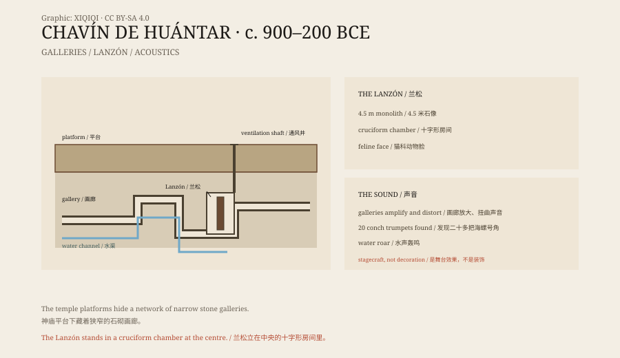

## 1. The valley

Chavín de Huántar is in the Áncash region of Peru, at about 3,180 metres above sea level.

It lies between two rivers, with snow-covered mountains behind. Around 900 BCE, large stone buildings began to appear here; by about 500 BCE it was a major ceremonial centre.

People came from far away on pilgrimage. They brought pottery, shells, gold, and stone objects, and they brought new images and ideas. Chavín's art style later influenced much of the Andes.

## 2. Old Temple and New Temple

The temple was built in stages.

The earliest is the “Old Temple”, a U-shaped platform with a sunken courtyard. Later, people built the “New Temple” beside it, larger, with black stone columns and white carvings on its facade.

The walls carry heads, eagles, felines, and snakes. The most famous image is a figure with a feline face holding a staff in each hand. It is now called the “Staff God”.

## 3. Underground

The strangest part of the temple is below ground.

Beneath the platforms is a network of stone galleries, narrow, low, and winding. A person has to duck, and in some places turn sideways to pass. The galleries have no windows; ventilation shafts bring in air, and drains carry rainwater away.

Deep inside is a cruciform chamber. In it stands a stone monolith called the Lanzón.

The Lanzón is about four and a half metres high and carved with a feline-faced deity. Its head nearly touches the ceiling, and its eyes face the entrance. Pilgrims had to walk through the narrow passages to see it.

*Original schematic: the temple platforms, the underground galleries, the position of the Lanzón, and the ventilation, drainage, and acoustic structures. Not a survey drawing. Oddity Archive, CC BY-SA 4.0.*

## 4. Sound

The underground spaces of Chavín were not just passages.

Archaeologists have tested the acoustics of the galleries. They found that their shape amplifies and distorts sound, so that a person cannot tell where it comes from. Water flowing in the stone channels produces a low roar; a voice returns from unexpected directions.

In 2001, the team found more than twenty conch-shell trumpets at the site. The instrument, called a pututu, produces a deep sound that carries a long way. Some researchers suggest that priests blew the trumpets in the galleries, and the sound travelled up the ventilation shafts into the plaza, making people outside believe a god was speaking underground.

This was not decoration. It was stagecraft.

## 5. Images

Chavín's stone carvings carry a complex set of symbols.

Besides the Lanzón, there are the Raimondi Stele and the Tello Obelisk. The stele shows the Staff God; the obelisk shows crocodiles, birds, and plants. These images were not random: they linked gods, animals, water, and agriculture.

The people of Chavín had no writing. Their history was transmitted through images, architecture, and ritual.

## 6. Now

In 1985, Chavín de Huántar became a World Heritage Site.

The 1970 earthquake damaged parts of the buildings, and later restoration used modern materials, which caused controversy. Today visitors can enter some of the galleries, but many areas are closed to protect the structure and the carvings.

A temple three thousand years old used darkness, narrow passages, and sound to make people believe that a god was just behind the wall.

## Valley

Chavín de Huantar, in a valley in the Peruvian Andes.

The site is more than 3,000 meters above sea level and is surrounded by mountains and river valleys. It was built around 900 BC and was the center of Chavin culture.

## Old Temple and New Temple

The site has two main buildings: the old temple and the new temple.

The old temple was U-shaped with courtyards, corridors and underground rooms. The new temple is larger, with plazas, stairs and stone carvings. Between the two buildings, there are passages and platforms.

## Underground

There is a narrow passage underground in the old temple.

There are steps, vents and stonework in the passage. At the end is a room with a stone pillar called "Lanzón". Carved on the pillar is a hybrid of feline and humanoid forms, with tusks and snakes.

## The Sound
The design of the channel may be related to sound.

When you speak in a channel, your sound will be amplified and reflected. Researchers believe that priests may have made sounds in the passages so that believers could hear "the voice of God."

## The Image
Chavín’s stone sculptures include jaguars, eagles, snakes and people.

These animals were not chosen randomly. They represent power, sky, underground and transformation. The religion of Chavín may involve shamans, visions, and sacrifices.

## Now

Chavin is a UNESCO World Heritage Site.

The ruins have been restored and strengthened, and some areas are open to tourists. Stone sculptures, pottery and goldware are on display in the museum.

A temple in a valley predates the Inca Empire by more than two thousand years. It proves that Andean civilization did not appear suddenly, but has long roots.

## Religion

Chavin's religion may involve hallucinations.

The cats, snakes and eagles on the stone carvings are related to Amazon shamanism. The priest may use plants, sounds, and darkness to induce a psychedelic state.

## Architecture

The U-shaped layout of the old temple resembles a ritual theater.

Courtyards, corridors and underground rooms guide people from outside to inside, from light to dark. Architecture is not a background, it is part of the ceremony.

## Travel

Chavín is a tourist spot in Peru.

Visitors can see ruins, museums and stone carvings. Some areas are high in altitude and require adaptation.

Chavín is a tourist spot in Peru.

Visitors can see ruins, museums and stone carvings. The altitude is high and requires adaptation.

A temple in a valley predates the Inca Empire by more than two thousand years.

Lan Song is still in the dark. It doesn't speak, but everyone who walks into the passage will hear their own footsteps.

## Research

Chavin’s research continues.

Archaeologists are looking for residential areas, farmland and artisan workshops. They wanted to know who built the temple and who supported it.

## Andes

Chavín in the Andes.

The altitude is high, the air is thin, and the mountain wind is cold. The site is surrounded by terraced fields, river valleys and snow-capped mountains.

## Temple

The temple of Chavín is a religious center.

People came from the surrounding valleys to participate in ceremonies, make sacrifices, and listen to the priests.

## Lansong

Lansong is a stone pillar.

It is engraved with a mixture of feline and human forms, with tusks, snakes and eagles. It is Chavin's most important image.

## Acoustics

Temple passages, probably used to amplify sounds.

The priest spoke in the passage, and his voice carried into the square. What believers hear is not the voice of man, but the voice of God.

---

**Sources and licenses**: the factual sources are listed in the source ledger S1–S3 at the bottom of this entry. Text and original diagrams are licensed under CC BY-SA 4.0. This article separates the building phases, the underground structures, the acoustic experiments, the images, and the conservation; the purpose of the acoustics is still debated, and the “priests creating an oracle” reading is one interpretation.
