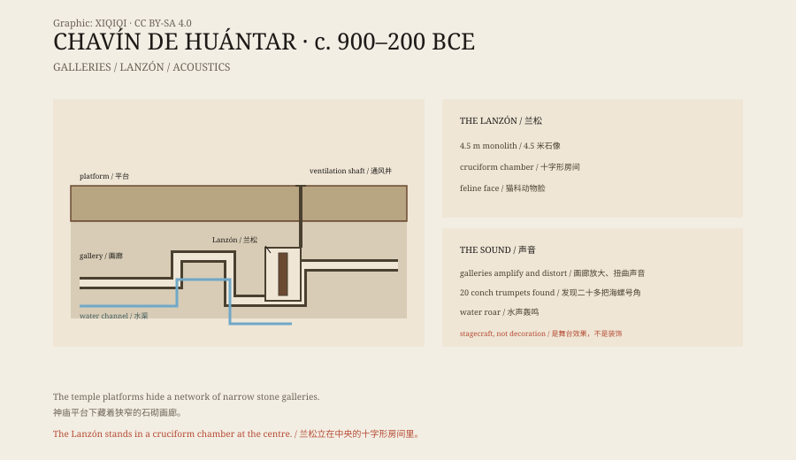

## 一、山谷

查文德万塔尔在秘鲁安卡什大区，海拔约三千一百八十米。

它坐落在两条河之间，背靠雪山。大约在公元前 900 年，这里开始出现大型石构建筑；到公元前 500 年左右，它已经是一个重要的祭祀中心。

人们从很远的地方来这里朝圣。他们带来陶器、贝壳、金器和石器，也带来新的图像和想法。查文的艺术风格，后来影响了整个安第斯地区。

## 二、旧庙与新庙

神庙分为几个阶段。

最早的是“旧庙”，一个 U 形的平台建筑，中间是下沉的庭院。后来，人们在它旁边建了“新庙”，规模更大，正面有黑色的石柱和白色的雕刻。

神庙的墙上有头像、鹰、猫科动物和蛇。最著名的图像是一个长着猫科动物脸、双手各持一根权杖的神。这个形象后来被称为“权杖神”。

## 三、地下

神庙最奇怪的部分在地下。

平台下面有一组石砌画廊，窄、低、弯弯曲曲。人进去要低头，有些地方只能侧身通过。画廊没有窗户，靠通风井换气；地面有排水渠，把雨水引走。

在画廊的深处，有一间十字形的房间。房间里立着一尊石像，叫“兰松”。

兰松高约四米半，刻着一个猫科动物脸的神。它的头几乎顶到天花板，眼睛盯着入口。朝圣者要沿着狭窄的通道走到它面前，才能看到它的全貌。

*原创示意图：神庙平台、地下画廊、兰松位置与通风、排水、声学结构。不是测绘图。稀奇奇编辑部，CC BY-SA 4.0。*

## 四、声音

查文的地下空间，不只是通道。

考古学家在画廊里做过声学测试。他们发现，画廊的形状会把声音放大、扭曲，让人分不清方向。水在石渠里流动，会发出低沉的轰鸣；人在里面说话，声音会从意想不到的地方返回来。

2001 年，考古队在遗址里发现了二十多把海螺号角。这种号角叫“pututu”，吹起来声音很低，能传很远。有人推测，祭司在画廊里吹号角，声音会穿过通风井，传到广场上，让外面的人以为地下有神在说话。

这不是装饰，是舞台效果。

## 五、图像

查文的石雕，有一套复杂的符号。

除了兰松，还有雷蒙迪石碑和特略方尖碑。石碑上刻着权杖神，方尖碑上刻着鳄鱼、鸟和植物。这些图像不是随便刻的，它们把神、动物、水和农业联系在一起。

查文人没有文字。他们的历史，靠图像、建筑和仪式流传。

## 六、现在

1985 年，查文德万塔尔被列入世界遗产。

1970 年的地震损坏了部分建筑，后来的修复用了现代材料，也引发了争议。今天，游客可以走进部分画廊，但很多区域已经关闭，以保护结构和壁画。

一座三千年前的神庙，靠黑暗、窄道和声音，让人相信神就在墙后面。

---

**来源与许可**：本文的事实来源见条目底部来源台账 S1–S3。文字与原创示意图采用 CC BY-SA 4.0。文中把建筑阶段、地下结构、声学实验、图像系统与保护状况分开叙述；声学效果的具体用途仍有不同解释，“祭司制造神谕”是其中一种。
