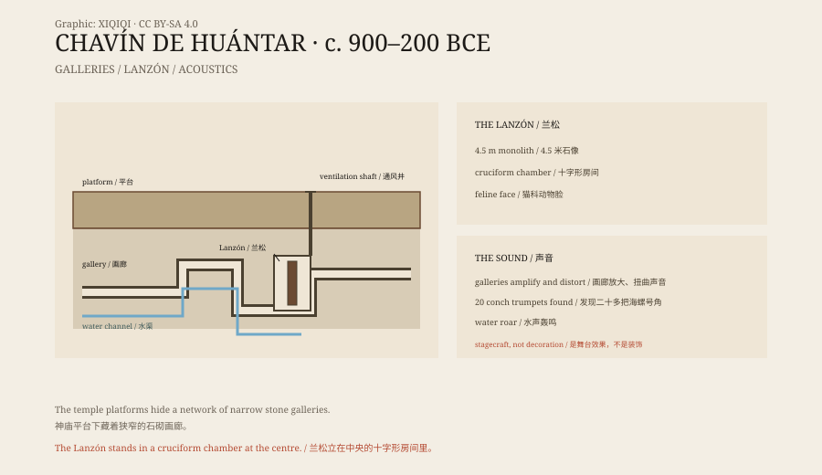

## 一、山谷

查文德万塔尔在秘鲁安卡什大区，海拔约三千一百八十米。

它坐落在两条河之间，背靠雪山。大约在公元前 900 年，这里开始出现大型石构建筑；到公元前 500 年左右，它已经是一个重要的祭祀中心。

人们从很远的地方来这里朝圣。他们带来陶器、贝壳、金器和石器，也带来新的图像和想法。查文的艺术风格，后来影响了整个安第斯地区。

## 二、旧庙与新庙

神庙分为几个阶段。

最早的是“旧庙”，一个 U 形的平台建筑，中间是下沉的庭院。后来，人们在它旁边建了“新庙”，规模更大，正面有黑色的石柱和白色的雕刻。

神庙的墙上有头像、鹰、猫科动物和蛇。最著名的图像是一个长着猫科动物脸、双手各持一根权杖的神。这个形象后来被称为“权杖神”。

## 三、地下

神庙最奇怪的部分在地下。

平台下面有一组石砌画廊，窄、低、弯弯曲曲。人进去要低头，有些地方只能侧身通过。画廊没有窗户，靠通风井换气；地面有排水渠，把雨水引走。

在画廊的深处，有一间十字形的房间。房间里立着一尊石像，叫“兰松”。

兰松高约四米半，刻着一个猫科动物脸的神。它的头几乎顶到天花板，眼睛盯着入口。朝圣者要沿着狭窄的通道走到它面前，才能看到它的全貌。

*原创示意图：神庙平台、地下画廊、兰松位置与通风、排水、声学结构。不是测绘图。稀奇奇编辑部，CC BY-SA 4.0。*

## 四、声音

查文的地下空间，不只是通道。

考古学家在画廊里做过声学测试。他们发现，画廊的形状会把声音放大、扭曲，让人分不清方向。水在石渠里流动，会发出低沉的轰鸣；人在里面说话，声音会从意想不到的地方返回来。

2001 年，考古队在遗址里发现了二十多把海螺号角。这种号角叫“pututu”，吹起来声音很低，能传很远。有人推测，祭司在画廊里吹号角，声音会穿过通风井，传到广场上，让外面的人以为地下有神在说话。

这不是装饰，是舞台效果。

## 五、图像

查文的石雕，有一套复杂的符号。

除了兰松，还有雷蒙迪石碑和特略方尖碑。石碑上刻着权杖神，方尖碑上刻着鳄鱼、鸟和植物。这些图像不是随便刻的，它们把神、动物、水和农业联系在一起。

查文人没有文字。他们的历史，靠图像、建筑和仪式流传。

## 六、现在

1985 年，查文德万塔尔被列入世界遗产。

1970 年的地震损坏了部分建筑，后来的修复用了现代材料，也引发了争议。今天，游客可以走进部分画廊，但很多区域已经关闭，以保护结构和壁画。

一座三千年前的神庙，靠黑暗、窄道和声音，让人相信神就在墙后面。

## 山谷

查文德万塔尔，在秘鲁安第斯山脉的一个山谷里。

遗址海拔三千多米，周围是高山和河谷。它建于公元前九百年左右，是查文文化的中心。

## 旧庙与新庙

遗址有两座主要建筑：旧庙和新庙。

旧庙呈 U 形，有庭院、走廊和地下房间。新庙更大，有广场、楼梯和石雕。两座建筑之间，有通道和平台。

## 地下

旧庙的地下，有一条狭窄的通道。

通道里有台阶、通风口和石雕。尽头是一个房间，里面有一根石柱，叫“兰松”（Lanzón）。石柱上刻着一个猫科动物和人形的混合体，有獠牙和蛇。

## 声音

通道的设计，可能和声音有关。

在通道里说话，声音会被放大、反射。研究者认为，祭司可能在通道里制造声音，让信徒听到“神的声音”。

## 图像

查文的石雕，有美洲豹、鹰、蛇和人。

这些动物不是随便选的。它们代表力量、天空、地下和转变。查文的宗教，可能涉及萨满、幻觉和祭祀。

## 现在

查文是联合国教科文组织世界遗产。

遗址被修复、加固，部分区域对游客开放。博物馆里展出石雕、陶器和金器。

一个山谷里的神庙，比印加帝国早两千多年。它证明，安第斯文明不是突然出现的，而是有很长的根。

## 宗教

查文的宗教，可能涉及幻觉。

石雕上的猫科动物、蛇和鹰，和亚马逊的萨满信仰有关。祭司可能用植物、声音和黑暗，让人进入迷幻状态。

## 建筑

旧庙的 U 形布局，像一个仪式剧场。

庭院、走廊和地下房间，引导人从外到内，从明到暗。建筑不是背景，是仪式的一部分。

## 旅游

查文是秘鲁的旅游点。

游客可以看遗址、博物馆和石雕。部分区域海拔高，需要适应。

查文是秘鲁的旅游点。

游客可以看遗址、博物馆和石雕。海拔高，需要适应。

一个山谷里的神庙，比印加帝国早两千多年。

兰松还在黑暗里。它不说话，但每一个走进通道的人，都会听到自己的脚步。

## 研究

查文的研究，还在继续。

考古学家在找居住区、农田和工匠作坊。他们想知道，谁建了神庙，谁供养了它。

## 安第斯

查文在安第斯山脉。

海拔高，空气薄，山风冷。遗址周围是梯田、河谷和雪山。

## 神庙

查文的神庙，是宗教中心。

人们从周围的山谷来，参加仪式，献祭，听祭司讲话。

## 兰松

兰松是一根石柱。

它刻着一个猫科动物和人形的混合体，有獠牙、蛇和鹰。它是查文最重要的图像。

## 声学

神庙的通道，可能用来放大声音。

祭司在通道里说话，声音传到广场。信徒听到的，不是人的声音，是神的声音。

---

**来源与许可**：本文的事实来源见条目底部来源台账 S1–S3。文字与原创示意图采用 CC BY-SA 4.0。文中把建筑阶段、地下结构、声学实验、图像系统与保护状况分开叙述；声学效果的具体用途仍有不同解释，“祭司制造神谕”是其中一种。
