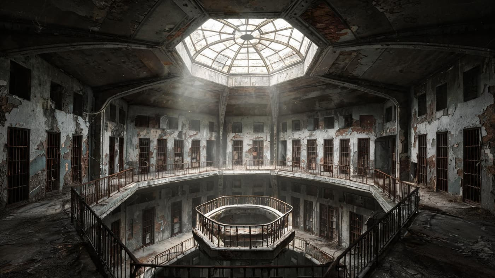
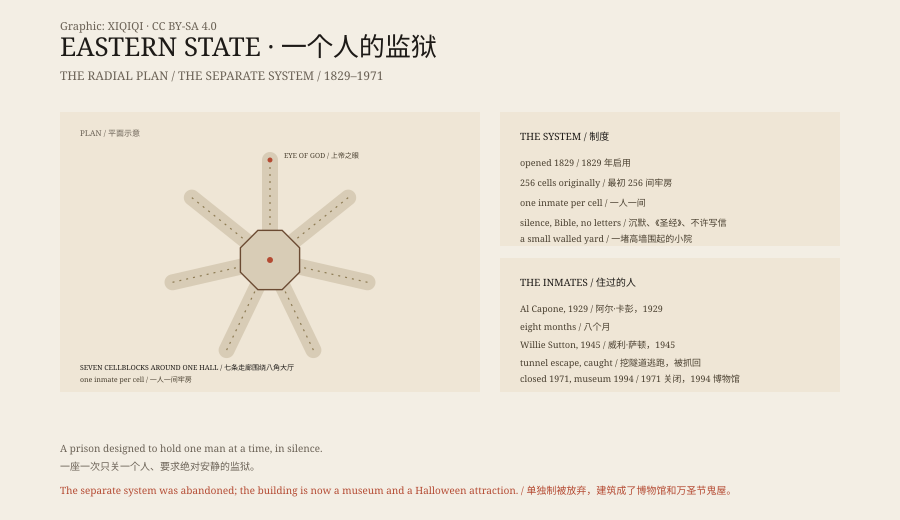

## 1. A Castle

October 1829, north of Philadelphia. A grey stone building opened under the name Eastern State Penitentiary.

Its architect, John Haviland, designed it as a Gothic castle: pointed arches, towers, thick walls. It was then the largest and most expensive public building in the United States.

From the air it looked like a wheel. An octagonal central hall sent seven cellblocks out like spokes. At the end of each block was a skylight known as the Eye of God.

Standing in the centre and looking up, you see the octagonal skylight. Seven corridors run out from your feet, each with its own light at the end.

*Reconstruction: the abandoned central rotunda of Eastern State Penitentiary. Not a photograph of the site. Oddity Archive, CC BY-SA 4.0.*

## 2. One Man

Eastern State was built for the "Pennsylvania system", also called the separate system.

Each prisoner had a cell to himself. He saw no other prisoner and no family. Exercise meant a small walled yard, open to the sky, barely larger than the cell.

When the door closed, the sound was shut out too. The corridor was left with the footsteps of the man bringing food.

The theory was that silence and solitude would produce repentance. Prisoners were forbidden to speak or write letters. They could read the Bible.

The cell had a bed, a table, a stool and a small window. It looked more humane than most prisons of the day. The cost was total isolation.

## 3. The Critics

In 1842 Charles Dickens visited. In American Notes he wrote that this solitude was a slow torture of the mind, worse than any physical punishment.

The prison soon became overcrowded. Haviland's plan held only 256 inmates. Two-storey cellblocks were added, and the rules of separate confinement gradually loosened.

By the twentieth century it was an ordinary prison.

## 4. The Inmates

In 1929 Al Capone served eight months here for carrying a concealed weapon. His cell was furnished with rugs, furniture and a radio, unlike those of ordinary prisoners. He also had his tonsils removed there.

The bank robber Willie Sutton spent eleven years at Eastern State. In 1945 he and ten other prisoners tunnelled out; he was caught yards from the prison.

The prison closed in 1971.

## 5. The Ruin

After closing, Eastern State stood empty for more than twenty years.

Rain came through the roofs, paint lifted in sheets, and trees grew from the cracks in the exercise yards.

Roofs leaked, paint peeled, trees grew in the exercise yards. It was neither demolished nor restored; it simply stayed abandoned.

In 1994 it opened as a museum. Visitors walk through empty cells and see flaking plaster and rusted iron doors.

Every Halloween the site runs a haunted house called Terror Behind the Walls. There are stories: Capone's cell, footsteps in the corridors, a shadow in a particular cell.

## 6. Ghosts

Eastern State has ghost stories, but no evidence.

It does not need ghosts to be frightening. The solitary confinement was real. Hundreds of people were held here, and some went mad.

A building can do nothing but stand there and still make people uneasy. Eastern State is one of them.

*Original schematic: the radial cellblock plan, the separate system and the 1829–1971 timeline. Not a photograph of the site. Oddity Archive, CC BY-SA 4.0.*

---

**Sources and licenses**: the factual sources are listed in the source ledger S1–S3 at the bottom of this entry. Text and original diagrams are licensed under CC BY-SA 4.0. This article separates the architecture and the system, the famous inmates, the closure and museum period, and the ghost stories; the solitary confinement and prison history are documented, while the ghost stories have no verifiable evidence. The illustration is a scene reconstruction, not a photograph of the site.
