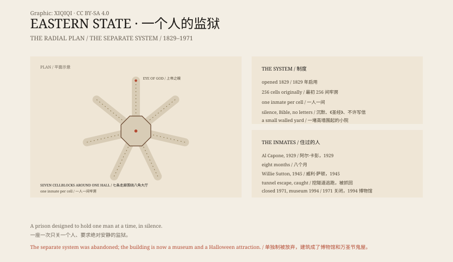

## 一、一座城堡

1829 年 10 月，费城北郊。一座灰色的石头建筑开门，叫东州教养所。

设计师约翰·哈维兰把它画成哥特式城堡：尖拱、塔楼、厚重的墙。它当时是美国最大、最贵的公共建筑。

从空中看，它是一个轮子：中央是八角形大厅，七条牢房走廊向外放射。每条走廊的尽头有一扇天窗，叫“上帝之眼”。

## 二、一个人

东州教养所实验的是“宾夕法尼亚制”，也叫“单独制”。

每个犯人一间牢房。不见其他犯人，不见家人。放风时走进一个比牢房大一点的小院，院墙很高，只能看见天。

狱方相信，安静和孤独会让人反省。犯人不许说话，不许写信，只能读《圣经》。

牢房里有床、桌子、凳子，墙上有小窗。看上去比当时的监狱人道，代价是彻底的孤独。

## 三、批评

1842 年，狄更斯来参观。他在《美国笔记》里写，这种孤独是对大脑的慢性折磨，比任何肉体刑罚都更糟。

监狱很快拥挤。原设计只容纳 256 人，后来加建二层牢房，单独监禁的规矩也慢慢松动。

到二十世纪，它变成了普通的监狱。

## 四、住过的人

1929 年，阿尔·卡彭因非法携带武器在这里关了八个月。他的牢房铺着地毯，有家具和收音机，和普通犯人的不一样。他还在这里割了扁桃体。

银行劫匪威利·萨顿在这里待了十一年。1945 年，他和十名犯人挖隧道逃出，在离监狱几码远的地方被抓回。

1971 年，监狱关闭。

## 五、废墟

关闭后，东州教养所空了二十多年。

屋顶漏水，油漆剥落，树从院子里长出来。它没有被拆，也没有被修好，就停在废弃的状态。

1994 年，它作为博物馆开放。游客走在空牢房里，能看到剥落的墙皮和生锈的铁门。

每年万圣节，这里办“墙后恐怖”鬼屋。故事很多：卡彭的牢房、走廊里的脚步声、某间牢房里的影子。

## 六、鬼

东州教养所有鬼故事，但没有证据。

它的可怕不需要鬼。单独监禁是真的，几百个人在这里被关过，有人发疯。

一座建筑可以什么都不做，只是站在那里，就让人不舒服。东州教养所就是这样。

*原创示意图：东州教养所的放射状牢房布局、单独监禁制度与 1829–1971 年时间线。不是现场照片。稀奇奇编辑部，CC BY-SA 4.0。*

---

**来源与许可**：本文的事实来源见条目底部来源台账 S1–S3。文字与原创示意图采用 CC BY-SA 4.0。文中把建筑与制度、著名犯人、关闭与博物馆化、鬼故事分开叙述；单独监禁和监狱历史有档案依据，鬼故事没有可验证的证据。插图是场景复原，不是现场照片。
