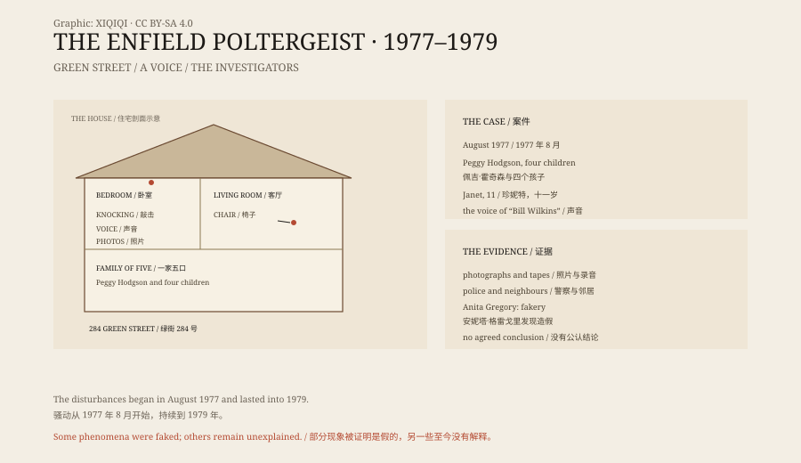

## 1. 284 Green Street

Enfield is in north London. Green Street is an ordinary residential street.

In 1977 Peggy Hodgson lived at number 284 with four children: Margaret, thirteen; Janet, eleven; Johnny, ten; and Billy, seven. The house was old, the walls were thin, and the floors creaked.

## 2. August 1977

It began with knocking.

Peggy said she heard knocking inside the walls and that the beds shook by themselves. One night she saw a chest of drawers slide towards the door. She took the children to a neighbour's house and called the police.

Police officers came. Their report said that one officer saw a chair move across the floor. They found no one in the house and no mechanism.

Over the following months objects began to fly: Lego bricks, marbles, crockery, a fireplace screen. Drawers opened by themselves and clothes were thrown out. Janet was sometimes pressed onto the bed by an invisible force, or thrown into the air.

## 3. The voice

The most famous part of the case was the voice.

Janet began to speak in a low, gravelly male voice. The voice said it was Bill Wilkins, a former occupant who had died in the house.

On the recordings the voice sounds completely different from Janet's. It answered questions, swore and laughed. Sometimes it appeared when Janet's mouth was barely moving.

## 4. The investigation

The Society for Psychical Research sent Maurice Grosse.

Grosse was a retired engineer and a paranormal investigator. He later worked with the writer Guy Lyon Playfair, and the two of them spent long periods in the house.

They recorded the knocking, the moving furniture and the voice, and they took photographs. The most famous photograph shows Janet apparently thrown into the air, her body against the wall, some distance from the bed.

These materials became the core evidence of the Enfield case.

## 5. The doubts

Not everyone believed it.

Another SPR researcher, Anita Gregory, carried out her own investigation. She concluded that Janet faked a great deal. She saw Janet bending spoons when she thought no one was watching, and she saw Margaret and Janet practising ventriloquism.

The photographs could also be explained: Janet may simply have jumped and fallen back onto the bed. Shutter speed, angle and lighting can make an ordinary jump look like levitation.

Years later Janet said in an interview that part of it had been made up. But she insisted that some things she could not explain.

## 6. Explanations

The Enfield case has no settled conclusion.

One explanation is a poltergeist phenomenon: adolescents, especially girls, under stress or seeking attention, can unconsciously generate disturbances or become the focus of them. A simpler explanation is that a family wanted attention, the children enjoyed performing, and the investigators wanted to believe.

But some events were not fully explained. Neighbours, police officers and journalists all saw objects move. Grosse and Playfair insisted that fakery could explain only part of it.

## 7. The film

In 2016 The Conjuring 2 used the Enfield case.

The house, the family and the demon nun in the film are adaptations. The real case had no nun, no demon and no Warrens. The actual investigators were Grosse and Playfair of the SPR.

The film made Enfield famous again, and the fictional version overshadowed the original records.

## 8. Now

284 Green Street is still standing, though the house has changed hands.

The Enfield material is kept in the SPR archive: photographs, recordings and notes, all available to researchers. It is one of the best-documented cases in the history of psychical research, and one of the hardest to settle.

An ordinary house, an eleven-year-old girl, the voice of a dead old man. Believers say it is evidence. Sceptics say it is a performance. Both can find what they want in the same pile of material.

*Original schematic: the timeline of 1977–1979, the investigators and the types of evidence. Not a photograph of the house. Oddity Archive, CC BY-SA 4.0.*

---

**Sources and licenses**: the factual sources are listed in the source ledger S1–S3 at the bottom of this entry. Text and original diagrams are licensed under CC BY-SA 4.0. This article separates the family's account, the investigators' records, the sceptical view and the film adaptation; the Enfield case has no agreed conclusion, some phenomena were shown to be faked, and others remain unexplained. The illustration is a scene reconstruction, not a photograph of the house.
