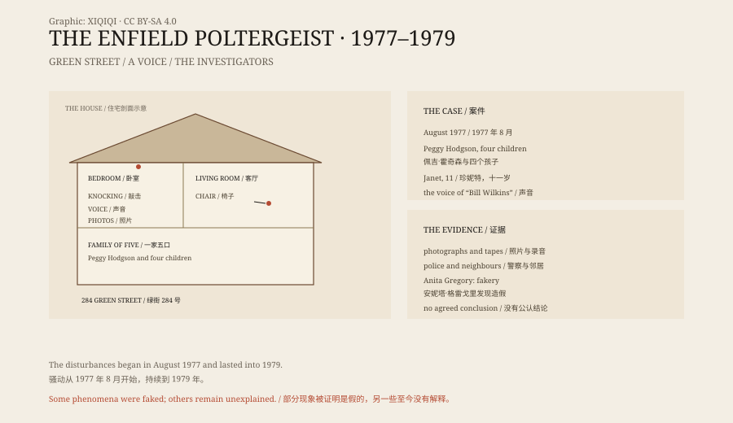

## 一、绿街 284 号

恩菲尔德在伦敦北部，绿街是一条普通的住宅街。

1977 年，佩吉·霍奇森带着四个孩子住在这里：十三岁的玛格丽特、十一岁的珍妮特、十岁的约翰尼和七岁的比利。房子是旧的，墙薄，地板会响。

## 二、1977 年 8 月

事情从敲墙声开始。

佩吉说，她听到墙壁里有敲击声，床会自己震动。有一天晚上，她看见五斗柜自己滑向门口。她带着孩子跑到邻居家，报了警。

有警察到场。后来的报告说，一名警官看见一把椅子在地板上移动。警察没有找到人，也没有找到机关。

接下来的几个月，家里的东西开始飞：乐高积木、弹珠、餐具、一个壁炉挡板。抽屉自己打开，衣服被扔出来。珍妮特有时会被一股力量按在床上，或者被抛到半空。

## 三、声音

最出名的是那个声音。

珍妮特开始用一种低沉的、沙哑的男声说话。声音说自己叫比尔·威尔金斯，以前住在这栋房子里，死在了这里。

录音里，那个声音和珍妮特的声音完全不同。它会回答问题，会骂人，会笑。有时候，它会在珍妮特嘴巴几乎不动的时候出现。

## 四、调查

灵异研究会（SPR）派了莫里斯·格罗斯来。

格罗斯是一个退休的工程师，也是灵异现象的调查者。他后来认识了作家盖伊·里昂·普莱费尔，两人一起在这栋房子里待了很长时间。

他们记录了敲击声、家具移动、声音，还拍了照片。最著名的一张，是珍妮特被“抛”到空中，身体贴着墙，离床有一段距离。

这些材料后来成了恩菲尔德案最核心的证据。

## 五、怀疑

不是所有人都相信。

SPR 的另一位研究者安妮塔·格雷戈里做过独立调查。她认为，珍妮特在很多场合造假。她看见珍妮特在没人注意时把勺子弄弯，也看见玛格丽特和珍妮特练习腹语。

照片也可以解释：珍妮特可能是自己跳起来，再落回床上。快门速度、角度和光线，都能让一个普通的跳跃看起来像悬浮。

多年后，珍妮特在采访中说，有一部分是她编的。但她坚持，还有一些事情她无法解释。

## 六、解释

恩菲尔德案没有定论。

一种解释是“波尔吉特”现象：青春期的孩子，尤其是女孩，在压力或关注下，会无意识地制造动静，或者成为现象的中心。另一种解释更简单：一个家庭需要关注，孩子喜欢表演，调查者愿意相信。

但也有一些事情没有被完全解释。邻居、警察、记者都看到过东西移动。格罗斯和普莱费尔坚持认为，假造只能解释一部分。

## 七、电影

2016 年，电影《招魂 2》用了恩菲尔德案。

电影里的房子、家庭和修女恶魔，都是改编。真实案件里没有修女，没有恶魔，也没有沃伦夫妇。真正的调查者是 SPR 的格罗斯和普莱费尔。

电影让恩菲尔德案重新出名，也让虚构的版本盖过了原始记录。

## 八、现在

绿街 284 号还在，房子后来换了主人。

恩菲尔德案的材料保存在 SPR 的档案里，照片、录音、笔记，都可以查。它是灵异研究史上记录最完整的案件之一，也是最难下结论的案件之一。

一间普通的房子，一个十一岁的女孩，一个死了的老头的声音。信的人说，这是证据；不信的人说，这是表演。两边都能从同一堆材料里找到自己想要的东西。

*原创示意图：1977–1979 年的事件时间线、调查者与证据类型。不是现场照片。稀奇奇编辑部，CC BY-SA 4.0。*

---

**来源与许可**：本文的事实来源见条目底部来源台账 S1–S3。文字与原创示意图采用 CC BY-SA 4.0。文中把家庭叙述、调查记录、怀疑意见与电影改编分开叙述；恩菲尔德案没有公认结论，部分现象被证明是假造，另一些至今没有解释。插图是场景复原，不是现场照片。
