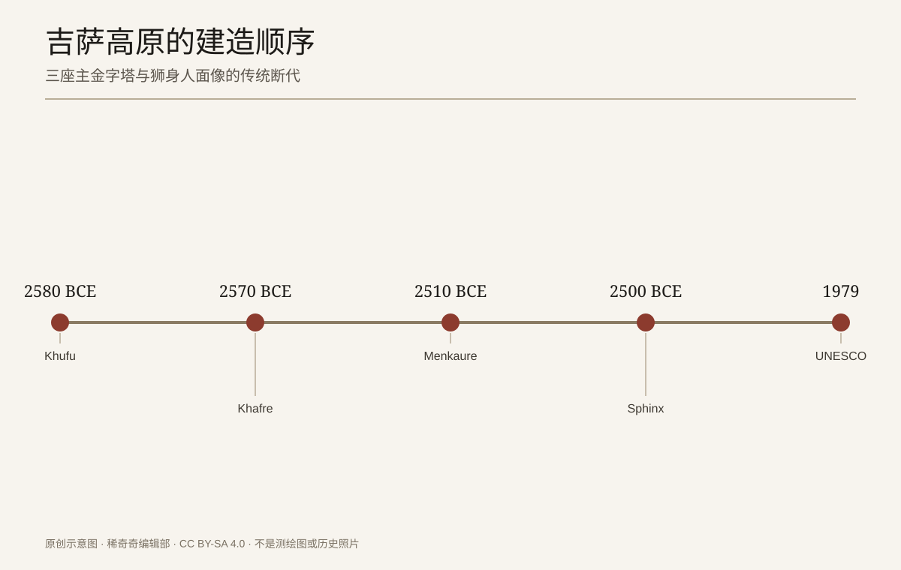
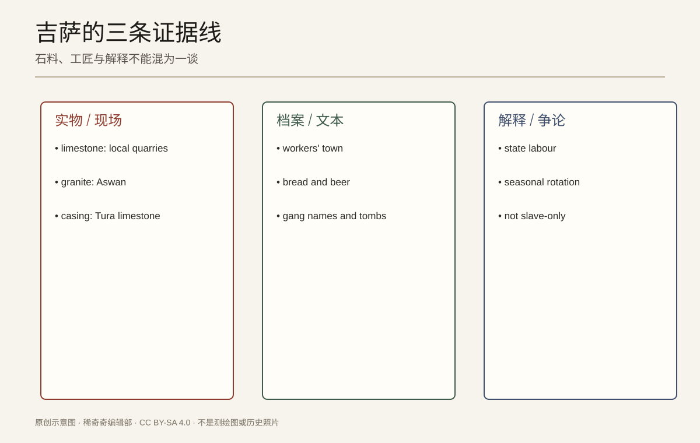

## 1. Three pyramids on a plateau

The Giza Plateau lies southwest of Cairo, on the west bank of the Nile. Its three most conspicuous pyramids are usually named for their owners: Khufu's Great Pyramid, Khafre's pyramid, and Menkaure's pyramid, with smaller queen's pyramids, temples, causeways, tombs, and the Sphinx around them. They belong to Egypt's Fourth Dynasty, roughly 2580–2500 BCE. To equate 'Giza' with 'the Great Pyramid' is to miss the complex: the three pyramids differ in scale, internal structure, and preservation, and the surrounding temples and cemeteries are essential to understanding how the site worked.

## 2. Stone, casing, and construction

The Great Pyramid was originally about 146 metres high and stands about 138 metres today; most of its white limestone casing was removed in later centuries, though a patch remains at the top of Khafre's pyramid. The core stone came mainly from quarries south of the plateau, while granite was brought from Aswan along the Nile. For raising blocks, scholars have proposed straight ramps, spiral ramps, levers, and internal passages; no single model explains every construction trace. What can be confirmed is that the work required tight organisation of quarrying, transport, food supply, and labour—not the single image of slaves driven by whips.

*Original diagram: the traditional building sequence of the three main Giza pyramids. Not a survey drawing. XIQIQI Editorial, CC BY-SA 4.0.*

## 3. Workers, rations, and cemeteries

The workers' settlements, bakeries, breweries, and cemeteries near the pyramids have changed the discussion of 'who built the pyramids'. Excavation shows that workers lived, ate, and were buried in an organised way, and some left gang names and graffiti. They were not free wage labourers in the modern sense, but they were also not simply unpaid slaves. The workforce may have rotated seasonally, coming from villages along the Nile in the agricultural off-season. Reducing the builders to 'slaves' or 'free men' hides the more important intermediate status: state conscription, food rations, technical division of labour, and differences of rank.

## 4. The Sphinx

The Sphinx is about 73 metres long and 20 metres high, carved from a single outcrop of limestone and facing east. Its date, original appearance, and builder are still debated: the mainstream places it in Khafre's reign, while others argue for an earlier date from erosion patterns. The 'Dream Stele' records a later king's dream after clearing sand, but it is a later text and cannot be read directly as a construction record. Erosion is another evidence line: salt, wind, groundwater, and historical clearance have all changed the surface, so dating from erosion alone is unreliable.

*Original diagram: stone sources, labour organisation, and interpretation layers at Giza. Not a survey drawing. XIQIQI Editorial, CC BY-SA 4.0.*

## 5. From wonder to occultism

Since the nineteenth century, Giza has been repeatedly written into occultism, nationalist narratives, and popular culture. Common claims include 'the pyramid is a precise calendrical computer', 'its proportions encode pi', or 'it is the product of aliens or a lost civilisation'. Such claims often confuse measurable geometry with intentional design: the pyramids do have precise orientation and dimensions, but precision is not the same as the supernatural. The work of Egyptology is not to deny wonder but to separate verifiable survey, contemporary documents, and later additions.

## 6. Conservation and tourism

Giza was inscribed in 1979 as part of 'Memphis and its Necropolis'. Today it faces rising groundwater, salt erosion, urban expansion, looting, and heavy visitation. The opening of the Grand Egyptian Museum near Cairo has diverted some objects and visitor pressure, but the plateau itself still has limited carrying capacity. Conservation plans often choose between openness and closure: total closure slows weathering but separates the site from the public; total openness brings revenue but accelerates wear.

The cover is an AI-assisted reconstruction of “The Giza Plateau: Three Pyramids and a Sphinx”, not a site photograph; the two inline figures are original diagrams, not survey drawings. Image types and licences are recorded in the source ledger below.

## Archive location

The archival core for Giza is Harvard's Giza Project, which brings together nineteenth-century and later excavation records, photographs, surveys, and object registers in a searchable database. The Egyptian Supreme Council of Antiquities and the Egyptian Museum system hold site-management, restoration, and find records, while the Grand Egyptian Museum catalogue supplies another numbering system. Place names, tomb numbers, and plate numbers do not always match across these archives, so researchers often have to build concordances. The chronological framework used here comes from those public catalogues and the UNESCO inscription; finer stratigraphic and workers' cemetery data still depend on the original entries in the project database.

## Limits of the record

Much about Giza's construction organisation remains blank: the exact quarry and transport routes, the building sequence of the individual pyramids, the seasonal rotation of work gangs, and the original form and date of the Sphinx all lack complete evidence. Claims about 'hidden passages' or 'underground palaces' must distinguish published geophysical anomalies from structures that have actually been opened. This entry treats as fact only what excavation, survey, or archival record supports, and leaves models and guesses in the interpretation layer.

---

**Sources and licenses**: Text and original diagrams are licensed CC BY-SA 4.0; third-party image and source licences are listed in the source ledger below.
