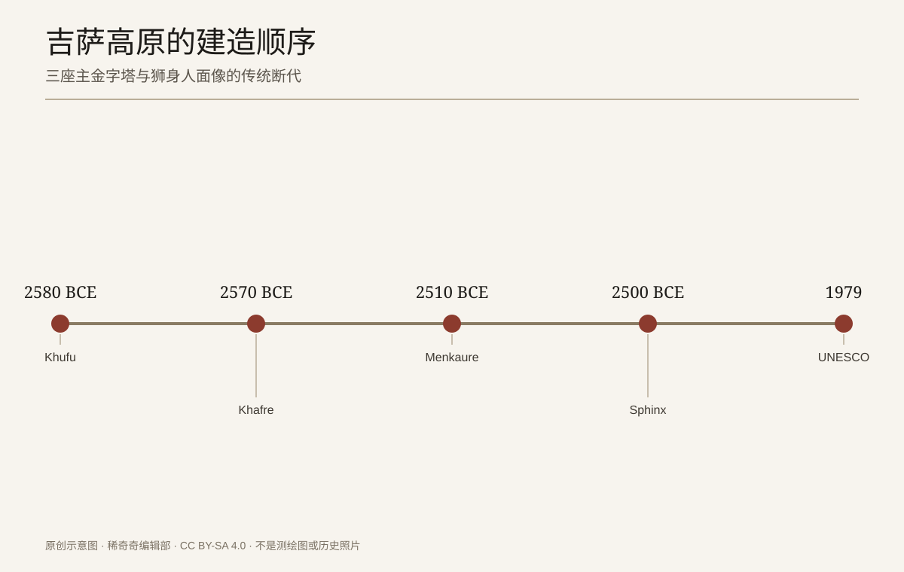
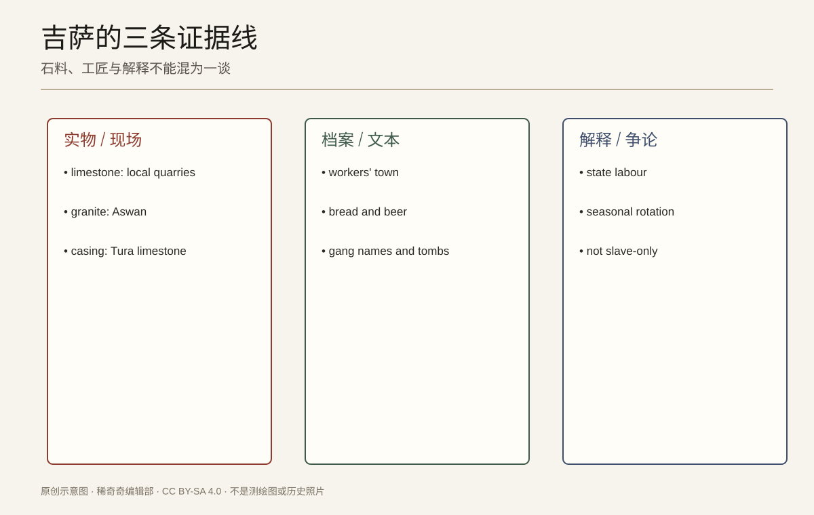

## 一、高原上的三座塔

吉萨高原在开罗西南，尼罗河西岸。这里最醒目的三座金字塔通常按主人称呼：胡夫的大金字塔、哈夫拉的金字塔和门卡乌拉的金字塔，旁边还有更小的王后金字塔、庙宇、堤道、墓葬和狮身人面像。它们属于埃及第四王朝，约公元前 2580 至前 2500 年。把“吉萨”等同于“胡夫金字塔”会漏掉整个建筑群：三座塔的规模、内部结构和保存状态并不相同，周围的庙宇与墓地才是理解其运作的关键。

## 二、石料、 casing 与施工

大金字塔原高约 146 米，现存约 138 米，外层的白色石灰岩 casing 大部分已被后世取走，只有哈夫拉塔顶还保留一段。核心石料主要采自高原南侧的采石场，花岗岩则从阿斯旺沿尼罗河运来。关于如何把石块提升到高处，学界提出过直线坡道、螺旋坡道、杠杆与内部通道等多种模型；没有一种模型能同时解释所有施工痕迹。可以确认的是，工程需要严密的采石、运输、供粮与人员组织，而不是“奴隶被鞭子赶上工地”的单一画面。

*原创示意图：吉萨三座主金字塔的传统建造顺序。不是测绘图。稀奇奇编辑部，CC BY-SA 4.0。*

## 三、工匠、口粮与墓地

金字塔附近的工匠聚落、面包房、啤酒作坊和墓地，改变了“谁建造了金字塔”的讨论。发掘显示，工人有组织地居住、进食和埋葬，一些人还留下了队名和涂鸦。他们不是现代意义上的自由雇佣者，但也不等于没有报酬的奴隶。劳动力可能按季节轮换，农闲时来自尼罗河沿岸的村庄。把建造者简单分成“奴隶”或“自由人”，会遮住更重要的中间状态：国家征调、口粮配给、技术分工与身份差异。

## 四、狮身人面像

狮身人面像长约 73 米、高约 20 米，由整块石灰岩凿成，面朝东方。它的年代、原始面貌和建造者仍有争论：主流观点把它放在哈夫拉时期，但也有人根据侵蚀形态提出更早的年代。所谓“梦碑”记录了一位法老清理沙土后得到梦谕的故事，属于后期文本，不能直接当作建造记录。侵蚀是另一条证据线：盐、风、地下水和历史上的清理都在改变石面，单靠侵蚀形态断代并不可靠。

*原创示意图：吉萨的石料来源、工匠组织与解释层次。不是测绘图。稀奇奇编辑部，CC BY-SA 4.0。*

## 五、从“奇迹”到“神秘学”

19 世纪以来，吉萨被反复写进神秘学、民族主义叙事和通俗文化。常见的说法包括“金字塔是精确的历法计算机”“比例里藏着圆周率”“它是外星人或失落文明的产物”。这些说法往往把可测量的几何关系与有意的设计混为一谈：金字塔确实有精确的朝向和尺度，但“精确”不等于“超自然”。埃及学家的工作不是否认神秘感，而是把可验证的测量、当时的文献和后世的添加分开。

## 六、保护与旅游

吉萨高原在 1979 年作为“孟菲斯及其墓地”的一部分列入世界遗产。今天它面对的是地下水上升、盐蚀、城市扩张、盗掘和大量游客。大埃及博物馆在开罗附近开放后，部分文物与参观压力得到分流，但高原本身的承载能力仍有限。保护方案常要在“开放”与“封闭”之间选择：完全封闭能减缓风化，却会让遗址脱离公众；完全开放能带来收入，却加速损耗。

## 时间线

- **约前 2580–前 2560 年**：胡夫大金字塔建造
- **约前 2570–前 2540 年**：哈夫拉金字塔与狮身人面像（传统断代）
- **约前 2510–前 2480 年**：门卡乌拉金字塔
- **1979 年**：列入世界遗产
- **2025 年**：大埃及博物馆开放，参观格局调整

## 来源与证据

本文的可核对材料以 S1、S2 为主：S1 提供遗址/器物的基本信息与官方记录，S2 提供独立的研究或档案背景。S3 是编辑部制作的封面与示意图，只用于视觉说明，不作为史实依据。凡正文出现年代、数量、地点与归属判断，尽量回到 S1/S2 的具体页面；无法回到页面的说法，在“档案空白”里标明。

封面为 AI 辅助场景复原，不是现场照片；两张插图为原创示意图，不是测绘图。图片类型与许可逐行记录在 `research/image-audit.csv`。

## 档案位置

吉萨的档案核心是哈佛大学的吉萨项目：它把十九世纪以来的发掘记录、照片、测绘图和器物登记汇总成可检索的数据库。埃及最高文物委员会与埃及博物馆系统保存着现场管理、修复和出土记录；大埃及博物馆的藏品目录则提供另一套编号。不同档案之间的地名、墓号和图号并不总是一致，研究者常要做“对照表”。本文使用的年代框架来自这些公开目录与联合国教科文组织的登录文本；更细的发掘层位与工匠墓地数据，仍以项目数据库的原始条目为准。

## 档案空白

吉萨的建造组织仍有大量空白：石料的具体采运路线、不同金字塔的施工顺序、工匠队伍的季节性轮换，以及狮身人面像的原始形制与年代，都缺少完整证据。所谓“隐藏通道”“地下宫殿”的探测结果，需要区分已发表的物探异常与已经打开的实地结构。本文只把有发掘、测绘或档案支撑的内容写成事实，把模型和猜测留在解释层。
