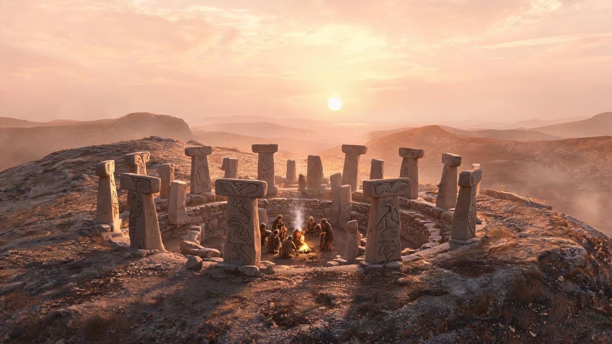
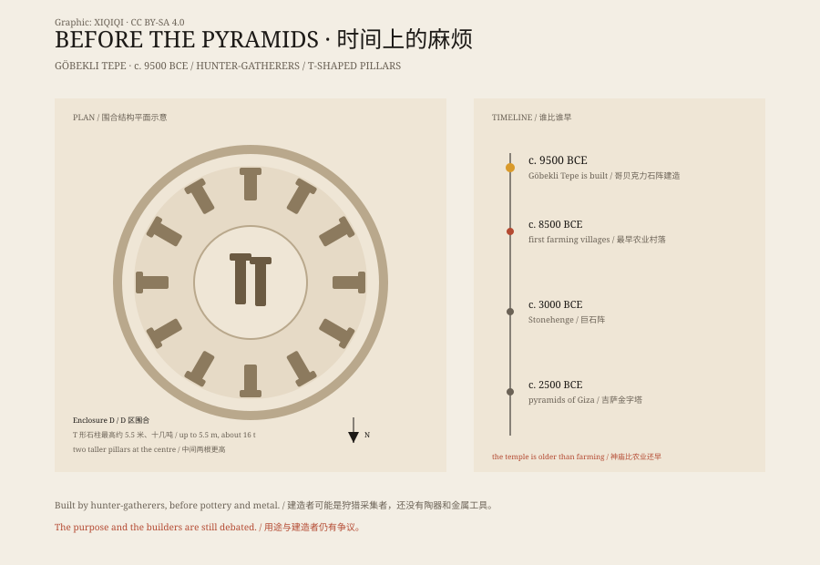

## 1. Stones on a barren hill

Southeastern Turkey, outside the city of Şanlıurfa. There is an unremarkable hill.

Locals call it Göbekli Tepe, “Potbelly Hill.” There is no water, no trees, only stone and grass. Shepherds used to bring animals here. No one thought it was special.

In 1963, an archaeological survey passed by and noticed some smoothed blocks on the ground. They took a few photographs and wrote in their report that it might be a Palaeolithic site. Then nothing happened.

In 1994, the German archaeologist Klaus Schmidt came back. What he saw was not ordinary stone. It was a set of huge T-shaped pillars, half buried in the earth. The pillars were carved with foxes, snakes, birds, scorpions, and boars.

Schmidt decided to dig. He did not know yet that the dig would change our understanding of prehistoric people.

## 2. What the site looks like

Göbekli Tepe is not a single building. It is a set of circular or oval enclosures.

In each enclosure, several massive T-shaped limestone pillars stand in a ring, with two taller pillars in the centre. The tallest are about 5.5 metres high and weigh more than ten tonnes. The pillars are connected by walls, and the surfaces are carefully smoothed.

Enclosure D is the best preserved. Its two central pillars are taller than the rest. One carries a carving of a fox, its body arched and its tail raised as if about to spring. There are also arms, belts, and abstract human figures, as if a person had been carved into the stone.

The most surprising part is the carving. The pillars carry foxes, snakes, boars, cranes, scorpions, spiders, and abstract human figures and arms. The carvings are not random. They have clear compositions and positions.

These pillars did not form naturally. They were quarried, moved, erected, and carved. That required labour, organisation, and a shared belief.

Rewind about eleven thousand years. It is still dark, and people are already moving on the hill. The pillars have been dragged up from a nearby quarry; their surfaces still carry tool marks. A fire burns in the centre of the enclosure, with meat from a recent hunt above it. People arrive from surrounding camps with food, hides, and news. When the ceremony ends, they fill the enclosure with rubble and earth, as if pressing a sentence into the ground.

The scene is an inference, but each part leaves a trace at the site: the carvings, the animal bones in the fill, the ash from hearths, the worn floor.

*Reconstruction: hunter-gatherers gathering in an enclosure at Göbekli Tepe around 9500 BCE. Not a historical photograph. Oddity Archive, CC BY-SA 4.0.*

*Diagram: a schematic plan of Enclosure D, and the date of Göbekli Tepe compared with farming villages, Stonehenge, and the pyramids. Original graphic, CC BY-SA 4.0.*

## 3. The trouble with the date

Radiocarbon dating places the construction around 9500 BCE.

What does that mean?

The pyramids were built around 2500 BCE. Göbekli Tepe is about seven thousand years older. Stonehenge was built around 3000 BCE. Göbekli Tepe is about six and a half thousand years older.

More awkwardly, it is older than the earliest large farming villages in the region. The traditional story says that people first learned to farm, settled down, produced a surplus, and only then could support priests, craftsmen, and large construction projects. Göbekli Tepe scrambles that order.

The builders may have been hunter-gatherers. They had not domesticated wheat, had no pottery, and had no metal tools. Yet they could organise hundreds of people to move ten-tonne stones from a quarry to the hill, stand them upright, and carve animals into them.

The hills around the site carry wild wheat and barley. Some scholars therefore argue that the builders were already managing plants. But there are no clear fields, storage pits, or domesticated animals at the site, and most evidence still points to mobile hunter-gatherers. They were not “people who had not yet learned to farm.” They were people who chose a different way of living.

## 4. Why was it buried

There is something even stranger about Göbekli Tepe: it was buried.

Not by a flood, and not by natural collapse. The archaeological layers show that the enclosures were deliberately filled with rubble and earth after a period of use. The fill contains tools, animal bones, and domestic debris.

Why bury a temple that had just been built?

Some say it was a way of sealing it. Some say it was renewal. Some say enemies were coming. Some say it was part of the ritual itself. There is no writing, and no clear answer.

Schmidt thought the enclosures were not everyday dwellings but ritual centres for gatherings, feasts, and ceremonies. People came from the surrounding region, brought food, slaughtered animals, performed rituals, and left. The site was not a city. It was a periodic gathering place.

## 5. What it changed

The importance of Göbekli Tepe is not only its age. It asks a question: does complexity have to begin with farming?

If a group of hunter-gatherers could build a temple, carve animals, and organise large feasts, then the linear story of “first farming, then civilisation” is not enough. Perhaps shared belief and ritual were the first force that brought people together to co-operate and build.

The idea is still debated. Some scholars point to traces of wild grains around the site, suggesting that people may already have been managing plants. Others argue that the site was used for a very long time, and that the social forms behind it may have been more complex than we imagine.

But whatever the explanation, Göbekli Tepe shows one thing: prehistoric people were far more capable than we used to think.

## 6. Visiting today

In 2018, Göbekli Tepe was inscribed as a UNESCO World Heritage Site.

Today, visitors walk along wooden boardwalks and see some of the pillars and enclosures. Many pillars are still underground, waiting for future archaeologists. A nearby museum displays carvings and reconstruction models.

Standing on the boardwalk, you see a T-shaped pillar, its surface weathered white, a fox carved into it. It has been standing there for about eleven thousand years.

---

**Sources and licenses**: the factual sources are listed in the source ledger S1–S4 at the bottom of this entry. Text and reconstruction illustrations are licensed under CC BY-SA 4.0. Reconstruction illustrations are not historical photographs. The purpose and identity of the builders of Göbekli Tepe remain debated; this article separates confirmed archaeological facts from interpretive hypotheses.
