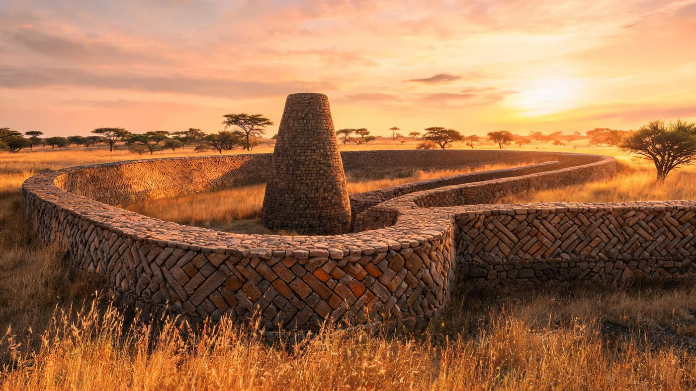
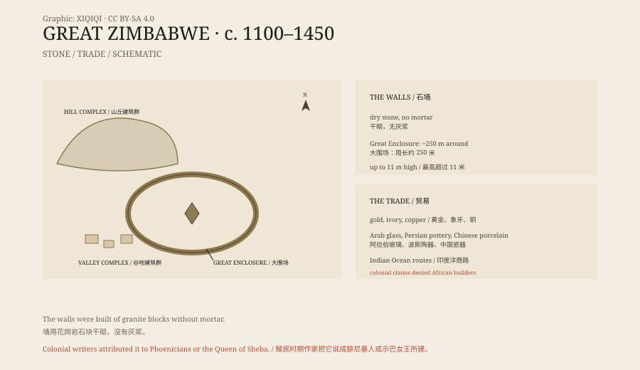

## 1. The city of stone

Great Zimbabwe lies near Masvingo in southern Zimbabwe.

“Zimbabwe” means “houses of stone” in Shona. The country takes its name from these ruins.

The site has three parts: the Hill Complex on the hill, the Valley Complex in the valley, and the most famous structure, the Great Enclosure. The Great Enclosure is an oval wall about 250 metres around and more than ten metres high at its highest point.

Late in the afternoon, walking up from the valley, you see the wall before you see the enclosure: not a straight rampart but a slow curve following the ground. Up close, the stones are not dressed flat. Each block sits at its own angle, grass grows in the joints, and the granite is still warm from the sun.

*Reconstruction: the Great Enclosure wall, the conical tower, and the surrounding savanna at golden hour. Not a photograph of the site. Oddity Archive, CC BY-SA 4.0.*

## 2. How it was built

The walls are dry-stone.

The builders stacked granite blocks without mortar and without smoothing them flat. The stones lock together by weight and angle; the walls lean slightly inward, thick at the base and thinner at the top. Many of them have stood for centuries.

Inside the Great Enclosure is a solid conical stone tower about nine metres high. Its purpose is unknown: it may have symbolised a granary, served a ritual function, or marked royal power.

*Original schematic: the Hill Complex, the Great Enclosure, the Valley Complex, and the Indian Ocean trade network. Not a survey drawing. Oddity Archive, CC BY-SA 4.0.*

## 3. Who built it

The builders were the Shona, a Bantu-speaking people.

Around the eleventh century they established a kingdom here and controlled the trade in gold, ivory, and copper. The site has produced Arab glass beads, Persian pottery, and Chinese porcelain, showing that its trade routes reached the Indian Ocean.

At its height the city may have held more than ten thousand people. The stone walls enclosed not ordinary houses but royal palaces, ritual spaces, and elite residences. Ordinary people lived outside the walls in earth and thatch houses.

## 4. The colonial denial

Europeans arrived at the end of the nineteenth century.

They saw the walls and refused to believe Africans had built them. Some said it was a Phoenician colony, some the palace of the Queen of Sheba, some the mines of Solomon. Archaeologists found African artefacts, but these explanations were still promoted officially.

In Rhodesia, school textbooks and tourist guides avoided saying “built by Africans”. This was not a scholarly debate but a political necessity: if the stone city was African, the colonial story of “civilising” Africa collapsed.

After Zimbabwe's independence in 1980, Great Zimbabwe became a national treasure. The Zimbabwe Bird, a soapstone sculpture found at the site, appears on the flag and the currency.

## 5. The decline

In the fifteenth century the city was abandoned.

The causes may have included shifting trade routes, overgrazing, drought, or overpopulation. The centre of power moved north, and the Mutapa kingdom rose. The stone city was not destroyed; it simply emptied.

## 6. Now

In 1986, Great Zimbabwe became a World Heritage Site.

Today it is the country's most important archaeological site and a symbol of national identity. The walls are weathering, roots are growing, and some sections need reinforcement. Excavation continues, and so does research on the city's population, kingship, and trade.

---

**Sources and licenses**: the factual sources are listed in the source ledger S1–S3 at the bottom of this entry. Text and original diagrams are licensed under CC BY-SA 4.0. This article separates the architecture, the builders, the trade, the colonial interpretation, and the decline; the function of some walls and buildings is still debated.
