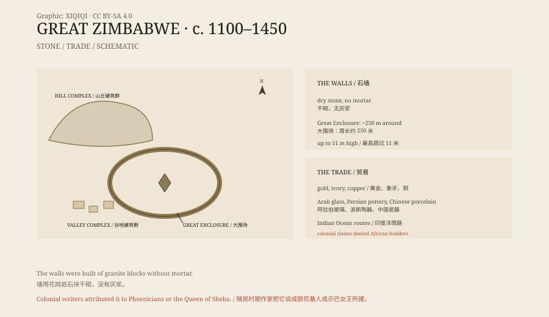

## 一、石头城

大津巴布韦在津巴布韦南部的马斯温戈附近。

“津巴布韦”在绍纳语里是“石头房子”的意思。这个国家的名字，就来自这片废墟。

遗址分为三部分：山上的“山丘建筑群”，谷地里的“谷地建筑群”，以及最著名的“大围场”。大围场是一圈椭圆形的石墙，周长约二百五十米，最高处超过十米。

## 二、怎么建的

墙是干砌的。

工匠把花岗岩石块一块块叠起来，不用灰浆，也不做削平处理。石块之间靠重量和角度咬合，墙身略微向内倾斜，底部厚，顶部薄。这种砌法今天还能看到，很多墙站了几百年。

大围场里有一座圆锥形的石塔，实心，高约九米。它的用途不清楚：可能是粮仓的象征，可能是祭祀建筑，也可能是王权的标志。

*原创示意图：山丘建筑群、大围场、谷地建筑群与印度洋贸易网络。不是测绘图。稀奇奇编辑部，CC BY-SA 4.0。*

## 三、谁建的

建城的是绍纳人，属于班图语族群。

大约在十一世纪，他们在这里建立了一个王国，控制着黄金、象牙和铜的贸易。遗址里出土了阿拉伯玻璃珠、波斯陶器、中国瓷器，说明这里的商路一直通到印度洋。

鼎盛时期，城里可能有一万多人。石墙围着的不是普通民居，而是王宫、仪式场所和贵族居住区。普通人住在墙外的土屋和茅屋里。

## 四、殖民者的否认

十九世纪末，欧洲人来到这里。

他们看到石墙，不相信是非洲人建的。有人说这是腓尼基人的殖民地，有人说是示巴女王的宫殿，有人说是所罗门王的金矿。考古学家挖掘出非洲人的遗物，这些说法仍然被官方压制。

在罗得西亚时期，学校教科书和旅游手册都避免说“非洲人建造”。这不是学术争论，而是政治需要：如果石头城是非洲人建的，殖民统治的“文明开化”叙事就站不住了。

1980 年津巴布韦独立后，大津巴布韦被定为国宝。津巴布韦鸟——从遗址里出土的石雕——成了国旗和货币上的图案。

## 五、衰落

十五世纪，城市被放弃。

原因可能是贸易路线改变、过度放牧、干旱，或者人口太多。权力中心向北迁移，出现了穆塔帕王国。石头城没有被摧毁，只是慢慢空了。

## 六、现在

1986 年，大津巴布韦被列入世界遗产。

今天，它是津巴布韦最重要的考古遗址，也是国家认同的象征。石墙在风化，树根在生长，部分墙体需要加固。考古工作还在继续，关于城市人口、王权和贸易的研究，也还在继续。

---

**来源与许可**：本文的事实来源见条目底部来源台账 S1–S3。文字与原创示意图采用 CC BY-SA 4.0。文中把建筑、建造者、贸易、殖民解释与衰落分开叙述；石墙的用途和部分建筑的功能仍有不同解释。
