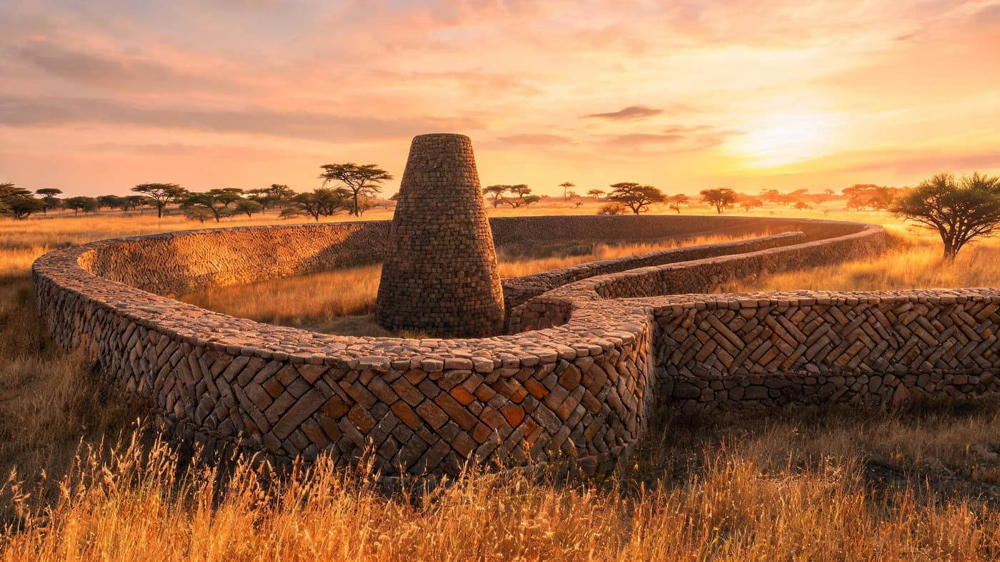
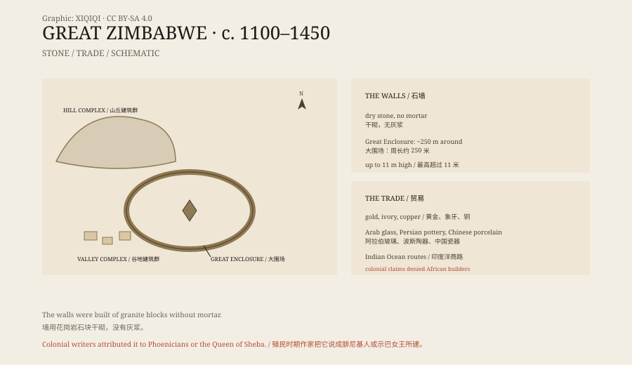

## 一、石头城

大津巴布韦在津巴布韦南部的马斯温戈附近。

“津巴布韦”在绍纳语里是“石头房子”的意思。这个国家的名字，就来自这片废墟。

遗址分为三部分：山上的“山丘建筑群”，谷地里的“谷地建筑群”，以及最著名的“大围场”。大围场是一圈椭圆形的石墙，周长约二百五十米，最高处超过十米。

下午太阳很低的时候，从谷地往上走，石墙会先出现在草丛后面。它不像欧洲城堡那样有棱有角，而是一道缓慢的弧线，顺着地形弯过去。走近了才看清，墙不是砌平的，每一块花岗岩都有自己的角度，缝隙里长着草。手放上去，石头是温的。

*场景复原：黄昏时的大围场石墙、圆锥形石塔与周围的稀树草原。不是实地照片。稀奇奇编辑部，CC BY-SA 4.0。*

## 二、怎么建的

墙是干砌的。

工匠把花岗岩石块一块块叠起来，不用灰浆，也不做削平处理。石块之间靠重量和角度咬合，墙身略微向内倾斜，底部厚，顶部薄。这种砌法今天还能看到，很多墙站了几百年。

大围场里有一座圆锥形的石塔，实心，高约九米。它的用途不清楚：可能是粮仓的象征，可能是祭祀建筑，也可能是王权的标志。

*原创示意图：山丘建筑群、大围场、谷地建筑群与印度洋贸易网络。不是测绘图。稀奇奇编辑部，CC BY-SA 4.0。*

## 三、谁建的

建城的是绍纳人，属于班图语族群。

大约在十一世纪，他们在这里建立了一个王国，控制着黄金、象牙和铜的贸易。遗址里出土了阿拉伯玻璃珠、波斯陶器、中国瓷器，说明这里的商路一直通到印度洋。

鼎盛时期，城里可能有一万多人。石墙围着的不是普通民居，而是王宫、仪式场所和贵族居住区。普通人住在墙外的土屋和茅屋里。

## 四、殖民者的否认

十九世纪末，欧洲人来到这里。

他们看到石墙，不相信是非洲人建的。有人说这是腓尼基人的殖民地，有人说是示巴女王的宫殿，有人说是所罗门王的金矿。考古学家挖掘出非洲人的遗物，这些说法仍然被官方压制。

在罗得西亚时期，学校教科书和旅游手册都避免说“非洲人建造”。这不是学术争论，而是政治需要：如果石头城是非洲人建的，殖民统治的“文明开化”叙事就站不住了。

1980 年津巴布韦独立后，大津巴布韦被定为国宝。津巴布韦鸟——从遗址里出土的石雕——成了国旗和货币上的图案。

## 五、衰落

十五世纪，城市被放弃。

原因可能是贸易路线改变、过度放牧、干旱，或者人口太多。权力中心向北迁移，出现了穆塔帕王国。石头城没有被摧毁，只是慢慢空了。

## 六、现在

1986 年，大津巴布韦被列入世界遗产。

今天，它是津巴布韦最重要的考古遗址，也是国家认同的象征。石墙在风化，树根在生长，部分墙体需要加固。考古工作还在继续，关于城市人口、王权和贸易的研究，也还在继续。

## 时间线

- **1980 年**：1980 年津巴布韦独立后，大津巴布韦被定为国宝
- **1986 年**：1986 年，大津巴布韦被列入世界遗产
- **背景**：约 1100–1450 年

## 来源与证据

本条目的事实底座以 1 条独立来源为主。S1（UNESCO World Heritage Centre）覆盖世界遗产信息、年代、建筑与保护状况。
原创插图只提供场景复原、结构示意或地图，不作为历史照片使用。正文把可核对记录、后来解释与传说分开叙述；同一件事在不同来源中的版本差异，保留在行文中，不强行合并。

## 档案位置

大津巴布韦的记录跨越考古学、建筑史和殖民时期的政治争论。考古调查确认了石墙、山丘建筑群和外围定居点的年代与营造顺序；早期欧洲旅行者和殖民官员的叙述，则长期把“谁建造”当成文明归属的论据。今天的博物馆与大学研究把建筑技术、牧牛与黄金贸易放在南部非洲内部的发展脉络里。本文把考古层位与殖民时代的解释分开，不重复“外来文明”的旧说。

大津巴布韦的档案一半是石头，一半是“谁有权解释石头”的纸面争论；本文先跟石头，再跟殖民时代的论辩。

## 档案空白

建筑年代、营造顺序与后续改动，需要考古报告和保护档案互证；单一的旅游说明或平面图，不足以定案。
这条档案把记录与未答的问题并排放置，不替读者做出超出证据的结论。
就可信度而言，本条目标为“verified”。这个标签描述的是当前证据状态，不是对传说真伪的终审；新档案出现时，标签应随之调整。

## 档案补记

以下补记保留正文没有展开的档案侧面：来源、技术细节与后续影响。
**博物馆**。 大津巴布韦，有一个博物馆。

它讲绍纳人的历史、贸易和建筑。博物馆里有陶器、金器和工具。

石头城不是谜。它是非洲人自己建的城市，只是后来的人不愿意相信。

石头城的存在，不需要殖民者承认。它就在那里，用花岗岩砌成，站了几百年。非洲的历史，不需要别人来证明。

墙还在，名字也在。

石头城不需要辩解，它只是站着。

石头城还在，故事也在。

---

**来源与许可**：本文的事实来源见条目底部来源台账 S1–S3。文字与原创示意图采用 CC BY-SA 4.0。文中把建筑、建造者、贸易、殖民解释与衰落分开叙述；石墙的用途和部分建筑的功能仍有不同解释。
