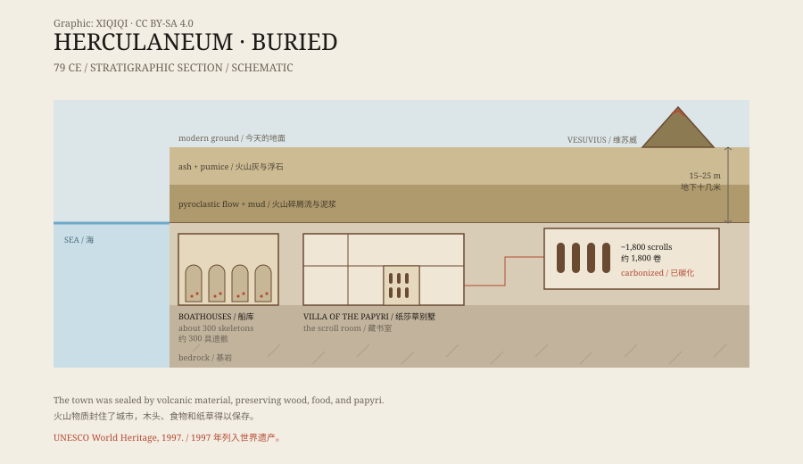

## 1. The eruption of 79 CE

In 79 CE, Mount Vesuvius erupted.

Pompeii was buried in ash. Herculaneum, closer to the volcano, was first covered by ash and pumice, then swallowed by hot pyroclastic flows and mud. The city ended up more than ten metres underground.

Unlike Pompeii, Herculaneum's burial environment was more sealed and more damp. Wood, food, cloth, and papyrus — organic materials that usually disappear — were carbonized and preserved.

## 2. The city in the mud

Herculaneum was a small Roman seaside town with apartment blocks, shops, baths, and villas.

In the eighteenth century, well-diggers hit the ruins. Engineers of the Bourbon dynasty then began systematic excavation. Because a modern town grew over the site, only part of the ancient city is visible today.

Archaeologists have found carbonized furniture, bread, beans, rope, and even a flattened roof. The city was not “burned to ash.” It was sealed almost instantly by hot gas and volcanic material.

*Original schematic: the burial layers, the seaside position, and the Villa of the Papyri at Herculaneum. Not a precise survey. Oddity Archive, CC BY-SA 4.0.*

## 3. The Villa of the Papyri

Near the shore stood a large villa, now called the Villa of the Papyri.

It was extensive, with gardens, colonnades, pools, and a library. Scholars usually identify its owner as Lucius Calpurnius Piso Caesoninus, Caesar's father-in-law and a nobleman with an interest in philosophy.

In the 1750s, excavators found a group of carbonized papyrus scrolls. The number is estimated at around 1,800 — the only complete library to survive from the ancient world.

## 4. Carbonized books

The scrolls had been burned into black, hardened lumps.

Papyrus carbonizes at high temperature, curling and sticking together; it can crumble at a touch. Eighteenth-century restorers tried to cut and peel the scrolls apart, destroying many. Later workers used slower, more careful methods, but the text remained very difficult to read.

Most of the scrolls are Greek philosophical works, especially associated with Epicureanism. One known author is Philodemus, a first-century BCE Epicurean philosopher.

## 5. Trying to read them

In the past, reading the scrolls meant opening them — and opening them often meant destroying them.

In recent years, researchers have tried X-rays, infrared imaging, and artificial intelligence to read the surface and internal structure without unrolling the scrolls. The Vesuvius Challenge, launched in 2023, released scan data and invited teams to compete at identifying letters. Some words and passages have been recovered, but a complete translation is still far off.

The work continues. Every small piece of text comes from a lump that looks like nothing but charcoal.

## 6. Now

In 1997, Herculaneum was inscribed as a World Heritage site together with Pompeii and Torre Annunziata.

Part of the site is open to visitors, including the seaside boathouses. In the 1980s, archaeologists found about 300 skeletons there; the people had not managed to reach the boats and were killed by the pyroclastic flow.

Most of the Villa of the Papyri is still underground. It is like a sealed library: the books are on the shelves, the words are in the books, and no one has yet been able to read them all.

---

**Sources and licenses**: the factual sources are listed in the source ledger S1–S3 at the bottom of this entry. Text and original diagrams are licensed under CC BY-SA 4.0. This article separates the burial process, the villa's ownership, the number of scrolls, and the reading technology; estimates of the owner and the number of scrolls vary, and the Vesuvius Challenge is still in progress.
