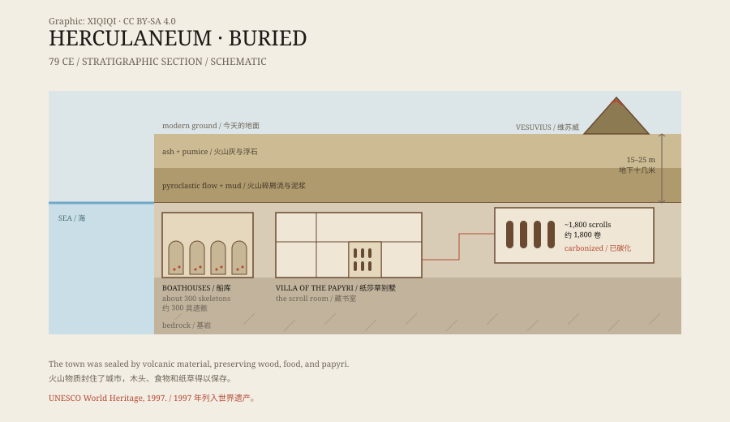

## 一、79 年的喷发

公元 79 年，维苏威火山喷发。

庞贝被火山灰埋住，赫库兰尼姆则更靠近火山。它先被火山灰和浮石覆盖，随后又被高温的火山碎屑流和泥浆吞没。城市被埋在地下十几米深的地方。

和庞贝不同，赫库兰尼姆的埋藏环境更封闭、更潮湿。木头、食物、布料、纸草，这些通常留不下来的有机物，在这里被碳化并保存了下来。

## 二、泥里的城市

赫库兰尼姆是一座罗马海滨小城，城里有多层住宅、商铺、浴场和别墅。

十八世纪，人们在挖井时碰到了遗址。随后，波旁王朝的工程师开始系统发掘。由于遗址上方后来建起了现代城镇，今天能看到的只是城市的一部分。

考古学家在这里发现了碳化的家具、面包、豆子、绳索，甚至还有一块被压扁的屋顶。城市不是被“烧成灰”，而是被高温气体和火山物质瞬间封住。

*原创示意图：赫库兰尼姆的埋藏层、海滨位置与纸莎草别墅。不是精确测绘图。稀奇奇编辑部，CC BY-SA 4.0。*

## 三、纸莎草别墅

城外海边有一座大型别墅，今天叫“纸莎草别墅”。

它面积很大，有花园、长廊、水池和图书室。学者通常认为它属于卢基乌斯·卡尔普尔尼乌斯·皮索·凯索尼努斯，他是凯撒的岳父，也是一位热衷哲学的贵族。

1750 年代，发掘者在别墅里找到了一批碳化的纸莎草卷轴。数量估计在一千八百卷左右，是古代世界唯一保存下来的完整图书馆。

## 四、碳化的书

这些卷轴已经被烧成了黑色的硬块。

纸莎草在高温下碳化，卷曲、粘连，稍一碰就可能碎。十八世纪的修复者尝试把它们切开、剥离，结果毁掉了不少。后来，人们改用更慢、更小心的方法，但仍然很难读出上面的字。

大部分卷轴是希腊文哲学著作，尤其与伊壁鸠鲁学派有关。已知的作者包括菲洛德穆，他是公元前一世纪的伊壁鸠鲁派哲学家。

## 五、试图读懂

过去，读懂这些卷轴意味着打开它们；而打开，往往意味着毁掉它们。

近年来，研究者尝试用 X 射线、红外成像和人工智能，在不展开卷轴的情况下读取表面和内部结构。2023 年启动的“维苏威挑战”把扫描数据公开，让团队比赛识别文字。已经有一些词和段落被读出来，但离完整翻译还很远。

这项工作仍在进行。每一小段被读出的文字，都来自一块看似没有希望的黑炭。

## 六、现在

1997 年，赫库兰尼姆与庞贝、托雷安农齐亚塔一起被列入世界遗产。

遗址的一部分对游客开放，包括海滨的船库。1980 年代，考古学家在那里发现了约三百具遗骸，他们没能逃上船，被火山碎屑流吞没。

纸莎草别墅的大部分仍然埋在地下。它像一个被封存的图书馆，书在架上，字在书里，只是还没有人能把它们全部读完。

---

**来源与许可**：本文的事实来源见条目底部来源台账 S1–S3。文字与原创示意图采用 CC BY-SA 4.0。文中把埋藏过程、别墅归属、卷轴数量与阅读技术分开叙述；别墅主人和卷轴数量存在不同估计，“维苏威挑战”的成果仍在推进。
