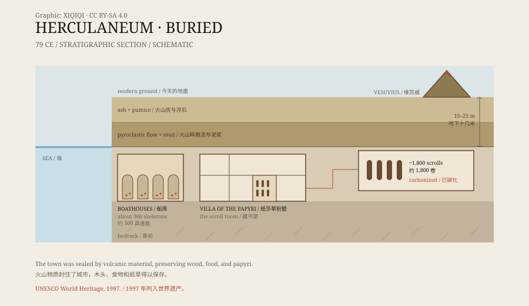

## 一、79 年的喷发

公元 79 年，维苏威火山喷发。

庞贝被火山灰埋住，赫库兰尼姆则更靠近火山。它先被火山灰和浮石覆盖，随后又被高温的火山碎屑流和泥浆吞没。城市被埋在地下十几米深的地方。

和庞贝不同，赫库兰尼姆的埋藏环境更封闭、更潮湿。木头、食物、布料、纸草，这些通常留不下来的有机物，在这里被碳化并保存了下来。

## 二、泥里的城市

赫库兰尼姆是一座罗马海滨小城，城里有多层住宅、商铺、浴场和别墅。

十八世纪，人们在挖井时碰到了遗址。随后，波旁王朝的工程师开始系统发掘。由于遗址上方后来建起了现代城镇，今天能看到的只是城市的一部分。

考古学家在这里发现了碳化的家具、面包、豆子、绳索，甚至还有一块被压扁的屋顶。城市不是被“烧成灰”，而是被高温气体和火山物质瞬间封住。

*原创示意图：赫库兰尼姆的埋藏层、海滨位置与纸莎草别墅。不是精确测绘图。稀奇奇编辑部，CC BY-SA 4.0。*

## 三、纸莎草别墅

城外海边有一座大型别墅，今天叫“纸莎草别墅”。

它面积很大，有花园、长廊、水池和图书室。学者通常认为它属于卢基乌斯·卡尔普尔尼乌斯·皮索·凯索尼努斯，他是凯撒的岳父，也是一位热衷哲学的贵族。

1750 年代，发掘者在别墅里找到了一批碳化的纸莎草卷轴。数量估计在一千八百卷左右，是古代世界唯一保存下来的完整图书馆。

## 四、碳化的书

这些卷轴已经被烧成了黑色的硬块。

纸莎草在高温下碳化，卷曲、粘连，稍一碰就可能碎。十八世纪的修复者尝试把它们切开、剥离，结果毁掉了不少。后来，人们改用更慢、更小心的方法，但仍然很难读出上面的字。

大部分卷轴是希腊文哲学著作，尤其与伊壁鸠鲁学派有关。已知的作者包括菲洛德穆，他是公元前一世纪的伊壁鸠鲁派哲学家。

## 五、试图读懂

过去，读懂这些卷轴意味着打开它们；而打开，往往意味着毁掉它们。

近年来，研究者尝试用 X 射线、红外成像和人工智能，在不展开卷轴的情况下读取表面和内部结构。2023 年启动的“维苏威挑战”把扫描数据公开，让团队比赛识别文字。已经有一些词和段落被读出来，但离完整翻译还很远。

这项工作仍在进行。每一小段被读出的文字，都来自一块看似没有希望的黑炭。

## 六、现在

1997 年，赫库兰尼姆与庞贝、托雷安农齐亚塔一起被列入世界遗产。

遗址的一部分对游客开放，包括海滨的船库。1980 年代，考古学家在那里发现了约三百具遗骸，他们没能逃上船，被火山碎屑流吞没。

纸莎草别墅的大部分仍然埋在地下。它像一个被封存的图书馆，书在架上，字在书里，只是还没有人能把它们全部读完。

## 喷发

公元 79 年，维苏威火山喷发。

庞贝被火山灰埋住，赫库兰尼姆被火山泥流埋住。泥流温度高、密度大，把城市封在里面。木质结构、食物和纸莎草，都被碳化保存。

## 泥里的城市

赫库兰尼姆比庞贝小，但保存得更好。

街道、房屋、商店和别墅，都在泥里。有的房子有两层，有的有花园和浴室。泥流把空气排走，减缓了腐烂。

## 纸莎草别墅

十八世纪，考古学家在赫库兰尼姆发现了一座别墅。

别墅里有几百卷纸莎草卷轴，被碳化成一团。它们属于一个富裕的家庭，内容主要是希腊哲学。

## 碳化的书

卷轴被碳化后，非常脆弱。

打开一卷，可能会把它碎成灰。早期的学者试过切开、剥离，但损失很大。后来，研究者用 X 射线、红外线和计算机技术，试图读出文字。

## 试图读懂

2015 年，研究者用 X 射线相位成像，读出了部分字母。

2023 年，一个国际团队用人工智能和粒子加速器，尝试解读更多卷轴。进展很慢，但每读出一个词，都是新的。

## 现在

赫库兰尼姆是考古公园。

游客可以看到街道、房屋和别墅。部分区域仍在挖掘，部分区域不开放。

一座被泥封住的城市，两千年后，还在被读。

## 火山

维苏威火山的喷发，持续了几天。

第一天，火山灰飘到罗马。第二天，庞贝被埋。赫库兰尼姆被火山泥流埋住，泥流温度高，速度快。

维苏威火山，是一座活火山。

它在那不勒斯湾，附近有庞贝、赫库兰尼姆和那不勒斯。公元 79 年的喷发，是最著名的一次。

## 保护

赫库兰尼姆的遗址，比庞贝小，但更完整。

泥流保护了木头、食物和纸莎草。遗址的开放区域有限，部分地方仍在挖掘。

## 数字

研究者用激光扫描、摄影测量和3D建模，记录遗址。

数字模型可以用于研究、展示和保护。如果遗址受损，模型可以作为参考。

研究者用 X 射线、红外线和人工智能，读卷轴。

每读出一个字母，都需要长时间的计算。进展很慢，但每一点都是新的。

## 游客

赫库兰尼姆的游客，比庞贝少。

这可能是好事。人少，遗址的压力小。但收入也少，保护的钱也少。

一座被泥封住的城市，安静地躺在那里。

## 纸莎草

纸莎草是古罗马的书写材料。

它用尼罗河的芦苇做，压成薄片，卷成卷轴。赫库兰尼姆的卷轴，被火山泥流碳化，变成了黑块。

## 旅游

赫库兰尼姆的街道，比庞贝窄。房屋保存得更好，木梁、家具和食物都留在原位。18 世纪，欧洲的王公来挖宝，把壁画切下来带走。

---

**来源与许可**：本文的事实来源见条目底部来源台账 S1–S3。文字与原创示意图采用 CC BY-SA 4.0。文中把埋藏过程、别墅归属、卷轴数量与阅读技术分开叙述；别墅主人和卷轴数量存在不同估计，“维苏威挑战”的成果仍在推进。
