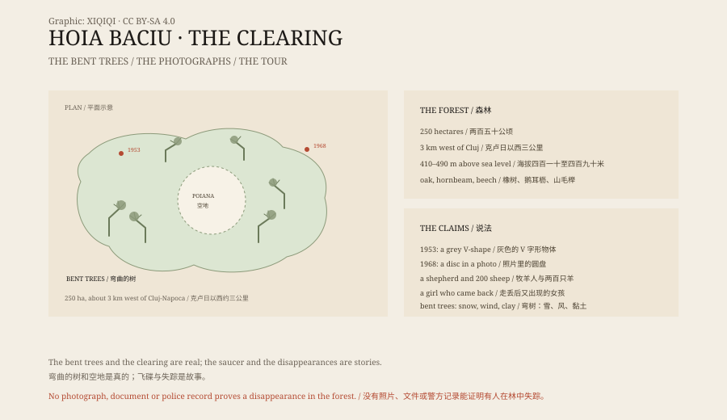

## 1. The Forest at the Edge of Town

Cluj-Napoca is a city in north-western Romania. Three kilometres west, the city ends and an oak forest begins.

The forest is called Hoia Baciu. It covers about 250 hectares, a little over two and a half square kilometres. The ground rises gently from the river valley, between 410 and 490 metres above sea level. Sessile oak, hornbeam and beech dominate. In summer the canopy is thick, and the woods are dark even at noon.

This is not a wilderness. There are marked trails. People run here at weekends and walk their dogs. But the stories about the place grow as crooked as its trees.

## 2. The Name

Locals explain the name with a story: a shepherd walked in with two hundred sheep and never came out. Neither the man nor the flock left a trace.

The story has no date, no document and no witness. It is the kind of legend that turns up everywhere: a particular wood, cave or stretch of road that supposedly swallowed someone.

The real origin of the name is uncertain. "Baciu" is connected in Romanian to shepherding and to old men, but attaching it to a vanished shepherd came later. The story has outlived the etymology.

## 3. The Bent Trees

The trees are what made Hoia Baciu famous.

Hundreds of them do not grow straight. Trunks bend, twist and corkscrew, sometimes folding low to the ground before turning upward again. In photographs they look unnatural.

The trees are real, and the photographs are not composites. But there is a fairly ordinary explanation for the shape.

A tree grows upward using gravity sensing and hormone distribution. If a sapling is weighed down by snow, pushed by wind for years, or loses its footing when clay soil shifts, the trunk can grow bent. Hoia Baciu has heavy winters and clay soil. It has the right conditions.

Forestry researchers have seen woods like this before. Bent trees are not rare in the Carpathians. Hoia Baciu simply has a lot of them, and a frightening story attached.

## 4. The Clearing

In the middle of the forest is a circular clearing, known locally as the poiana.

Almost no trees grow there, and the grass is poor. Standing at the edge, you look through dense woods into a sudden open space, as if a layer had been scooped out.

The clearing exists. Some say a flying saucer landed and pressed it flat; some say the soil is wrong; some say it was a ritual site.

No published survey has shown that the clearing is barren because of anything abnormal. Grazing, logging, poor soil and deliberate clearing are all plausible. None of them satisfies everyone.

## 5. The Photographs

In July 1953 a student named Alexandru Sift reported a grey, V-shaped object at the edge of the wood. He later became a biologist and one of the forest's main investigators, taking many photographs.

What made Hoia Baciu famous, though, was 18 August 1968. A military technician named Emil Barnea said he saw a disc-shaped object above the trees and took several photographs.

The pictures were reprinted by newspapers and magazines around the world. Some called it a flying saucer; some called it a camera fault; some called it a fake. The negatives, the original prints and the conditions of the shot were never independently verified.

Television programmes, travel sites and short videos have repeated the stories ever since. Hoia Baciu acquired several nicknames: "the Bermuda Triangle of Transylvania", "Romania's Area 51", "the most haunted forest in the world".

## 6. The Missing

The most widely told disappearance is that of a five-year-old girl. She is said to have wandered into the woods and reappeared hours later, unable to say where she had been.

The story has no name, no date and no police record. Romanian journalists usually attach the phrase "the legend says".

The documented cases in the area are mostly adults who got lost or injured while hiking in the surrounding hills, no different from any other European mountain range.

The forest is small, about three square kilometres. An adult can walk the trail loop in an afternoon. Disappearing here is harder than the legends suggest.

## 7. The Business

Hoia Baciu is now a tourist product.

There are daytime hikes and night tours, ghost-hunting gadgets and guides with flashlights telling the shepherd and saucer stories. Nearby there are guesthouses, taxis and souvenir stalls.

This is not a fraud. Visitors know they are buying a story, and guides know they are telling one. The problem is that after a story has been told often enough, many people begin to treat it as fact.

## 8. The Forest

Take away the saucers, the ghosts and the disappearances, and Hoia Baciu is still a good oak forest.

Wild flowers in spring, shade in summer, yellow leaves in autumn, snow resting on bent trunks in winter. The trees are still crooked, the clearing is still empty, and the shepherd has still not come back.

Some places do not need an answer. They need a storyteller and a flashlight.

*Original schematic: the clearing, the bent trees and the 1953 and 1968 sightings. Not a photograph of the site. Oddity Archive, CC BY-SA 4.0.*

---

**Sources and licenses**: the factual sources are listed in the source ledger S1–S3 at the bottom of this entry. Text and original diagrams are licensed under CC BY-SA 4.0. This article separates the geography and tree forms, the local legends, the photograph controversy and the tourist trade; the bent trees and the clearing are real, while the saucer and disappearance stories have no verifiable evidence. The illustration is a scene reconstruction, not a photograph of the site.
