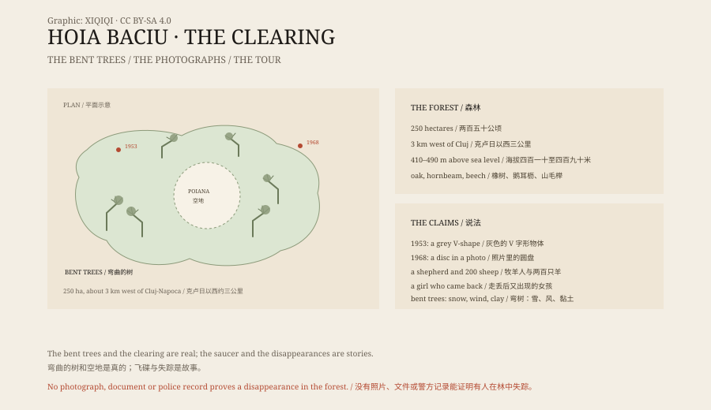

## 一、城边的林子

克卢日-纳波卡是罗马尼亚西北部的一座城市。往西走三公里，城市突然结束，变成一片橡树林。

林子叫霍亚巴丘，大约两百五十公顷，也就是两个半平方公里多一点。地势从河谷缓缓升高，海拔在四百一十米到四百九十米之间。主要树种是无梗橡、鹅耳枥和山毛榉。夏天叶子很密，白天走进去也是暗的。

这片林子不是荒野。它有步道，有标记，周末有人跑步，有人遛狗。但关于它的故事，和它的树一样，长得歪歪扭扭。

## 二、名字

“霍亚巴丘”这个名字，当地人给了一个解释：一个牧羊人带着两百只羊走进去，再也没出来。人和羊都没有留下痕迹。

这个故事没有日期，没有文件，也没有目击者。它属于那种在每个地方都能听到的传说：某片林子、某个山洞、某段路，吞掉过一个人。

名字的真正来源，语言学家也没有定论。“Baciu”在罗马尼亚语里和牧羊、老人有关，但把它直接安在一位消失的牧羊人身上，是后来的说法。故事比词源活得更久。

## 三、弯曲的树

霍亚巴丘最有名的，是树。

林子里有几百棵树，树干不是直的，而是打着弯、拧着圈，像被人从中间折了一下。有些树在很低的地方突然拐弯，然后又向上长。照片看起来很不自然。

这些树是真的，照片也不是合成。但“为什么弯”，有比较普通的解释。

植物向上长，靠的是重力感应和激素分布。如果幼树在生长时被雪压住、被风长期吹向一边，或者根下的土层滑动，树干就可能长成弯曲的形状。霍亚巴丘冬天雪大，土壤又是黏土，这些条件都具备。

林业研究者见过类似的林子。弯曲的树在喀尔巴阡山区不算罕见，只是这里数量多，又刚好有一个吓人的故事。

## 四、空地

林子中央有一块圆形空地，当地人叫它“波亚纳”。

空地上几乎没有树，草也长得不好。站在边上往里看，四周是密林，中间突然空出来一块，像被谁挖走了一层。

这块空地确实存在。有人说是飞碟降落压出来的，有人说是土壤里有问题，有人说是古代仪式场所。

目前没有公开的检测报告能证明它“不长东西”是因为异常。空地可能和放牧、伐木、土壤贫瘠或人为清理有关。但没有一个解释能让所有人满意。

## 五、照片

1953 年 7 月，一个叫亚历山德鲁·西夫特的学生在林边看见一个灰色的、V 字形的物体。他后来成了生物学家，也成了这片林子的调查者，拍了很多照片。

真正让霍亚巴丘出名的是 1968 年 8 月 18 日。一名叫埃米尔·巴尔内亚的军事技术员说，他在林子上空看见一个圆盘状物体，并拍下了几张照片。

照片后来被全世界的报纸和杂志转载。有人说是飞碟，有人说是相机故障，有人说是伪造。照片的原件、底片和拍摄条件，都没有得到独立验证。

从那以后，电视节目、旅游网站和短视频不断重复这些故事。霍亚巴丘有了几个外号：“特兰西瓦尼亚的百慕大三角”、“罗马尼亚的 51 区”、“世界最闹鬼的森林”。

## 六、失踪

关于霍亚巴丘的失踪故事，流传最广的是一个五岁女孩。据说她在林子里走丢，几个小时后自己出现，说不出去了哪里。

这个故事没有姓名、没有日期、没有警方记录。罗马尼亚媒体在写霍亚巴丘时，通常会加一句“传说”。

能查到的失踪记录，多是成年人在这一带山区徒步时迷路或受伤，和欧洲其他山地没有太大区别。

林子不大，三平方公里左右。一个成年人沿着步道走，一个下午可以绕一圈。要在这里“消失”，比传说里难得多。

## 七、生意

霍亚巴丘现在是一个旅游项目。

有白天徒步，有夜游，有“捉鬼”设备，有讲解员带着手电筒讲牧羊人和飞碟。附近有民宿，有出租车，有卖纪念品的摊位。

这不是骗局。游客知道自己在买一个故事，导游也知道自己在讲一个故事。问题在于，故事被讲得太多遍之后，很多人会把它当成事实。

## 八、林子

如果你去掉飞碟、鬼魂和失踪，霍亚巴丘还是一片不错的橡树林。

春天有野花，夏天有阴凉，秋天叶子变黄，冬天雪压在弯曲的树干上。树还是弯的，空地还是空的，牧羊人还是没有回来。

有些地方不需要答案。它们只需要一个讲故事的人，和一盏手电筒。

*原创示意图：霍亚巴丘森林的空地位置、弯曲树木与 1953／1968 年两次目击。不是现场照片。稀奇奇编辑部，CC BY-SA 4.0。*

---

**来源与许可**：本文的事实来源见条目底部来源台账 S1–S3。文字与原创示意图采用 CC BY-SA 4.0。文中把森林的地理与树木形态、当地传说、照片争议和旅游现状分开叙述；弯曲的树和空地的存在有实地依据，飞碟与失踪故事没有可验证的证据。插图是场景复原，不是现场照片。
