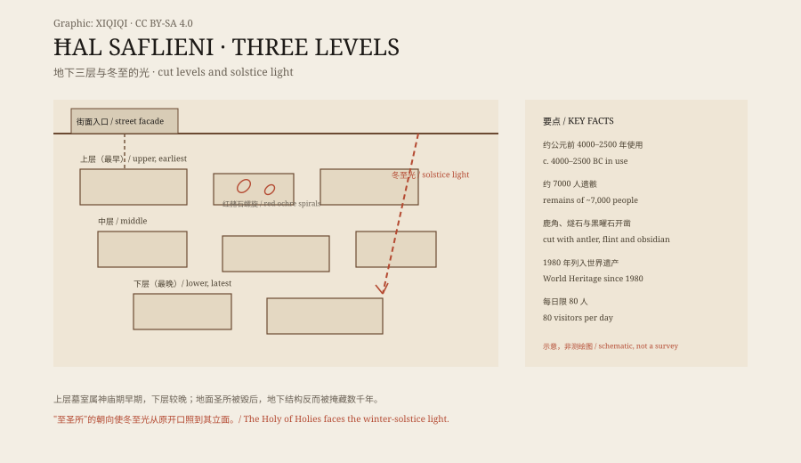

## 1. The building site of 1902

In 1902, a housing development was under construction in Paola, Malta.

Workers digging foundations broke into an underground space. Below was not soil or a natural cave but a series of carved passages and rooms.

The news reached archaeologists. Excavation followed, directed by the Maltese doctor and archaeologist Temi Zammit. The site became known as the Ħal Saflieni Hypogeum.

## 2. Three underground levels

The Hypogeum is not a single chamber but a three-level underground complex.

The upper, middle, and lower levels descend through the limestone. Rooms, corridors, steps, niches, and ceiling carvings were all cut from the rock. The stone is the local globigerina limestone, soft enough to carve but vulnerable to water and salt.

Its most important use was as a necropolis. Excavation found large quantities of human bone; thousands of people are estimated to have been buried there. At the same time, its layout and decoration are more elaborate than a simple cemetery, suggesting a ritual function as well.

*Original schematic: the upper, middle, and lower levels and main chambers of the Hypogeum. Not a precise survey. Oddity Archive, CC BY-SA 4.0.*

## 3. Red paintings

The most striking feature is the red ochre painting.

Spirals, dots, curves, and geometric patterns cover the walls. Some follow doorways and niches; some cover entire ceilings. The red stands out sharply against the gray-yellow limestone.

There is no accompanying text. Researchers can only infer connections to ritual, death, or ancestry from the position, combinations, and similarities with other Maltese prehistoric sites.

## 4. The Sleeping Lady

After 1902, the site produced a group of small figurines and objects.

The most famous is a reclining female figure, later called the “Sleeping Lady.” She lies on her side, with a full body and a calm posture. The figurine is small enough to hold in one hand.

It is now in Malta's National Museum of Archaeology. Whether it represents a deity, an ancestor, or a ritual role is unresolved.

## 5. Sound

The Hypogeum is also known for its acoustics.

One chamber is called the “Oracle Room.” Researchers have measured its acoustic properties and found that certain low frequencies are amplified, producing resonance. A person speaking inside sounds deeper and fuller.

Whether this was a deliberate design choice is debated. What is clear is that the sound depends on the underground setting, the shape of the room, and the stone.

## 6. Now

In 1980, the Hypogeum was inscribed as a UNESCO World Heritage site.

Visitor numbers are tightly limited to protect the site. Humidity, carbon dioxide, and temperature inside the chambers must be controlled, because breath and sweat accelerate the decay of limestone. The site has been closed at times for conservation work.

It is not a place you can simply walk into. More often it functions as a carefully guarded underground archive, preserving a Neolithic understanding of death, space, and sound.

---

**Sources and licenses**: the factual sources are listed in the source ledger S1–S3 at the bottom of this entry. Text and original diagrams are licensed under CC BY-SA 4.0. This article separates the structure, the finds, the acoustics, and the interpretations; the site's exact use is still debated.
