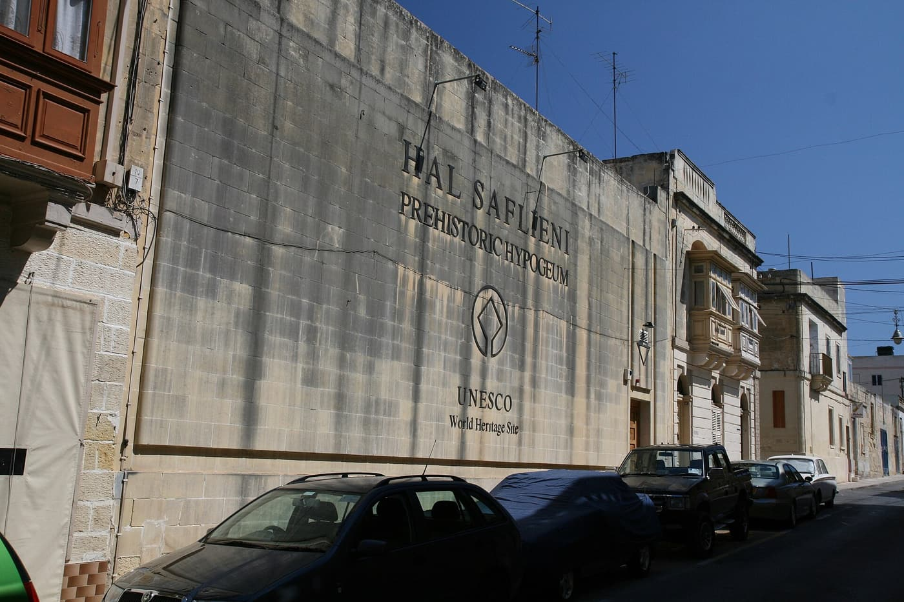
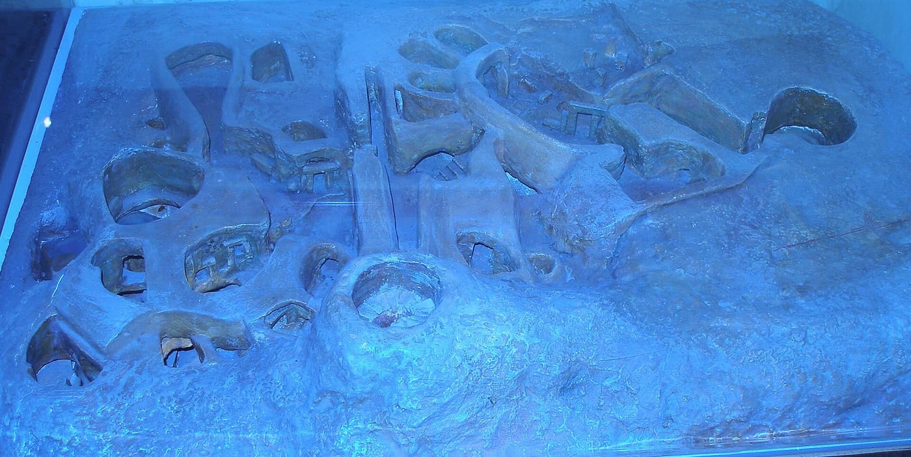
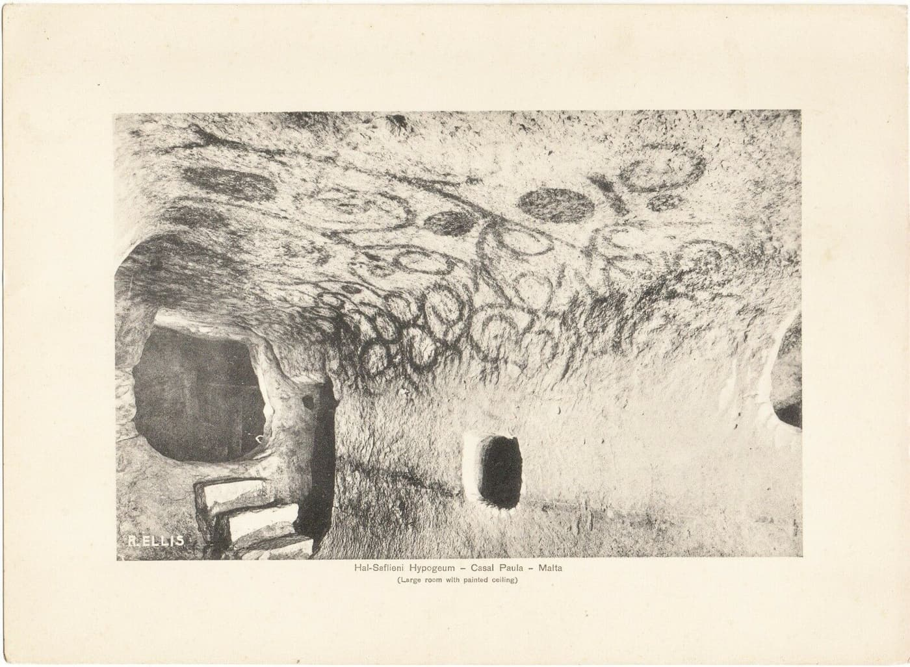
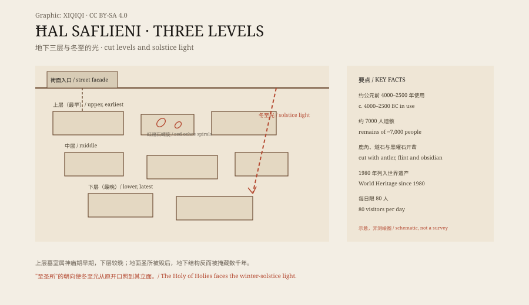

## 一、1902 年，凿穿屋顶

马耳他保拉，一条普通住宅街。街面是一堵混凝土墙，漆着字："HAL SAFLIENI PREHISTORIC HYPOGEUM / UNESCO World Heritage Site"。墙后停着车，晾着衣。没有人看得出墙下藏着什么。

1902 年，工人为新住宅区凿蓄水池，凿穿了这座地下建筑的屋顶。他们起初想把它瞒下来——发现古迹意味着工程停摆、土地被征——但最终还是暴露了。1903 年 11 月起，曼努埃尔·马格里神父代表博物馆委员会主持发掘；发掘中大量内容物——随葬品与人骨——被清出、未经妥善编目就丢弃。1907 年马格里在突尼斯传教时去世，他的地下宫报告随之遗失。

*现场照片：2011-07-30，Andrey BG，公有领域（Wikimedia Commons）。地下宫的地面入口墙与街景；地下结构藏在普通街面之后。*

接手的是塞米斯托克莱·扎米特，他尽力抢救剩余材料，1910 年起陆续发表报告，把出土物存入瓦莱塔的国家考古博物馆。地下宫 1908 年发掘期间就已对访客开放；1912 年玛丽王后到访。后来建博物馆时，压在其上的四栋当代房屋被拆掉。早期发掘的代价今天无法估量：被丢弃的随葬品与人骨没有目录，意味着多少层位、多少组合关系永久丢失，已不可知。

## 二、三层地下

地下宫可能起源于一个天然洞穴，后被直接用工具向岩体里扩凿：鹿角、燧石与黑曜石等。它分三层：上层墓室属马耳他神庙期早期，中层与下层较晚。考古学上以它命名了一个阶段——萨夫列尼期（约公元前 3300–3000 年）。总面积约五百平方米，考古学家记录的遗骸超过七千人——它既是圣所，也是墓地。

*现场照片：2006-09-02，原上传 320rwekfpl，公有领域（Wikimedia Commons）。博物馆展出的地下宫剖切模型，可见三层墓室与连接开口。*

模型把这件事说清楚了：这不是"挖了一个洞"，而是在岩石里雕出一整座建筑——房间、门洞、台阶、竖井，彼此套叠，像把一座地面神庙翻扣进地下。马耳他的地面神庙（如吉甘提亚）比埃及金字塔还早；地下宫是同一套神庙文化向地下的延伸：同样的巨石工艺、同样的仪式空间，只是材料从"垒起来"变成"凿进去"。马格里 1907 年 10 月绘制的平面图是早期记录之一；他的文字报告遗失后，这类图与照片成了重建发掘史的主要依据。

## 三、红赭石的螺旋

部分天花板上绘着红赭石图案：圆点、螺旋、蜂窝纹。约 1900 年，马耳他摄影师理查德·埃利斯拍下其中一间大室：照片里螺旋从天花板漫到墙面，门洞与台阶在左下，印页下方题着"Hal-Saflieni Hypogeum — Casal Paula — Malta (Large room with painted ceiling)"，左下角是他的签名"R. ELLIS"。

*历史照片：约 1900 年，Richard Ellis，公有领域（Wikimedia Commons）。彩绘天花板大室；印页含题字与摄影师签名。*

这张照片本身也是一件文物：它记录的是发掘早期、尚未被现代灯光与保护工程改变的状态。螺旋在黑白照片里呈深色；在原石上，它们是红赭石——一种氧化铁颜料，史前地中海最通用的"红"。埃利斯是马耳他早期摄影的代表人物，他的照片同时是明信片商品与考古记录；这张印页正是两者合一的产物。图案的含义没有被破译：圆点、螺旋、蜂窝可能是象征、可能是仪式标记，也可能只是装饰；本文不替史前作者给出解释。

## 四、冬至的光

地下宫的结构对光有安排：从地面引入的光被导向下层房间。主室之一被称为"至圣所"，其朝向使得冬至那天、从原始开口进入的光照亮它的立面。地面曾有一座圣所标记入口；它被毁后，地下结构反而被掩藏了数千年，直到 1902 年那镐。2014 年国际团队来研究的声学特性也属于这套"空间设计"：某些房间对低频人声有明显的共振，被解释为仪式吟诵或宣告的空间——声音和光一样，是被建筑引导的。

*原创示意图：三层岩凿结构、红赭石螺旋与冬至光路。不是测绘图。稀奇奇编辑部，CC BY-SA 4.0。*

## 五、每天八十人

1990–1993 年再次发掘；1991 到 2000 年关闭修复。重新开放后，管理方 Heritage Malta 每天只放八十人进入，并严格调控微气候——访客的呼吸、湿气与体温会改变洞内环境，威胁红赭石彩绘：二氧化碳与凝露会缓慢溶解颜料层，所以人数、停留时间与通风都被计算过。2011 年启动更密集的劣化监测；2014 年有国际团队来研究声学；2017 年 5 月，在关闭一年改进环境管理系统后重新开放。1980 年它列入世界遗产，依据的是标准三（iii）：作为已消失的马耳他神庙文化的独特见证。

八十人是一个保护数字，也是一个隐喻：这座能容纳七千名死者的建筑，今天每天只允许八十个活人呼吸。门票需预约、分时段放行；2017 年重开前的那一年关闭，正是为了把环境管理系统做到能支撑这八十次呼吸而不伤害彩绘。预约制也改变了参观的性质：它不再是"随时可看的景点"，而是一次被限额的进入。

## 六、名字与山顶

"哈尔萨夫列尼"意为"低村"：ħal 是村，saflieni 是低。但扎米特指出这个名字名不副实——地点其实在山顶；它只是比附近的"高村"哈尔富卡尼低。两个词都源自柏柏尔语，说明这个村名可能出现在穆斯林来到马耳他之后。一个已不存在的村子的名字，留在了一座比村子更古老得多的建筑上；马耳他有一份"消失村庄"清单，哈尔萨夫列尼是其中之一。

今天那堵街面墙还在，字还在。墙下三层岩石里，螺旋还在天花板上，冬至的光每年仍照一次"至圣所"的立面。八十张门票之外，它安静地继续做它做了六千年的事：装着死者，等着光。
---

**来源与许可**：事实来源见台账 S1–S5。文字与原创示意图 CC BY-SA 4.0。入口、模型与埃利斯照片为公有领域（Wikimedia Commons），出处见台账。年代与人数为考古估计；"至圣所"冬至朝向为考古天文学解释，本文作为解释呈现。