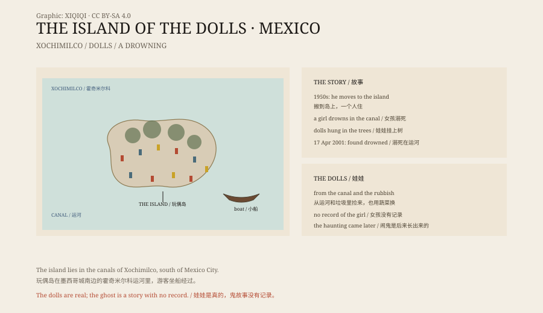

## 1. The canals

South of Mexico City there is a network of waterways called Xochimilco.

It was once an Aztec farming district. People piled earth in the shallow water to make narrow artificial islands called chinampas. They grew vegetables and flowers, and moved between them by boat. In 1987 the area became a World Heritage Site.

Today visitors sit in flat-bottomed boats and are rowed slowly along the canals. On both sides are vegetable plots and flower beds, and sometimes a band playing on another boat.

The boatmen stop at one particular place and let everyone look at a small island.

## 2. The man on the island

The island belonged to Julián Santana Barrera.

He was a farmer. In the 1950s he moved to the island and lived there alone, growing vegetables, keeping chickens, repairing the shed.

Neighbours described him as quiet and withdrawn.

## 3. The drowned girl

The story most often told about the island goes like this.

One day Santana saw a girl drowning in the canal beside the island. He could not swim, or he was too late. The girl died.

There are many versions. Some say he found a body floating in the water. Some say he heard a cry for help. Some say the girl was with him. No one knows her name, and there is no record.

Santana later said that the girl's ghost began to appear on the island. He heard footsteps, heard crying, saw a shape on the water.

## 4. The dolls

He began collecting dolls.

He pulled them out of the canal, took them from rubbish piles, picked up the ones visitors threw away. He hung them in the trees, nailed them to walls, tied them to sheets of tin. He also traded vegetables from the island for dolls.

The dolls multiplied. Some were missing arms. Some had no eyes. Some had lost their hair to birds. Some were covered in moss. Hundreds of dolls hung in the trees and turned together in the wind.

Santana said the dolls were there to calm the girl's ghost and to protect himself. Some say he believed the dolls could take the place of living people and draw the ghost away.

## 5. 17 April 2001

On 17 April 2001, Santana's nephew came to look for him and found him drowned in the canal near the island.

He died close to the place where he said he had seen the girl.

When the news spread, the island became famous. People said the girl had taken revenge, or that the ghost had led him into the water.

## 6. Now

The island is now a tourist stop.

Boatmen pause there for ten or fifteen minutes and let visitors take photographs. Some people bring new clothes for the dolls, some leave dolls of their own, some will not touch them.

People who live nearby say the dolls can be heard talking at night. Others say it is only the wind passing through plastic bodies.

*Original schematic: the canals of Xochimilco, the dolls on the island, and the timeline of Santana's life there. Not a photograph of the site. Oddity Archive, CC BY-SA 4.0.*

## 7. The story

The dolls are real. There are hundreds of them, hanging in the trees, faded and broken.

Was the girl real? There is no record, no name, no body report. No second person can confirm Santana's account.

A man lived alone on a small island for fifty years, collected hundreds of dolls, and died in the same water. That is enough by itself. The ghost story grew afterwards.

## Canal

Doll Island, in the Hochimirko Canal District, Mexico City.

This was once an agricultural area of the Aztec people, which became a tourist destination. On both sides of the Canal are artificial islands (chinampa), flowers, vegetables, restaurants and boats.

The canal of Hochimirko was dug artificially.

The water is shallow and the boat is small. The sides are artificial islands, flowers and vegetables. Tourists take boats, watch flowers, listen to music.

## The man on the island

The man on the island is Julian Santana Barrera.

He lived on the island alone, living by fishing and growing vegetables. In the 1950s, he started hanging dolls on trees. Some said he was trying to remember a drowning girl; others said he was trying to drive out evil spirits.

## Dolls

The dolls were hanging on trees, walls and boats.

They're wet by rain, dry by sun, their hair is falling off, their eyes are white. Some of them have little arms, some have only one head. They don't look like toys, more like remains.

The dolls on the island, they're not just toys anymore.

They're broken by rain, sunlight and birds. Some have lost their hair, some have lost their eyes. They look like people, and they don't look like people.

The dolls on the island, they're from Julian.

Why did he hang up, nobody knows. Some people say memorials, some say exorcism, some say it's just loneliness.

## Death

On April 17, 2001, Julian died on the island.

He died in the canal with no clear record of the cause of death. Some say he drowned, some say he had a heart attack. After he died, the dolls on the island continued to hang and became a scene.

## Now

Doll Island became a tourist destination.

Tourists come by boat, take pictures, buy souvenirs. There are no permanent residents on the island, but only dolls and old houses.

## The story

The story of doll island is about loneliness and remembrance.

A man lives on the island and fills trees with dolls. He doesn't know that these dolls will turn into attractions or that they will be filmed as horror films.

The dolls aren't ghosts. They're just plastic and cloth, they're dirty in time.

## Tourism

Doll Island is a tourist destination.

Tourists come by boat, take pictures, buy souvenirs. There are no toilets, no restaurants, only dolls.

Doll Island has become a tourist destination.

Tourists come by boat, take pictures, buy souvenirs. There are no residents on the island, only dolls.

## Ecology

The water quality of the canal is declining.

Tourism, agriculture and urban sewage affect the canal. The name of doll island also brings more people here.

A site consisting of dolls, behind which an injured canal was found.

## Hodge Mirko

Hodge Mirko is south of Mexico City.

This was once a lake, which was replaced by canals and artificial islands.

## Manshima

The artificial island is called chinampa.

People dig from the bottom of the lake, pile up into islands, then plant willows. The islands are narrow, the water is shallow and the ships can cross.

## Environment

The dolls are still in the trees, the canals are still flowing. The men on the island are gone and the story is left.

There's some dolls on doll island without a head. Legends say tourists or storms break.

The dolls on the island were first placed by local fishermen. Later, tourists also brought the dolls. No one counted the number of dolls. There were, according to some people, thousands.

---

**Sources and licenses**: the factual sources are listed in the source ledger S1–S3 at the bottom of this entry. Text and original diagrams are licensed under CC BY-SA 4.0. This article separates the canals and the island, Santana's life, the story of the girl, the dolls, and his death; there is no verifiable record of the girl's identity or drowning, and Santana's death is recorded as drowning. The illustration is a scene reconstruction, not a photograph of the site.
