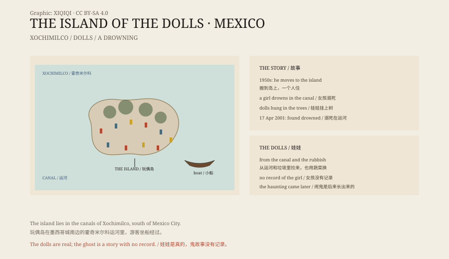

## 1. The canals

South of Mexico City there is a network of waterways called Xochimilco.

It was once an Aztec farming district. People piled earth in the shallow water to make narrow artificial islands called chinampas. They grew vegetables and flowers, and moved between them by boat. In 1987 the area became a World Heritage Site.

Today visitors sit in flat-bottomed boats and are rowed slowly along the canals. On both sides are vegetable plots and flower beds, and sometimes a band playing on another boat.

The boatmen stop at one particular place and let everyone look at a small island.

## 2. The man on the island

The island belonged to Julián Santana Barrera.

He was a farmer. In the 1950s he moved to the island and lived there alone, growing vegetables, keeping chickens, repairing the shed.

Neighbours described him as quiet and withdrawn.

## 3. The drowned girl

The story most often told about the island goes like this.

One day Santana saw a girl drowning in the canal beside the island. He could not swim, or he was too late. The girl died.

There are many versions. Some say he found a body floating in the water. Some say he heard a cry for help. Some say the girl was with him. No one knows her name, and there is no record.

Santana later said that the girl's ghost began to appear on the island. He heard footsteps, heard crying, saw a shape on the water.

## 4. The dolls

He began collecting dolls.

He pulled them out of the canal, took them from rubbish piles, picked up the ones visitors threw away. He hung them in the trees, nailed them to walls, tied them to sheets of tin. He also traded vegetables from the island for dolls.

The dolls multiplied. Some were missing arms. Some had no eyes. Some had lost their hair to birds. Some were covered in moss. Hundreds of dolls hung in the trees and turned together in the wind.

Santana said the dolls were there to calm the girl's ghost and to protect himself. Some say he believed the dolls could take the place of living people and draw the ghost away.

## 5. 17 April 2001

On 17 April 2001, Santana's nephew came to look for him and found him drowned in the canal near the island.

He died close to the place where he said he had seen the girl.

When the news spread, the island became famous. People said the girl had taken revenge, or that the ghost had led him into the water.

## 6. Now

The island is now a tourist stop.

Boatmen pause there for ten or fifteen minutes and let visitors take photographs. Some people bring new clothes for the dolls, some leave dolls of their own, some will not touch them.

People who live nearby say the dolls can be heard talking at night. Others say it is only the wind passing through plastic bodies.

*Original schematic: the canals of Xochimilco, the dolls on the island, and the timeline of Santana's life there. Not a photograph of the site. Oddity Archive, CC BY-SA 4.0.*

## 7. The story

The dolls are real. There are hundreds of them, hanging in the trees, faded and broken.

Was the girl real? There is no record, no name, no body report. No second person can confirm Santana's account.

A man lived alone on a small island for fifty years, collected hundreds of dolls, and died in the same water. That is enough by itself. The ghost story grew afterwards.

---

**Sources and licenses**: the factual sources are listed in the source ledger S1–S3 at the bottom of this entry. Text and original diagrams are licensed under CC BY-SA 4.0. This article separates the canals and the island, Santana's life, the story of the girl, the dolls, and his death; there is no verifiable record of the girl's identity or drowning, and Santana's death is recorded as drowning. The illustration is a scene reconstruction, not a photograph of the site.
