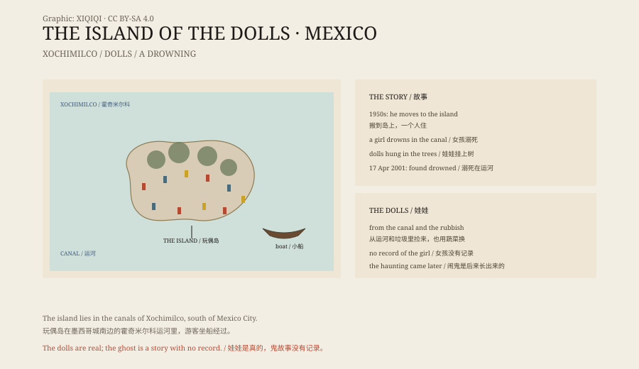

## 一、运河

墨西哥城南边有一片水网，叫霍奇米尔科。

这里曾经是阿兹特克人的农业区。人们在浅水里堆土，做成一块块狭长的人工岛，叫 chinampa。岛上种菜、种花，水道之间靠小船来往。1987 年，这一片被列入世界遗产。

今天，游客坐上平底船，在运河里慢慢划。两岸是菜地和花圃，偶尔有乐队在船上演奏。

船夫会把船停在一个地方，让大家看一座小岛。

## 二、岛上的男人

岛主叫胡利安·桑塔纳·巴雷拉。

他原本是种地的。1950 年代，他搬到这座小岛上，一个人住，种菜、养鸡、修理破屋。

邻居说他安静、寡言，不太和人打交道。

## 三、溺水的女孩

关于这座岛，流传最广的故事是这样的：

有一天，桑塔纳在岛边的运河里，看见一个女孩溺水。他不会游泳，或者来不及了。女孩死了。

版本有很多。有人说他看见了浮在水面的尸体，有人说他听见了呼救，有人说女孩是和他一起的。没有人知道女孩的名字，也没有记录。

桑塔纳后来对人说，女孩的鬼魂开始出现在岛上。他听见脚步声，听见哭声，看见水面上有影子。

## 四、娃娃

他开始捡娃娃。

运河里漂来的、垃圾堆里扔掉的、游客不要的，他都捞上来，挂在树上、钉在墙上、绑在铁皮上。他也用岛上的蔬菜，和岸上的人换娃娃。

娃娃越来越多。有的缺胳膊，有的没有眼睛，有的头发被鸟叼走，有的身上长满青苔。几百个娃娃挂在树上，风一吹，一起晃。

桑塔纳说，娃娃是为了安抚女孩的鬼魂，也是为了保护自己。有人说，他相信娃娃可以代替活人，把鬼魂引开。

## 五、2001 年 4 月 17 日

2001 年 4 月 17 日，桑塔纳的侄子来找他，发现他溺死在岛附近的运河里。

他死的地方，离他当年看见女孩的地方很近。

消息传开后，这座岛出了名。人们说，这是女孩的报复，或者是鬼魂把他带走了。

## 六、现在

岛现在是一个旅游点。

船夫会在这里停十几分钟，让游客拍照。有人给娃娃换上新衣服，有人留下自己的娃娃，有人不敢碰。

住在附近的人说，晚上能听见娃娃在说话。也有人说，那只是风穿过塑料身体的声音。

*原创示意图：霍奇米尔科运河、岛上的娃娃与桑塔纳的时间线。不是现场照片。稀奇奇编辑部，CC BY-SA 4.0。*

## 七、故事

娃娃是真的。几百个，挂在树上，褪了色，缺了零件。

女孩是真的吗？没有记录，没有名字，没有尸体报告。桑塔纳的说法，没有第二个人能证实。

一个人在一座孤岛上住了五十年，捡了几百个娃娃，最后死在同一片水里。这件事本身就够了。鬼故事是后来才长出来的。

---

**来源与许可**：本文的事实来源见条目底部来源台账 S1–S3。文字与原创示意图采用 CC BY-SA 4.0。文中把运河与岛屿、桑塔纳的生平、女孩的传说、娃娃与他的死亡分开叙述；女孩的身份与溺水经过没有可核实的记录，桑塔纳的死因记录为溺死。插图是场景复原，不是现场照片。
