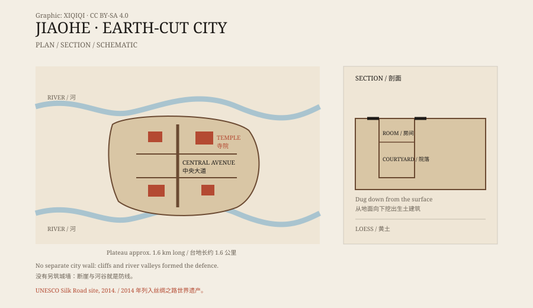

## 1. Between two rivers

Jiaohe stands on a narrow loess plateau west of Turpan.

The plateau rises about thirty metres above the surrounding ground, with river valleys on both sides. The Yarnaz River runs past it, cutting the plateau into a natural island. From above, the city looks like a ship stranded in a dry riverbed.

The name “Jiaohe” — “intersecting rivers” — comes from this setting.

## 2. A city dug downward

What makes Jiaohe unusual is how it was built.

Most ancient cities were built upward: foundations, walls, roofs. Jiaohe was different. Its buildings were dug down from the surface.

Workers first cut streets and courtyards into the loess plateau, then carved rooms, hearths, niches, and storage spaces into the walls of the pits. Roofs were made of wood and reeds, covered with mud. Half of each house was underground, cool in summer and warm in winter.

Because the edges of the plateau are cliffs, the city needed no separate wall. The cliffs, river valleys, and steep slopes were the defence.

*Original schematic: the plateau, main streets, and a section through the earth-cut buildings at Jiaohe. Not a precise survey. Oddity Archive, CC BY-SA 4.0.*

## 3. Who lived here

Jiaohe has a long history.

Around the second century BCE it was the capital of the Jushi kingdom. Later, Chinese dynasties, the Gaochang kingdom, Turks, Tibetans, and Uyghurs controlled the site at different times. In 640 CE the Tang established the Anxi Protectorate, and Jiaohe became an important base for Tang power in the western regions.

Archaeologists have found temples, stupas, government offices, houses, workshops, and wells. Buildings from different periods overlap, showing that the city was repeatedly used, modified, and expanded.

## 4. Why it was abandoned

Jiaohe was eventually left.

No single event explains it. Warfare, changes of regime, shifts in the river, water supply problems, and the movement of trade routes may all have contributed. Around the fourteenth century the city gradually emptied, leaving a large earthen ruin.

Wind and rain then took over. The loess eroded, buildings collapsed, and streets filled in. What visitors see today is a city cut back by time.

## 5. On the Silk Road

Jiaohe sits in the Turpan Basin, an important node on the northern Silk Road.

Caravans came from the east, passed through, and continued west into the steppe north of the Tianshan or into the Tarim Basin. Documents in Chinese, Uyghur, Sanskrit, and other scripts have been found at the site, along with silk, coins, and religious art.

It was not an isolated frontier town but a junction of languages, religions, and trade networks.

## 6. Now

Jiaohe is a national protected site in China and part of the UNESCO World Heritage listing “Silk Roads: the Routes Network of Chang'an-Tianshan Corridor.”

The ruins are open to visitors, but many areas are fenced off. Loess is fragile; a heavy rain or a single careless footstep can cause irreversible damage.

It looks like an abandoned city, but it is closer to a huge sculpture slowly weathering away. The city was dug out of the earth, and the wind and rain are digging it back in.

---

**Sources and licenses**: the factual sources are listed in the source ledger S1–S3 at the bottom of this entry. Text and original diagrams are licensed under CC BY-SA 4.0. This article separates the layout, the historical sequence, and the explanations for abandonment; the abandonment is not attributed to a single event.
