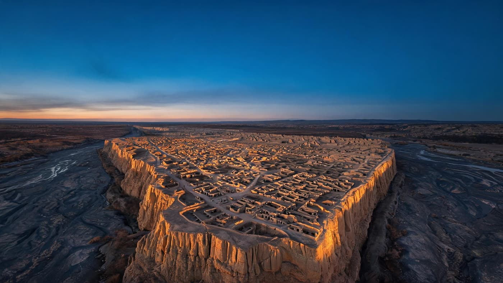
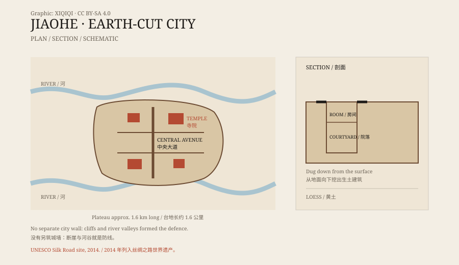

## 一、两河之间

交河故城在吐鲁番市区以西，建在一块狭长的黄土台地上。

台地高出周围地面约三十米，两侧是河谷。亚尔乃孜河从旁边流过，把台地切成了一个天然的岛。从高处看，城市像一艘搁浅在干河床里的船。

“交河”这个名字，就和两条河交汇的地形有关。

傍晚站上台地边缘，风从河谷里上来，带着土腥味。脚下是断崖，崖壁上有一道道竖向的沟，是雨水冲出来的。对面的河床干着，白花花一片。回头看，城市的街道从脚下往里延伸，两侧的院墙只剩下半人高的土棱，一间间房子敞着顶，像被谁揭开了盖子。

*场景复原：黄昏时从高处看交河故城的台地、断崖与生土街巷。不是实地照片。稀奇奇编辑部，CC BY-SA 4.0。*

## 二、一座往下挖的城

交河故城最特别的地方，是它的建造方式。

大多数古城是往上盖的：打地基，砌墙，架屋顶。交河不是。这里的建筑是从地面往下挖的。

工匠先在黄土台地上挖出街道和院落，再在坑壁上掏出房间、灶台、壁龛和储物间。屋顶用木头和芦苇覆盖，再抹上泥。房子有一半在地下，冬暖夏凉。

因为台地边缘就是断崖，城市没有另筑城墙。崖壁、河谷和陡坡，本身就是防线。

*原创示意图：交河故城的台地、主要街道与生土建筑剖面。不是精确测绘图。稀奇奇编辑部，CC BY-SA 4.0。*

## 三、谁住在这里

交河的历史很长。

公元前二世纪左右，这里是车师前国的都城。后来，中原王朝、高昌国、突厥、吐蕃、回鹘等势力先后控制过这里。唐朝在公元 640 年设立安西都护府，交河一度是唐朝经营西域的重要据点。

城里发现了寺院、佛塔、官署、民居、手工作坊和水井。不同时期的建筑叠在一起，说明这座城市被反复使用、改建和扩建。

## 四、为什么废弃

交河最终被放弃。

原因不是单一事件。战争、政权更替、河流改道、水源变化、商路转移，都可能起作用。十四世纪前后，城市逐渐废弃，留下大片土遗址。

风沙和雨水随后接管了这里。黄土被侵蚀，房屋坍塌，街道被填平。今天看到的交河，是一座被时间削过的城市。

## 五、丝绸之路上

交河位于吐鲁番盆地，是丝绸之路北道的重要节点。

商队从东方来，经过这里，再向西进入天山以北的草原或塔里木盆地。城市里出土过汉文、回鹘文、梵文等文字的文书，也有丝绸、钱币和宗教艺术品。

它不是一个孤立的边城，而是一个连接多种语言、宗教和贸易网络的节点。

## 六、现在

交河故城现在是全国重点文物保护单位，也是“丝绸之路：长安—天山廊道的路网”世界遗产的一部分。

遗址对游客开放，但很多区域被围栏保护，不能随意进入。黄土遗址很脆弱，一场大雨或一次踩踏，都可能造成不可逆的损坏。

它看起来像一座被遗弃的城市，其实更像一件正在慢慢风化的巨大雕塑。城市是挖出来的，也正在被风雨挖回去。

## 时间线

- **640 年**：唐朝在公元 640 年设立安西都护府，交河一度是唐朝经营西域的重要据点
- **背景**：约公元前 100 年–14 世纪

## 来源与证据

本条目的事实底座以 1 条独立来源为主。S4（国家文物局）覆盖交河故城作为丝绸之路世界遗产的构成与价值。
原创插图只提供场景复原、结构示意或地图，不作为历史照片使用。正文把可核对记录、后来解释与传说分开叙述；同一件事在不同来源中的版本差异，保留在行文中，不强行合并。

## 档案位置

交河故城的记录分三层：联合国教科文组织与《丝绸之路》申遗文本给出遗址范围、年代与突出普遍价值；新疆文物考古机构和吐鲁番学界的调查提供城址分区、寺院、墓葬与出土文书；旅游说明和导览则简化了这些结论。遗址建在雅尔乃孜沟的台地上，城址本身约 37.6 公顷，沟北、沟西墓地另计。本文把申遗文本的框架与考古调查的细节分开，不把导览词当成发掘报告。

交河的纸面档案穿过发掘报告、保护文件和丝绸之路申遗文本；遗址本身才是第一手文件，凡文字记录变薄的地方，本文回到废墟。

## 档案空白

建筑年代、营造顺序与后续改动，需要考古报告和保护档案互证；单一的旅游说明或平面图，不足以定案。
这条档案把记录与未答的问题并排放置，不替读者做出超出证据的结论。
就可信度而言，本条目标为“verified”。这个标签描述的是当前证据状态，不是对传说真伪的终审；新档案出现时，标签应随之调整。

## 档案补记

以下补记保留正文没有展开的档案侧面：来源、技术细节与后续影响。
**保护**。 交河故城，受到风沙和游客的威胁。

保护者加固墙、清理沙、限制访问。

交河的水，曾经从两边流过。城废弃了，河还在，只是换了方向。

城废弃之后，风沙慢慢埋住了街道和房屋。今天的人挖开沙土，看到的是一座没有屋顶的城。它没有消失，只是换了一种方式存在。

---

**来源与许可**：本文的事实来源见条目底部来源台账 S1–S3。文字与原创示意图采用 CC BY-SA 4.0。文中把城市布局、历史沿革与废弃原因分开叙述；废弃原因存在多种解释，本文不把它归为单一事件。
