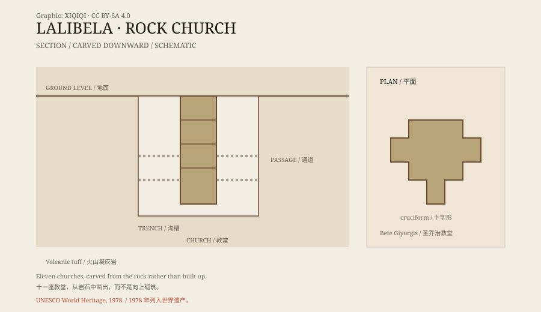

## 1. A new Jerusalem

Lalibela lies in the highlands of northern Ethiopia, about 2,500 metres above sea level.

In the late twelfth and early thirteenth centuries, King Lalibela of the Zagwe dynasty ordered a group of churches to be built here. Tradition says he wanted to create a “New Jerusalem,” so that believers who could not travel to Jerusalem could still complete a pilgrimage locally.

That idea explains the layout: some buildings correspond to the Holy Sepulchre, others to sites of the Passion, and the trenches and passages resemble pilgrimage routes.

## 2. Cut down into the rock

The churches at Lalibela were made in the opposite way to most buildings.

A normal church is built upward: foundations, walls, roof. These churches were cut downward from the surface.

Workers first marked the outline on the volcanic tuff, then dug a deep trench around a block of rock, isolating it from the surrounding mass. Next they carved doors, windows, columns, arches, and rooms into the block. The building and the bedrock were originally one piece; what remains is the interior space and the outer shell.

Because the work went downward, no scaffolding was needed and no material had to be lifted into place. But it also meant that a mistake was hard to correct.

*Original schematic: a Lalibela church cut down from the bedrock, with its surrounding trench. Not a precise survey. Oddity Archive, CC BY-SA 4.0.*

## 3. Eleven churches

The Lalibela churches are usually counted as eleven, spread across several groups.

The most famous is Bete Giyorgis, the Church of St George. The whole building is cruciform and sits in a deep pit; from the rim, it looks like a huge cross.

The largest is Bete Medhane Alem, the Church of the Saviour, with tall colonnades and a broad interior. Several churches are connected by tunnels and passages, forming an underground complex.

These are not ruins. They are still used by the Ethiopian Orthodox Church, with old wall paintings, liturgical objects, and the traces of pilgrims.

## 4. How they were built

No construction drawings or written records survive.

Researchers can only infer the process from tool marks, the layout, and local stone-working traditions. A likely sequence is: plan the whole complex, cut trenches along the outlines to isolate the rock blocks, then carve downward layer by layer, and finally finish the walls, columns, and decoration.

The scale was enormous. At Bete Giyorgis alone, the surrounding trench required the removal of a great volume of rock. Tradition credits King Lalibela with the project, but there are no reliable figures for how many years or how many workers it took.

## 5. Pilgrimage

Lalibela remains one of Ethiopia's most important pilgrimage sites.

Every January, at Timkat (Epiphany) and Genna (Christmas), large numbers of believers arrive. White robes, candles, singing, and processions fill the trenches and passages around the churches.

On those days the churches are not museums but living religious spaces. Visitors are expected to keep clear of ceremonies and respect local rules.

## 6. Now

In 1978, the rock-hewn churches of Lalibela were inscribed as a UNESCO World Heritage site.

Their main threat is not visitors but water and time. Rain seeps into the rock, and freeze-thaw cycles and weathering crack the structures. Protective shelters have been built over some churches, but they also change the appearance of the site.

The stone churches are still in use, and they are still ageing. They were not built up but “subtracted” from the rock; now weathering and erosion are doing the opposite.

---

**Sources and licenses**: the factual sources are listed in the source ledger S1–S3 at the bottom of this entry. Text and original diagrams are licensed under CC BY-SA 4.0. This article separates the architecture, historical background, traditional accounts, and modern conservation; estimates of the construction period vary.
