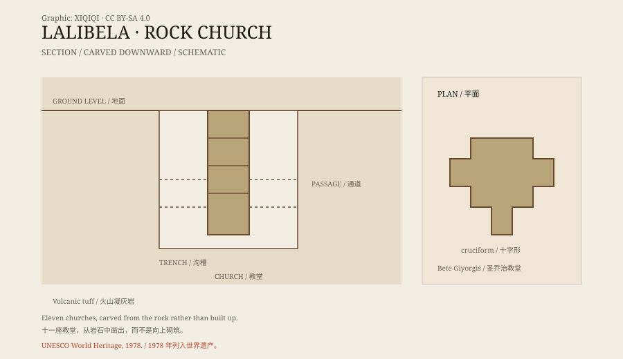

## 一、新耶路撒冷

拉利贝拉在埃塞俄比亚北部的高原上，海拔约两千五百米。

十二世纪末到十三世纪初，扎格维王朝的国王拉利贝拉下令在这里建造一组教堂。传统说法是，他希望把这里变成“新耶路撒冷”，让无法前往耶路撒冷朝圣的信徒，也能在本地完成朝圣。

这个说法解释了教堂的布局：有的建筑对应圣墓，有的对应耶稣受难的地点，沟槽和通道则像一条条朝圣路线。

## 二、从岩石里凿出来

拉利贝拉的教堂，和大多数教堂的建造方式相反。

通常的教堂是往上盖的：打地基，砌墙，架屋顶。这里的教堂是从地面往下凿的。

工匠先在火山凝灰岩上画好轮廓，然后向下挖出一圈深沟，把整块岩石孤立出来。接着，他们在这块岩石内部凿出门、窗、柱、拱顶和房间。建筑与岩床原本是一体的，最后只剩下内部空间和外壳。

因为是从上往下凿，施工时不需要脚手架，也不需要把材料运到高处。但这也意味着，一旦凿错，很难补救。

*原创示意图：拉利贝拉教堂从岩床上凿出的剖面与沟槽结构。不是精确测绘图。稀奇奇编辑部，CC BY-SA 4.0。*

## 三、十一座教堂

拉利贝拉的教堂通常算作十一座，分布在几个区域。

最著名的是圣乔治教堂（Bete Giyorgis），整栋建筑呈十字形，沉在一个深坑里，从坑边往下看，像一个巨大的十字架。

最大的教堂是救世主教堂（Bete Medhane Alem），有高大的柱廊和宽阔的内部空间。还有几座教堂通过隧道和通道相连，形成一组地下建筑群。

这些教堂不是废墟。它们至今仍被埃塞俄比亚正教会使用，里面有色泽古老的壁画、祭祀器具和朝圣者留下的痕迹。

## 四、怎么建

没有留下施工图，也没有留下文字记录。

研究者只能从岩石上的凿痕、教堂的布局和当地的石工传统来推断。可能的工序是：先规划整体，再沿着轮廓开沟，把岩块分离出来；然后从顶部向下，一层一层凿出空间；最后修整墙面、柱子和装饰。

工程量巨大。以圣乔治教堂为例，仅外部的坑槽就要挖掉大量岩石。传统说法把建造归功于国王拉利贝拉，但具体用了多少年、多少人力，没有可靠数字。

## 五、朝圣

拉利贝拉至今是埃塞俄比亚最重要的朝圣地之一。

每年一月的主显节（Timkat）和圣诞（Genna），会有大量信徒前来。白色长袍、烛光、歌声和队伍，填满教堂周围的沟槽和通道。

在这些日子里，教堂不是博物馆，而是仍在使用的宗教空间。游客需要避开仪式，尊重当地的规矩。

## 六、现在

1978 年，拉利贝拉的岩石教堂被列入联合国教科文组织世界遗产。

它们面临的主要威胁不是游客，而是水和时间。雨水渗入岩石，冻融和风化让一些结构开裂；部分教堂上方搭建了保护棚，但这也改变了景观。

石头教堂还在使用，也还在慢慢老化。它们不是被建起来的，而是从岩石里被“减”出来的；现在，风化和侵蚀正在做相反的事。

---

**来源与许可**：本文的事实来源见条目底部来源台账 S1–S3。文字与原创示意图采用 CC BY-SA 4.0。文中把建筑结构、历史背景、传统说法与现代保护分开叙述；建造年代和工期存在不同估计。
